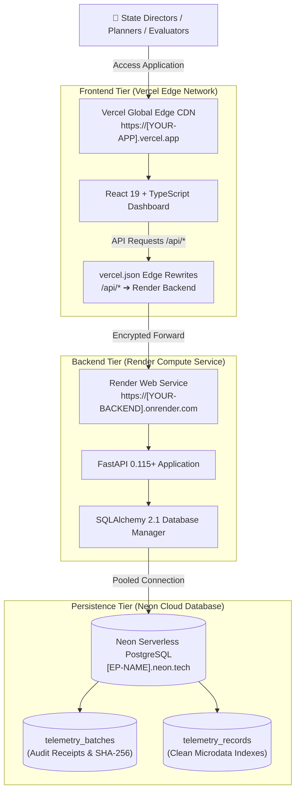

# 🌐 Cloud Deployment Guide & Topology — KaushalDrishti (कौशल दृष्टि)
### Ministry of Skill Development and Entrepreneurship (MSDE), Government of India

This guide provides the deployment topology, architecture blueprints, and verification steps for deploying **KaushalDrishti** on a modern, decoupled cloud stack.

---

## 🚀 Cloud Service Topology (Reference Architecture)

The system is designed to run on a **decoupled, forever-free multi-tier cloud architecture**:

| Tier | Recommended Platform | Specification & Role | Reference / Mock URL Pattern |
| :--- | :--- | :--- | :--- |
| **Frontend Tier** | **Vercel** | React 19 + TypeScript + Vite on Global Edge CDN. Optimized for ultra-low latency delivery. | `https://[YOUR-PROJECT].vercel.app` |
| **Compute / API Tier** | **Render** | Python 3.14 + FastAPI + Scikit-Learn + Uvicorn compute cluster. Computes CDI, ML forecasts, and simulations. | `https://[YOUR-BACKEND].onrender.com` |
| **Interactive API Console** | **Render Swagger** | OpenAPI / Swagger UI test console (`/docs`). Direct execution of all REST endpoints. | `https://[YOUR-BACKEND].onrender.com/docs` |
| **Persistence Tier** | **Neon** | Serverless PostgreSQL with auto-scaling connection pooling (`pool_recycle=300`). Stores telemetry batches and microdata. | `postgresql://[USER]:[PASSWORD]@[EP-NAME].neon.tech/neondb?sslmode=require` |
| **Telemetry & Health Check** | **API Gateway** | Diagnostic endpoint returning database engine type, connection status, batch counts, and ping latency. | `https://[YOUR-PROJECT].vercel.app/api/telemetry/db-status` |

---

## 🏛️ Deployment Architecture Blueprint



---

## 🧪 Health Verification Runbook (Example Commands)

Use the following sample commands to verify health and end-to-end integration across all tiers:

### 1. Database Connectivity & Persistence Verification
```bash
# Query the live database status endpoint via the proxy:
curl -s https://[YOUR-APP].vercel.app/api/telemetry/db-status
```
**Expected Response:**
```json
{
  "engine": "postgresql",
  "status": "connected",
  "url": "postgresql+psycopg2://[USER]:****@[EP-NAME].neon.tech/neondb",
  "database_url_configured": true,
  "connection_error": null,
  "cloud_persisted": true
}
```

### 2. Backend Engine Health Check
```bash
# Direct ping to backend compute service:
curl -s https://[YOUR-BACKEND].onrender.com/api/health
```
**Expected Response:**
```json
{
  "status": "healthy",
  "system": "KaushalDrishti",
  "version": "1.0.0",
  "title": "AI-Enabled Labour Market Intelligence & Skill Forecasting Engine"
}
```

### 3. Querying Active Telemetry Batches
```bash
curl -s https://[YOUR-APP].vercel.app/api/telemetry/batches
```

---

## 🔄 End-to-End Operational Lifecycle

1. **User Action:** An officer or evaluator uploads a district telemetry CSV on `https://[YOUR-APP].vercel.app`.
2. **Client-Side Validation:** The browser parses and cross-validates records against canonical LGD 2024 and NCO-2015 registries in memory.
3. **Commit to Ledger:** Upon clicking *"Commit to Central Ledger"*, clean rows and a SHA-256 audit digest are transmitted to `/api/telemetry/commit`.
4. **Vercel Edge Proxy:** Vercel transparently proxies the request over secure HTTPS to the Render backend, eliminating CORS restrictions.
5. **PostgreSQL Persistence:** The Render FastAPI engine executes an ACID transaction into **Neon PostgreSQL** (`telemetry_batches` and `telemetry_records`).
6. **Global Real-Time Broadcast:** Every other browser session polling the endpoint (every 6 seconds) automatically receives the update, recalculating local dashboards and KPI cards globally.
