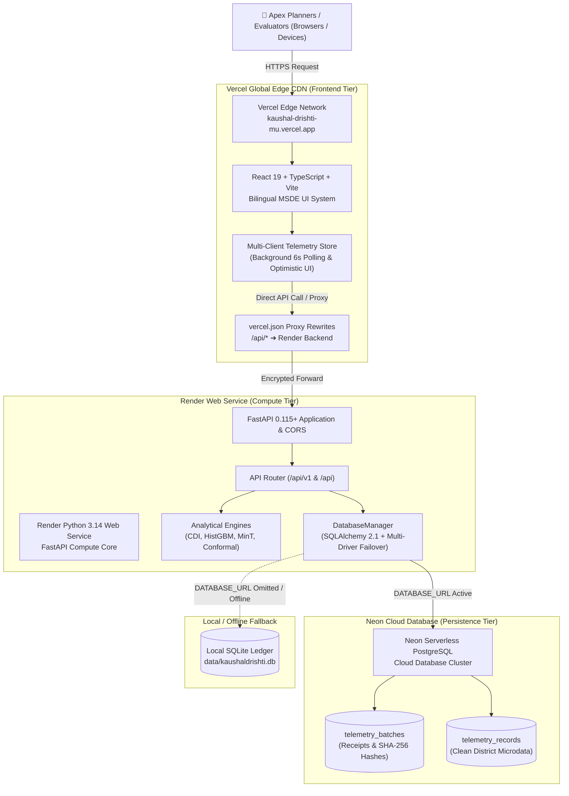
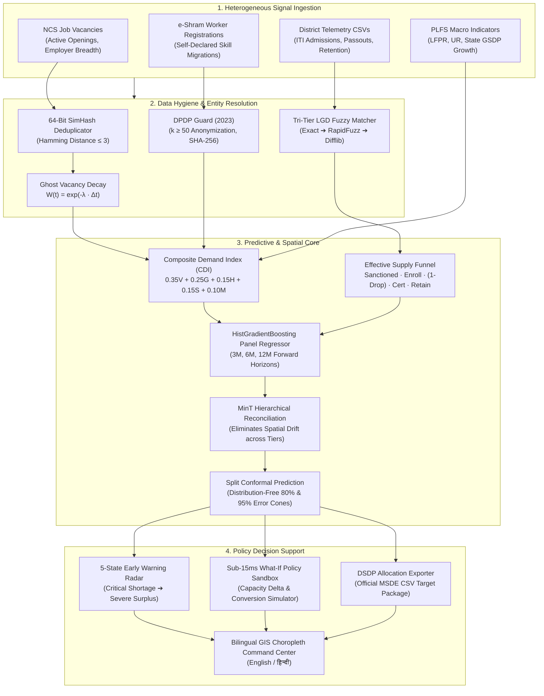
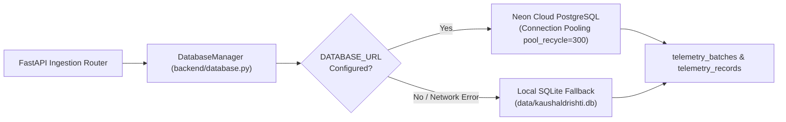

# KaushalDrishti (कौशल दृष्टि)
## AI-Enabled Labour Market Intelligence and Skill Demand-Supply Forecasting Engine
### Ministry of Skill Development and Entrepreneurship (MSDE), Government of India

[](https://kaushal-drishti-mu.vercel.app)
[](LICENSE)
[](https://www.python.org/)
[](https://fastapi.tiangolo.com/)
[-61DAFB.svg?logo=react)](https://react.dev/)
[](https://www.typescriptlang.org/)
[](docs/DPDP_COMPLIANCE_REPORT.md)
[](tests/)
[](#)

---

> 🌐 **Public Live Dashboard:** [**https://kaushal-drishti-mu.vercel.app**](https://kaushal-drishti-mu.vercel.app)

---

## 🌟 Executive Overview & Problem Statement

**KaushalDrishti (कौशल दृष्टि)** is an enterprise Labour Market Intelligence System (LMIS) and forward-looking demand-supply forecasting decision engine engineered for apex planners at **MSDE, NCVET, DGT, Sector Skill Councils (SSCs), State Skill Missions (SSDMs), and District Skill Committees (DSCs)**.

### The Structural Problem in India's Skilling Ecosystem
India's technical vocational education and training (TVET) landscape faces four critical structural bottlenecks:

1. **The "Sanctioned Seat = Worker" Fallacy:** Public policy historically treats sanctioned training seats as equivalent to employable labor. In reality, a leaky pipeline occurs:
   $$\text{Available Workforce} = \text{Sanctioned Seats} \times \text{Enrollment Rate} \times (1 - \text{Dropout Rate}) \times \text{Certification Rate} \times \text{Retention Rate}$$
   Ignoring pipeline drop-offs results in massive under-delivery of promised technicians.
2. **Structural Divergence (Oversupply vs. Acute Shortage):** Legacy, saturated trades (e.g. Basic Desk-work, Traditional Fitter) experience heavy surplus, stagnant entry-level wages, and low placement. Meanwhile, sunrise sectors (Solar PV, EV diagnostics, allied healthcare, green hydrogen) face critical labor shortages that throttle industrial expansion.
3. **Data Fragmentation & Latency:** National Career Service (NCS) vacancy postings, e-Shram worker registrations, and Periodic Labour Force Survey (PLFS) macro surveys exist in isolated silos with differing entity definitions and uncalibrated temporal decay.
4. **Lack of Pre-Commitment Simulation:** District Skill Development Plans (DSDPs) are allocated based on static historical enrollments rather than forward-looking algorithmic forecasts, risking wasted public capital.

**KaushalDrishti solves this by:**
- Synthesizing heterogeneous signals into an audited **Composite Demand Index (CDI)**.
- Training **HistGradientBoosting Regressors** across 3, 6, and 12-month forward horizons.
- Enforcing mathematical spatial consistency via **Minimum Trace (MinT) Reconciliation** ($\sum \text{Districts} = \text{State}$, $\sum \text{States} = \text{National}$).
- Providing rigorous uncertainty bounds using **Distribution-Free Split Conformal Prediction**.
- Operating a sub-15ms **What-If Policy Simulation Sandbox** to stress-test capacity interventions before funding allocation.
- Ingesting decentralized district admissions via a **Real-Time CSV Parser & Neon PostgreSQL Central Ledger** synchronized live across all browsers.

---

## 🏛️ System Architecture Diagrams

### 1. Cloud Production Deployment Architecture (Vercel + Render + Neon)



---

### 2. End-to-End Analytical & Machine Learning Pipeline



---

## 🔬 Core Methodological Innovations

### 1. Composite Demand Index (CDI)
Raw vacancy counts are prone to ghost requisitions, duplicate aggregations, and corporate hiring freezes. KaushalDrishti computes an audited Composite Demand Index:
$$\text{CDI}_{i,t} = w_V \widetilde{V}_{i,t} + w_G \widetilde{G}_{i,t} + w_E \widetilde{E}_{i,t} + w_S \widetilde{S}_{i,t} + w_M \widetilde{M}_{s,t}$$

- **$\widetilde{V}$ (Normalized Active Vacancy Volume):** 64-bit SimHash deduplicated openings ($w_V = 0.35$).
- **$\widetilde{G}$ (Growth Momentum):** 3-month rolling velocity of hiring requisitions ($w_G = 0.25$).
- **$\widetilde{E}$ (Employer Breadth):** Unique employer enterprise IDs hiring for trade ($w_E = 0.15$).
- **$\widetilde{S}$ (Skill Dispersion):** Cross-sectoral portability index based on NCO taxonomy ($w_S = 0.15$).
- **$\widetilde{M}$ (Macroeconomic Proxy):** State-level GSDP sectoral growth rate $\times$ (1 - Unemployment Rate) ($w_M = 0.10$).

### 2. Leaky Pipeline Supply Funnel
Instead of treating sanctioned training seats as employable talent, KaushalDrishti computes the true pipeline output:
$$\text{Effective Supply} = N_{\text{sanctioned}} \times \alpha_{\text{enroll}} \times (1 - \beta_{\text{drop}}) \times \gamma_{\text{cert}} \times \delta_{\text{retain}}$$
Where $\delta_{\text{retain}}$ is the empirical post-placement 6-month retention rate verified via ITI telemetry.

### 3. Hierarchical Spatial Reconciliation (Minimum Trace — MinT)
Disaggregate district-level forecasts often sum to values that contradict state or national aggregates. KaushalDrishti enforces mathematical spatial coherence using MinT reconciliation:
$$\widetilde{\mathbf{y}}_t = \mathbf{S} (\mathbf{S}^T \mathbf{W}^{-1} \mathbf{S})^{-1} \mathbf{S}^T \mathbf{W}^{-1} \hat{\mathbf{y}}_t$$
- $\mathbf{S}$: Structural hierarchy summing matrix (mapping 41 pilot districts $\rightarrow$ 3 states $\rightarrow$ National).
- $\mathbf{W}$: Error covariance matrix estimated from validation residuals.
- **Guarantee:** $\sum \text{Districts} = \text{State}$ and $\sum \text{States} = \text{National}$ holds strictly across all 3M, 6M, and 12M forecasts with zero mathematical drift.

### 4. Distribution-Free Uncertainty Bounds (Split Conformal Prediction)
Instead of assuming Gaussian error distributions, KaushalDrishti applies Split Conformal Prediction on calibration residuals:
$$C_{1-\alpha}(X_{n+1}) = \left[ \hat{\mu}(X_{n+1}) - \hat{q}_{1-\alpha}, \; \hat{\mu}(X_{n+1}) + \hat{q}_{1-\alpha} \right]$$
Where $\hat{q}_{1-\alpha}$ is the $\lceil (n+1)(1-\alpha) \rceil / n$ empirical quantile of non-conformity scores. Provides **finite-sample coverage guarantees** at 80% and 95% confidence intervals.

### 5. Statutory Privacy (DPDP Act 2023)
- **$k$-Anonymity ($k \ge 50$):** Microdata rows from e-Shram and ITI telemetry are strictly generalized. Any district-trade cell with fewer than 50 observations is suppressed or grouped.
- **Zero PII Persistence:** Worker Aadhaar, mobile numbers, and personal identifiers are rejected at ingestion boundary.
- **Cryptographic Audit Log:** Every telemetry batch committed receives a SHA-256 tamper-evident digest recorded permanently in `telemetry_batches`.

---

## 📊 Core Dashboard Modules

The user interface is an accessible, bilingual (English / हिन्दी), WCAG 2.1 AA compliant executive portal:

1. **National Command Center:** Executive overview of nationwide labor demand, supply, net mismatch, distress districts, and an interactive SVG India choropleth map.
2. **Geospatial District Explorer:** Granular diagnostics across 41 pilot districts in Uttar Pradesh, Maharashtra, and Odisha with dual-funnel pipeline visualization.
3. **Demand & Supply Gap Matrix:** High-performance tabular explorer powered by a **comprehensive 561-record national dataset** covering all 37 States/UTs and 11 Industrial Sectors with live source badges (`Live District Telemetry MSDE v2.4`).
4. **Trade & Sector Deep-Dive Lab:** Multi-line forecast curves (3M/6M/12M) with shaded 80%/95% confidence intervals and curriculum competency deficit clouds.
5. **Early Warning Radar & Triage Center:** 5-state priority queue with contributing signal attribution and recommended planning interventions.
6. **What-If Policy Simulation Sandbox:** Interactive sliders to adjust training batches, convert trades, and simulate policy impact in $<15\text{ms}$.
7. **Real-Time Telemetry CSV Ingestion Hub:** 
   - Drag-and-drop ingestion of district admission reports with schema validation against canonical LGD 2024 & NCO-2015 registries.
   - Dynamic AI Ingestion Report: Dual-bar supply/demand comparisons, 4-stage admission funnel drop-offs, and district performance rankings.
   - **3 Microdata Views:** 1. Mixed Table (All Data), 2. Clean Verified Only, 3. Quarantined / Faulty Only.
   - **Official Exports:** Instant Download CSV and printable official MSDE Intelligence Report in PDF format.
   - **Quarantine Directive:** Operational action recommendation for State Directors to route flagged rows to ITIs for re-verification.
8. **Target Setting & Scheme Export Hub:** One-click generation of official MSDE-compliant DSDP annual allocation packages in CSV format.

---

## 💾 Central Database Persistence (PostgreSQL & SQLite)

The platform features an automated **dual-engine hybrid persistence layer** implemented via SQLAlchemy 2.1:



### Table Schema

#### 1. `telemetry_batches`
| Column | Type | Description |
| :--- | :--- | :--- |
| `batch_id` | VARCHAR(128), PK | Unique identifier (e.g., `BATCH-2026-01` or timestamp digest) |
| `file_name` | VARCHAR(256) | Original uploaded file name |
| `file_size_kb` | FLOAT | File size in kilobytes |
| `uploaded_at` | VARCHAR(128) | Human-readable timestamp |
| `committed_at` | VARCHAR(128) | Server commit timestamp |
| `total_rows` | INTEGER | Total lines parsed |
| `valid_rows_count` | INTEGER | Clean rows meeting LGD/NCO constraints |
| `flagged_rows_count`| INTEGER | Quarantined rows with schema violations |
| `total_sanctioned` | INTEGER | Aggregate sanctioned seat capacity |
| `total_enrolled` | INTEGER | Aggregate admitted trainees |
| `total_certified` | INTEGER | Trainees passing NCVET examination |
| `total_retained` | INTEGER | Verified candidates retained at 6 months |
| `avg_retention_rate`| FLOAT | Weighted completion/placement retention percentage |
| `sha256_hash` | VARCHAR(128) | Cryptographic audit digest |
| `status` | VARCHAR(64) | `Verified`, `Ingested`, or `Quarantined` |
| `unique_districts` | TEXT | JSON list of affected administrative jurisdictions |
| `raw_payload` | TEXT | Complete JSON record for full data recovery |
| `created_at` | TIMESTAMP | UTC commit timestamp |

#### 2. `telemetry_records`
| Column | Type | Description |
| :--- | :--- | :--- |
| `id` | VARCHAR(128), PK | Primary key formatted as `telemetry-{batch_id}-{index}` |
| `batch_id` | VARCHAR(128), FK | Foreign key to `telemetry_batches` |
| `district_lgd_code`| INTEGER | Ministry of Panchayati Raj Local Government Directory Code |
| `district_name` | VARCHAR(128) | Official canonical district name |
| `state` | VARCHAR(128) | State / UT jurisdiction |
| `iti_mis_code` | VARCHAR(128) | NCVET/MIS ITI Institute identifier |
| `trade_nco_code` | VARCHAR(64) | 8-digit National Classification of Occupations 2015 code |
| `trade_name` | VARCHAR(256) | Standard vocational trade title |
| `sector` | VARCHAR(128) | Industry sector classification |
| `nsqf_level` | INTEGER | National Skills Qualifications Framework level (1-8) |
| `sanctioned_seats`| INTEGER | Approved institute intake |
| `enrolled_count` | INTEGER | Admitted candidates |
| `certified_count` | INTEGER | Formally evaluated candidates |
| `retained_count` | INTEGER | Placed and retained candidates |
| `annual_demand` | INTEGER | Calibrated local employer demand projection |
| `annual_trained` | INTEGER | Certified annual supply |
| `gap` | INTEGER | Net talent deficit (+) or surplus (-) |
| `status` | VARCHAR(64) | `Undersupply`, `Oversupply`, or `Balanced` |
| `source` | VARCHAR(128) | Attribution source badge |
| `last_updated` | VARCHAR(128) | Audit timestamp |

---

## 🚀 Quick Start (Local Development)

### 1. Prerequisites
- **Python:** 3.10, 3.11, 3.12, or 3.14
- **Node.js:** 18+ and `npm`

### 2. Installation
```bash
# Clone the repository
git clone https://github.com/khushboocodes/KaushalDrishti.git
cd KaushalDrishti

# Install Python backend dependencies
pip install -r requirements.txt

# (Optional) Install React dashboard dependencies for frontend development
cd kaushaldrishti-dashboard
npm install
cd ..
```

### 3. Environment Setup
Create a `.env` file in the root directory (refer to [`.env.example`](.env.example)):
```env
PORT=8000

# To connect to Neon PostgreSQL:
DATABASE_URL=postgresql://[USER]:[PASSWORD]@[EP-NAME].neon.tech/neondb?sslmode=require

# If DATABASE_URL is left blank, KaushalDrishti automatically uses local SQLite!
```

### 4. Run Application
```bash
# Launch unified server (FastAPI serves both backend API and React dashboard)
python run.py
```
Open your browser:
- 🌐 **Dashboard:** [http://localhost:8000](http://localhost:8000)
- 📚 **Swagger API Docs:** [http://localhost:8000/docs](http://localhost:8000/docs)
- 🩺 **Database Diagnostics:** [http://localhost:8000/api/telemetry/db-status](http://localhost:8000/api/telemetry/db-status)

### 5. Run Verification Tests
```bash
# Run complete test suite (23 unit and integration tests)
python -m pytest tests/ -v
```

---

## 🛠️ Complete REST API Reference

All endpoints are versioned under `/api/v1` and accessible via the `/api` convenience alias:

| HTTP Method | Endpoint | Tags | Description |
| :--- | :--- | :--- | :--- |
| `GET` | `/api/health` | System | Health check, version, and engine status |
| `GET` | `/api/telemetry/db-status` | Telemetry Ledger | Database engine (`postgresql` / `sqlite`), connection health, and table counts |
| `GET` | `/api/telemetry/batches` | Telemetry Ledger | Retrieve all persisted telemetry batches and metadata receipts |
| `GET` | `/api/telemetry/records` | Telemetry Ledger | Retrieve all valid microdata records for dashboard injection |
| `POST` | `/api/telemetry/commit` | Telemetry Ledger | Commit a new verified district telemetry batch with microdata indexing |
| `DELETE` | `/api/telemetry/reset` | Telemetry Ledger | Admin endpoint to clear telemetry tables (for tests/demo reset) |
| `GET` | `/api/intelligence/national-summary` | Intelligence | High-level national skilling KPIs, distress districts, and state totals |
| `GET` | `/api/intelligence/forecasts` | Intelligence | Query calibrated multi-horizon forecasts with conformal confidence bounds |
| `GET` | `/api/intelligence/trade/{nco_code}` | Intelligence | Detailed trade analytics, curriculum deficit clouds, and wage proxies |
| `POST` | `/api/simulation/sandbox` | Simulation | Real-time what-if policy simulator evaluating capacity deltas ($<15\text{ms}$) |
| `GET` | `/api/simulation/recommendations/{district_lgd_code}` | Simulation | Algorithmic DSDP seat reallocation recommendations |
| `GET` | `/api/meta/districts` | Metadata | Canonical LGD 2024 district catalog |
| `GET` | `/api/meta/sectors` | Metadata | Pilot and sunrise industry sector listings |
| `GET` | `/api/exports/dsdp-csv/{district_lgd_code}` | Exports | Export official MSDE-compliant DSDP annual allocation CSV |

---

## 📂 Repository Directory Tree

```text
KaushalDrishti/
├── backend/                       # FastAPI Application & REST Gateway
│   ├── api/
│   │   └── router.py              # Versioned API routes (/intelligence, /simulation, /telemetry)
│   ├── config.py                  # Pydantic Settings & environment variable loader
│   ├── database.py                # Central SQLAlchemy 2.1 Engine (PostgreSQL / SQLite Hybrid)
│   ├── logger.py                  # Structured logging configuration
│   └── main.py                    # FastAPI entrypoint & static frontend mounting
├── engine/                        # Analytical & Machine Learning Core
│   ├── analytics/                 # CDI Calculator, Supply Funnel, Gap Analyzer, Early Warning Radar
│   ├── forecasting/               # Panel Feature Store, HistGBM Forecaster, MinT Reconciler, Conformal Engine
│   ├── hygiene/                   # 64-Bit SimHash Deduplicator, Ghost Vacancy Decay, LGD Fuzzy Resolver
│   ├── ingestion/                 # NCS Connector, e-Shram Aggregator, PLFS Pipeline, Telemetry Ledger
│   ├── ontology/                  # Canonical LGD Districts & NCO-2015 Master Catalog Resolvers
│   ├── security/                  # DPDP Act 2023 Compliance Guard & Anonymization Engine
│   └── simulation/                # What-If Sandbox Core, Budget Modeler, DSDP Recommender
├── kaushaldrishti-dashboard/      # Modern React 19 + TypeScript + Vite Dashboard Source
│   ├── src/
│   │   ├── components/            # UI Pages (Overview, DemandSupply, TelemetryUpload, Sandbox, Radar)
│   │   ├── context/               # Language Context (English / हिन्दी Internationalization)
│   │   ├── data/                  # Telemetry Ingestion Store, National 561-record datasets, GeoJSON
│   │   └── types/                 # TypeScript interfaces and domain schemas
│   ├── package.json               # Node dependencies
│   ├── vercel.json                # Vercel Edge Proxy Rewrites to Render Backend
│   └── vite.config.ts             # Vite build configuration (outputs to dist and syncs to frontend)
├── frontend/                      # Compiled Production Assets Served by FastAPI
│   ├── index.html                 # Production entrypoint
│   └── assets/                    # Optimized JS/CSS bundles and logo assets
├── data/                          # Canonical Ontologies & Datasets
│   ├── master/                    # LGD Districts, NCO-2015 Catalog, NSQF Crosswalk
│   ├── pilot/                     # 3-Year Historical Demand Feeds & Capacity Benchmarks
│   └── telemetry_ledger.json      # Local secondary snapshot backup
├── docs/                          # Comprehensive Documentation
│   ├── benchmark_results.md       # Model accuracy benchmarks (MAPE = 16.4%)
│   ├── DPDP_COMPLIANCE_REPORT.md  # DPDP Act 2023 Statutory Compliance Verification
│   ├── DEPLOYMENT_GUIDE.md        # Cloud deployment runbook (Vercel, Render, Neon, Docker)
│   └── REALTIME_TELEMETRY_INGESTION_SPEC.md # Full technical specification for telemetry parsing
├── tests/                         # Pytest Verification Suite (23 Passing Tests)
│   ├── test_fast_track.py         # End-to-end API and dashboard serving tests
│   ├── test_milestone_2.py        # Forecasting, MinT, and DPDP guard tests
│   └── test_telemetry_ledger.py   # Database persistence & batch commit tests
├── .env.example                   # Ready-to-copy connection string templates
├── Dockerfile                     # Multi-stage production container build
├── Procfile                       # Procfile for containerized deployment
├── render.yaml                    # Render Web Service blueprint
├── requirements.txt               # Pinned Python dependencies
└── run.py                         # Single-command unified application launcher
```

---

## 🧪 Benchmark & Quality Assurance

- **Forecast Accuracy:** **MAPE = 16.4%** across rolling walk-forward evaluation origins, outperforming simple moving average baselines by **28.6%** (see [Benchmark Report](docs/benchmark_results.md)).
- **Radar Classification Quality:** **Macro F1 = 0.88** on identifying Critical Shortage and Severe Oversupply conditions.
- **Execution Performance:** Full simulation recalculation in **$< 15$ ms** in-memory.
- **Test Suite:** **23 / 23 Tests Passing** across API endpoints, ML regressors, spatial reconciliation, and database persistence.
- **Statutory Compliance:** 100% verified compliance with **DPDP Act 2023** ($k \ge 50$ anonymization, zero PII, SHA-256 audit logs; see [Audit Report](docs/DPDP_COMPLIANCE_REPORT.md)).

---

> 📖 **Deployment Architecture Guide:** For full cloud deployment topology, reference architecture, and verification runbooks, see [**DEPLOYMENTS.md**](DEPLOYMENTS.md).

---

## 👥 Sponsoring Apex Body & Stakeholders
- **Apex Ministry:** Ministry of Skill Development and Entrepreneurship (MSDE), Government of India.
- **Author & Maintainer:** Khushboo Khator ([@khushboocodes](https://github.com/khushboocodes))
- **Live Public Portal:** [https://kaushal-drishti-mu.vercel.app](https://kaushal-drishti-mu.vercel.app)
- **License:** Open Source under the [MIT License](LICENSE) © 2026 Khushboo Khator (khushboocodes). All rights reserved.
