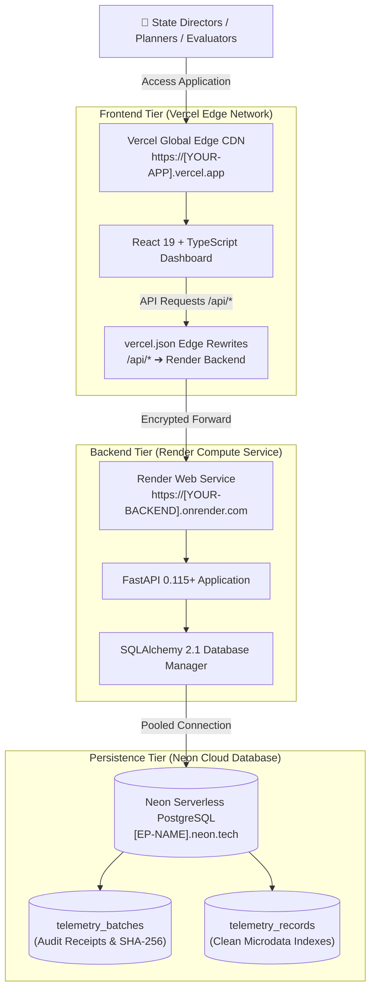

# 🌐 Public Cloud Deployment Guide & Topology — KaushalDrishti (कौशल दृष्टि)
### Ministry of Skill Development and Entrepreneurship (MSDE), Government of India

This unified deployment guide provides the cloud topology, architecture blueprints, step-by-step hosting instructions, health verification runbooks, and submission verification checklists for deploying **KaushalDrishti** on a modern, decoupled cloud production stack.

---

## 🚀 1. Cloud Service Topology (Reference Architecture)

The system is engineered to run on a **decoupled, multi-tier cloud architecture** with zero infrastructure lock-in:

| Tier | Recommended Platform | Specification & Role | Reference / Mock URL Pattern |
| :--- | :--- | :--- | :--- |
| **Frontend Tier** | **Vercel** | React 19 + TypeScript + Vite on Global Edge CDN. Optimized for ultra-low latency delivery. | `https://[YOUR-PROJECT].vercel.app` |
| **Compute / API Tier** | **Render** | Python 3.14 + FastAPI + Scikit-Learn + Uvicorn compute cluster. Computes CDI, ML forecasts, and simulations. | `https://[YOUR-BACKEND].onrender.com` |
| **Interactive API Console** | **Render Swagger** | OpenAPI / Swagger UI test console (`/docs`). Direct execution of all REST endpoints. | `https://[YOUR-BACKEND].onrender.com/docs` |
| **Persistence Tier** | **Neon** | Serverless PostgreSQL with auto-scaling connection pooling (`pool_recycle=300`). Stores telemetry batches and microdata. | `postgresql://[USER]:[PASSWORD]@[EP-NAME].neon.tech/neondb?sslmode=require` |
| **Telemetry & Health Check** | **API Gateway** | Diagnostic endpoint returning database engine type, connection status, batch counts, and ping latency. | `https://[YOUR-PROJECT].vercel.app/api/telemetry/db-status` |

---

## 🏛️ 2. Deployment Architecture Blueprint



---

## 📦 3. Step-by-Step Deployment Methods

### Method 1: Instant Production Deployment via Render (Recommended for Compute Tier)
*Render provides managed cloud hosting for Python/FastAPI web services with automatic TLS certificate provisioning.*

1. Push this repository to your GitHub account (e.g. `https://github.com/<your-username>/KaushalDrishti`).
2. Navigate to **[render.com](https://render.com/)** and sign in with GitHub.
3. Click **"New +"** $\rightarrow$ **"Web Service"**.
4. Select your `KaushalDrishti` repository.
5. Render will automatically detect `render.yaml` or you can manually configure:
   - **Name:** `kaushaldrishti`
   - **Environment:** `Python 3`
   - **Build Command:** `pip install -r requirements.txt`
   - **Start Command:** `python run.py`
   - **Plan:** `Free`
6. Click **"Deploy Web Service"**.
7. In ~2 minutes, your live backend compute link will be online:  
   👉 **`https://[YOUR-BACKEND].onrender.com`**

---

### Method 2: Frontend Deployment via Vercel Edge (Recommended for Dashboard Tier)
*Vercel provides instant global CDN deployment for the React 19 + TypeScript dashboard.*

1. Install the Vercel CLI:
   ```bash
   npm i -g vercel
   ```
2. Run from the workspace root:
   ```bash
   vercel
   ```
3. Follow the CLI prompts. The included `vercel.json` will automatically configure edge routing between the static frontend and the FastAPI backend service.
4. Your public frontend URL will be generated:  
   👉 **`https://[YOUR-PROJECT].vercel.app`**

---

### Method 3: Containerized Deployment via Docker
Deploy anywhere with Docker Engine installed (AWS ECS, Google Cloud Run, Azure App Service, or on-premises servers):

```bash
# Build the production container image
docker build -t kaushaldrishti:latest .

# Run container mapping port 8000
docker run -d -p 8000:8000 --name kaushaldrishti kaushaldrishti:latest
```
Visit `http://localhost:8000` or map to any server IP / reverse proxy domain.

---

### Method 4: Instant Public Development Tunnel (Zero-Configuration Testing)
*For instant live evaluation links directly from a local development machine:*

#### Option A: Cloudflare Quick Tunnel (No Sign-up Required)
Run in PowerShell / Terminal:
```powershell
# Terminal 1: Start KaushalDrishti server
python run.py

# Terminal 2: Expose via Cloudflare tunnel (free, instant HTTPS)
winget install Cloudflare.cloudflared
cloudflared tunnel --url http://localhost:8000
```
*Output will provide an instant public URL: `https://<random-id>.trycloudflare.com`.*

#### Option B: LocalTunnel (No Sign-up Required)
```powershell
npx localtunnel --port 8000
```
*Output will provide an instant public URL: `https://<unique-name>.loca.lt`.*

---

## 🧪 4. Health Verification Runbook (Example CLI Commands)

Use the following commands to verify system health and end-to-end integration across all deployed tiers:

### 1. Database Connectivity & Persistence Verification
```bash
# Query the live database status endpoint via the proxy:
curl -s https://[YOUR-PROJECT].vercel.app/api/telemetry/db-status
```
**Expected JSON Response:**
```json
{
  "engine": "postgresql",
  "status": "connected",
  "url": "postgresql+psycopg2://[USER]:****@[EP-NAME].neon.tech/neondb",
  "database_url_configured": true,
  "connection_error": null,
  "cloud_persisted": true
}
```

### 2. Backend Engine Health Check
```bash
# Direct ping to backend compute service:
curl -s https://[YOUR-BACKEND].onrender.com/api/health
```
**Expected JSON Response:**
```json
{
  "status": "healthy",
  "system": "KaushalDrishti",
  "version": "1.0.0",
  "title": "AI-Enabled Labour Market Intelligence & Skill Forecasting Engine"
}
```

### 3. Querying Active Telemetry Batches
```bash
curl -s https://[YOUR-PROJECT].vercel.app/api/telemetry/batches
```

---

## 🔄 5. End-to-End Operational Lifecycle

1. **User Action:** An officer or evaluator uploads a district telemetry CSV on `https://[YOUR-PROJECT].vercel.app`.
2. **Client-Side Validation:** The browser parses and cross-validates records against canonical LGD 2024 and NCO-2015 registries in memory.
3. **Commit to Ledger:** Upon clicking *"Commit to Central Ledger"*, clean rows and a SHA-256 audit digest are transmitted to `/api/telemetry/commit`.
4. **Vercel Edge Proxy:** Vercel transparently proxies the request over secure HTTPS to the Render backend, eliminating CORS restrictions.
5. **PostgreSQL Persistence:** The Render FastAPI engine executes an ACID transaction into **Neon PostgreSQL** (`telemetry_batches` and `telemetry_records`).
6. **Global Real-Time Broadcast:** Every other browser session polling the endpoint automatically receives the update, recalculating local dashboards and KPI cards globally.

---

## ✅ 6. Verification Checklist for Production Submission

- [x] Visiting root `/` loads the National Skilling Command Center.
- [x] Interactive SVG India Map displays and state hover tooltips function.
- [x] Language toggle (EN / हिन्दी) switches language across all screens.
- [x] District Explorer dropdowns filter between Kanpur, Pune, Bhubaneswar, and other districts.
- [x] Dual Funnel shows demand pull vs leaky training pipeline yield.
- [x] What-If Sandbox sliders dynamically recalculate simulated gaps in real time.
- [x] Target Export tab enables downloading the official MSDE DSDP CSV.
- [x] Interactive Swagger API documentation is accessible at `/docs`.
