# Project KaushalDrishti (कौशल दृष्टि)
## AI-Enabled Labour Market Intelligence and Skill Demand-Supply Forecasting Engine
### Comprehensive Product Requirements Document (PRD)

---

| Document Attribute | Details |
| :--- | :--- |
| **Platform Initiative** | AI-Enabled Labour Market Intelligence and Skill Demand-Supply Forecasting Engine |
| **Sponsoring Organization** | Ministry of Skill Development and Entrepreneurship (MSDE), Government of India |
| **Associated Entities** | NCVET, DGT, NSDC, Sector Skill Councils (SSCs), State Skill Development Missions (SSDMs), District Skill Committees (DSCs) |
| **Category & Theme** | Software / Miscellaneous (Governance & Economic Intelligence) |
| **Document Version** | 1.0.0 (Master Release) |
| **Status** | Approved for Architecture & Implementation |
| **Classification** | Strategic Public Digital Infrastructure Specification |

---

## 1. Executive Summary & Strategic Context

### 1.1 Executive Summary
India operates one of the largest vocational training ecosystems in the world, skilling millions of youth annually across Industrial Training Institutes (ITIs), Pradhan Mantri Kaushal Vikas Yojana (PMKVY) centres, Jan Shikshan Sansthans (JSS), and National Apprenticeship Promotion Scheme (NAPS) facilities. However, training capacity sanctioning, annual target allocation, and curriculum revisions have historically operated in administrative silos, detached from localized, real-time economic demand.

The consequence is a severe **structural mismatch**:
- **Chronic Oversupply:** Millions of candidates are trained and certified in saturated, legacy trades (e.g., conventional data entry, basic computer operators, generic tailoring) where vacancies are stagnant or shrinking, leading to underemployment, credential depreciation, and depressed wages.
- **Acute Undersupply:** High-growth, sunrise, and industrial sectors (e.g., solar photovoltaic installation and micro-grid maintenance, CNC machining, semiconductor packaging, EV diagnostics, allied healthcare) face severe talent shortages, stalling local capital expenditure and capping industrial productivity.
- **Post-Facto Discovery:** Planners discover mismatches only after training cycles conclude and placement audits (often with a 6-to-12-month lag) reveal poor placement rates.

**KaushalDrishti (कौशल दृष्टि)** is an AI-powered Labour Market Intelligence System (LMIS) and forward-looking Demand-Supply Forecasting Engine designed specifically for the apex decision-makers at MSDE, NCVET, Sector Skill Councils, SSDMs, and District Skill Committees. It synthesizes heterogeneous labour market signals (public employment exchanges, online job postings, e-Shram registrations, and Periodic Labour Force Survey microdata), balances them against real training throughput and seat capacities, forecasts net demand-supply gaps over 3, 6, and 12-month planning horizons, and triggers explainable early-warning flags to steer scheme targets *before* public capital is committed.

---

### 1.2 System Vision and Core Mission
- **Vision:** To establish a unified, real-time, data-driven Labour Market Intelligence Digital Public Good that aligns India’s human capital development directly with dynamic industrial and regional economic demand.
- **Mission:** Empower national, state, and district skill planners with predictive analytics, early-warning signals, explainable root causes, and interactive "What-If" simulation capabilities to achieve zero-waste training seat allocations and maximize youth employability.

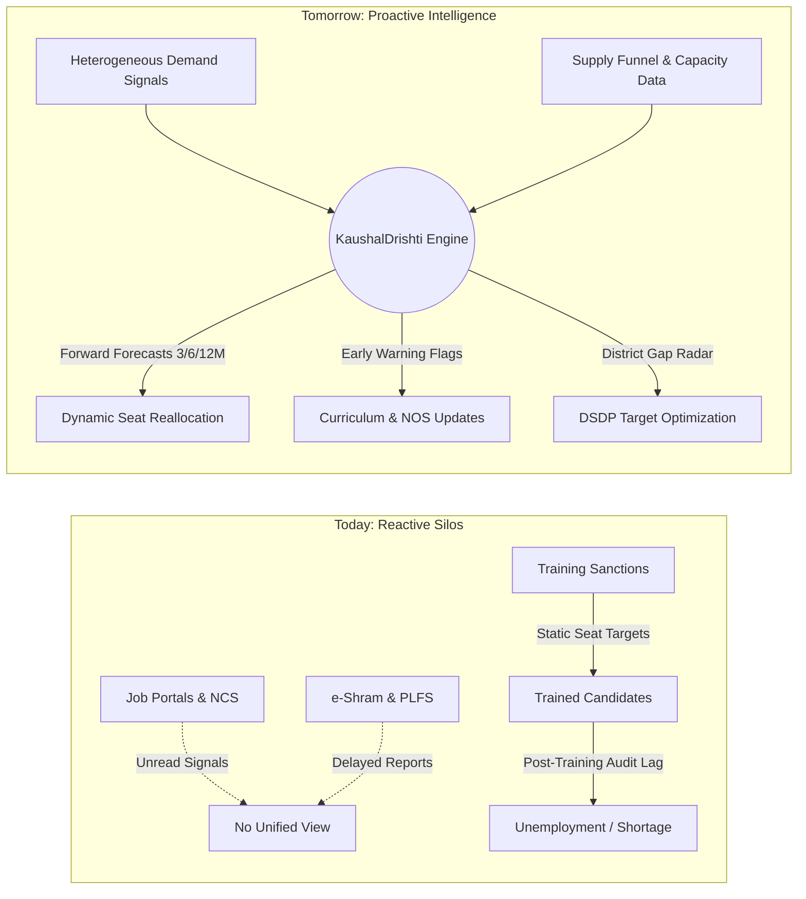

---

### 1.3 Institutional Ecosystem Alignment
The system interfaces directly with India's skilling hierarchy:

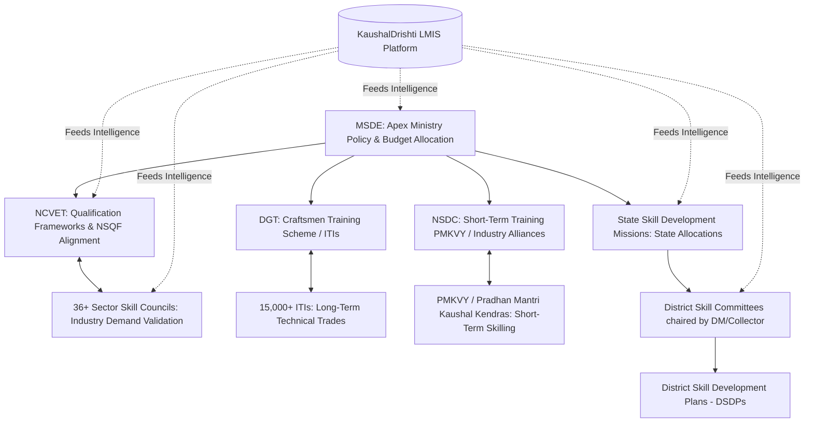

---

## 2. Forensic Problem Analysis & Failure Mode Taxonomy

### 2.1 The Four Core Failure Modes in Current Skilling Operations

#### Failure Mode 1: The Annual Allocation Inertia (Target Path-Dependency)
- **Mechanism:** District-level seat allocation is heavily path-dependent. If District X had 1,200 seats for "Sewing Machine Operator" and 800 seats for "Data Entry Operator" in FY 2023, the FY 2024 target typically increments or decrements these baseline numbers by 5-10% without evaluating local macro-economic shifts, factory closures, or automation.
- **Impact:** Chronic multi-year oversupply in low-capital trades; persistent zero-capacity in emerging trades.

#### Failure Mode 2: The Online Job Portal "White-Collar & Urban" Bias
- **Mechanism:** Web-scraped vacancies from major job boards (Naukri, LinkedIn, Indeed) skew 85%+ toward Tier-1 cities, IT/software engineering, and tertiary services (NSQF Level 6-9). Vocational trades (NSQF Level 2-5: welders, fitters, CNC operators, solar technicians, geriatric care aides) are severely underrepresented online.
- **Correction Required:** The system cannot rely solely on raw web postings. It must fuse National Career Service (NCS) data, MSME cluster surveys, PLFS informal employment ratios, and e-Shram worker distributions into a normalized Composite Demand Index.

#### Failure Mode 3: The "Sanctioned Seat = Available Skilled Worker" Fallacy
- **Mechanism:** Planners frequently equate 1,000 sanctioned ITI seats with 1,000 ready workers entering the local labour pool.
- **Reality (The Leaky Pipeline):**
  1. Sanctioned Seats $\neq$ Actual Enrolled Candidates (Admissions average 70-85%).
  2. Enrolled Candidates $\neq$ Completing Candidates (Dropouts average 10-25%).
  3. Completing Candidates $\neq$ Certified Candidates (Assessment failure rates average 10-20%).
  4. Certified Candidates $\neq$ Locally Available Candidates (Inter-district migration, higher-education exits, non-participation of female graduates due to mobility friction).
- **Correction Required:** The supply modeling engine must simulate candidate throughput using empirical attrition coefficients at each pipeline phase.

#### Failure Mode 4: Static Post-Placement Outcome Auditing
- **Mechanism:** Scheme performance relies on placement tracking 3 to 6 months after graduation. By the time a placement audit flags that only 18% of candidates in a trade secured employment, two subsequent batches of trainees are already enrolled.
- **Correction Required:** Forward-looking forecasting of economic demand horizons (3, 6, 12 months) coupled with leading indicators (capex announcements, industrial park sanctions, tender awards, PLI scheme disbursements).

---

### 2.2 System Scope Boundaries: What KaushalDrishti IS and IS NOT

| Feature / Dimension | What KaushalDrishti IS | What KaushalDrishti IS NOT |
| :--- | :--- | :--- |
| **Primary Nature** | AI-driven Strategic Decision Support & Intelligence Engine | Operational Job Portal, Candidate Placement Agency, or Job Exchange |
| **User Role** | Empowers human planners with probabilistic forecasts, scenarios, and evidence | Autonomous algorithm that executes automated seat sanctions without human approval |
| **Demand Measurement** | Composite Demand Index (relative tension) + Calibrated Job Volume Forecasts | Literal raw count of internet job advertisements |
| **Supply Measurement** | Dynamic pipeline modeling with empirical attrition, dropouts, and retention | Direct 1:1 count of registered e-Shram workers or sanctioned ITI seats |
| **Intervention Target** | Pre-training planning: Target setting, seat sanctioning, curriculum overhaul | Post-facto placement auditing or candidate resume screening |
| **Resolution Scale** | National $\rightarrow$ State $\rightarrow$ District (LGD-compliant) across Sectors & Trades | Micro candidate-level tracking or individual hiring manager recruitment CRM |

---

## 3. User Personas, Role-Based Access Control & User Journeys

### 3.1 Primary Personas


---

### 3.2 End-to-End User Journey Walkthroughs

#### Journey A: MSDE/SSDM Annual Target Allocation Workflow (Pre-Cycle Planning)
1. **Login & Macro Status Review:** SSDM Director logs into the State Portal in April (pre-budget sanctioning).
2. **Alert Triaging:** System highlights 8 "Critical Shortage Risk" trades and 14 "Severe Oversupply Risk" trades in the state.
3. **District Drill-Down:** Director drills down into District "Kanpur Nagar", Sector "Green Energy / Electronics".
4. **Evidence Inspection:** System flags a +2,400 worker shortage in *Solar PV Installation & Grid Maintenance* (NSQF Level 4) for Q3/Q4. Contributing signals: 3 newly sanctioned solar parks, +140% rise in local tender notices, only 2 ITIs offering the course with total annual capacity of 240 seats.
5. **Scenario Simulation (What-If Sandbox):**
   - Director drags the slider to simulate sanctioning 6 new training batches (+360 capacity) in Kanpur Nagar and converting 2 under-utilized *Desktop Publishing* units (-120 seats).
   - Engine recalculates projected supply, taking into account 12% dropout, 15% assessment failure, and 80% local retention.
   - The projected gap shifts from "Critical Shortage (+2,400)" to "Moderate Equilibrium (+210)", preventing acute industry deficit.
6. **Export & Formal Sanction:** Director clicks "Export DSDP Target Package", generating an MSDE-compliant CSV and cryptographically signed PDF summary for the State Sanctioning Committee.

#### Journey B: NCVET Course Obsolescence & Curriculum Revision Workflow
1. **Obsolescence Alert:** NCVET Director receives a quarterly alert: Trade *Data Entry Operator (NCO 4132.0100)* shows an Oversupply Factor of 3.8x nationally and a -42% annual decline in wage growth.
2. **Competency Gap Analysis:** Deep NLP inspection reveals that active employers are demanding *Cloud Data Curation, Prompt Verification, and ERP Data Integrity*, which are absent from the legacy NSQF Level 3 syllabus.
3. **Action:** NCVET initiates an expedited curriculum revision workflow with the IT-ITeS Sector Skill Council.

---

## 4. Multi-Source Ingestion & Data Harmonization Engine

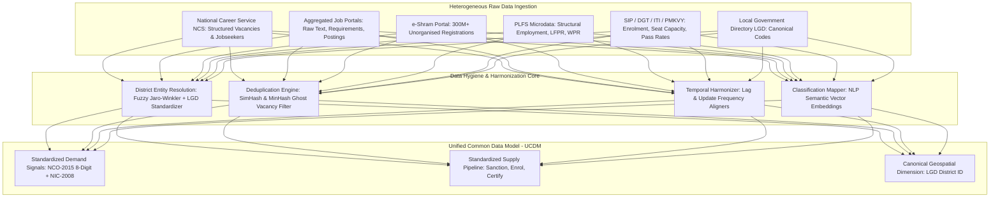

---

### 4.1 Ingestion Sources & Field Specification

| Source Identifier | Update Cadence | Key Fields Extracted | Challenges / Biases | Preprocessing Strategy |
| :--- | :--- | :--- | :--- | :--- |
| **National Career Service (NCS)** | Daily / Weekly Batch | Job ID, NCO Code, Vacancy Count, Location, Salary Range, Minimum NSQF Level | Stale vacancies; government contract bias | State validity check; drop posts inactive > 60 days. |
| **Aggregated Job Portals / Web Signals** | Continuous / Weekly | Job Title, Unstructured Text, District/City, Employer, Required Skills | Heavy urban bias; white-collar skew; duplicate aggregator posts | MinHash deduplication; regex skill extraction; wage outlier capping. |
| **e-Shram Database** | Monthly Batch Aggregate | Primary Occupation (NCO), Secondary Skill, Current District, Home District, Age, Gender | Registered $\neq$ available; informal self-declaration; no verified competence test | Use strictly as an informal labour supply proxy and inter-state migration vector; do NOT treat as immediate certified supply. |
| **Periodic Labour Force Survey (PLFS)** | Annual / Quarterly Urban | Principal Status, Subsidiary Status, NIC 2-Digit, NCO 3-Digit, Wage, Educational Attainment | Sample-based; 9-12 month publication lag | Establish structural baseline macro rates (LFPR, formal/informal ratios). |
| **Skill India Portal (SIP) / DGT / ITI / PMKVY** | Monthly / Cycle Batch | Scheme Code, Center ID, LGD District, Trade Code, Sanctioned Seats, Enrolled Candidates, Passed, Certified | Seat reporting delays; private ITI ghost admissions | Cross-verify against National Board of Examination (NBE) / NCVET certificate issuance logs. |
| **Local Government Directory (LGD)** | Quarterly Reference | State LGD Code, District LGD Code, Sub-District LGD Code, Canonical Name, Aliases | Ongoing district bifurcations / renamings | Authoritative master lookup for all geospatial resolution. |

---

### 4.2 Deduplication & De-biasing Pipeline

#### Step 1: Duplicate Vacancy Detection
Job postings are frequently syndicated across multiple portals and re-posted every 14 days by recruitment agencies.
- **Algorithm:** 64-bit **SimHash** computed over `[Normalized Employer Name + District LGD Code + NCO Code + Salient Requirements Vector]`.
- Postings with Hamming Distance $\le 3$ within a 45-day rolling window are clustered into a single unique vacancy instance.

#### Step 2: Ghost & Stale Vacancy Removal
Vacancies that remain open $> 90$ days without renewal signals are subjected to an exponential temporal decay function:
$$W_{fresh}(t) = \exp(-\lambda \cdot \Delta t)$$
where $\lambda = 0.035$ (half-life $\approx 20$ days) for commercial portal postings, and $\lambda = 0.015$ for public service commission notices.

#### Step 3: Geographic Standardization (LGD Harmonization)
Unstructured district strings (e.g., "Kashi", "Benares", "Varanasi", "Banaras") are resolved to canonical **LGD District Code 184 (Varanasi)** via a tri-tier entity resolution pipeline:
1. Exact match against LGD alias dictionary.
2. Phonetic Double Metaphone match.
3. Jaro-Winkler Distance threshold ($\ge 0.88$) constrained by State boundary.

---

### 4.3 Taxonomy & Ontology Cross-Mapping Engine
The system bridges raw employer jargon with standard government classifications:

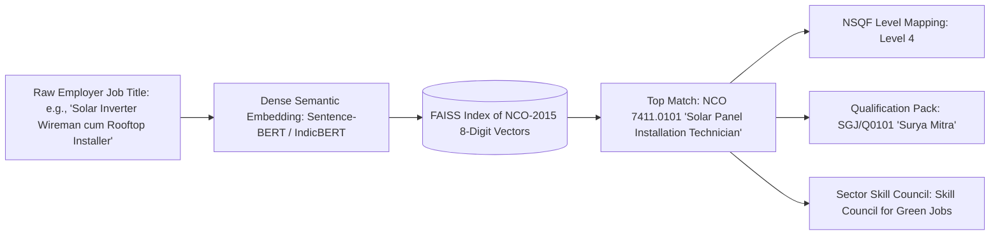

---

## 5. Analytical Core: Demand Index & Absolute Demand Forecasting

The system provides two distinct, non-conflated measures of demand:
1. **Composite Demand Index (CDI):** A normalized intensity metric (0 to 100) indicating the relative demand pressure across trades and districts.
2. **Calibrated Absolute Job Demand ($D_{abs}$):** A forecasted integer quantity of net worker hires expected over 3, 6, and 12-month horizons.

---

### 5.1 Mathematical Formulation of the Composite Demand Index (CDI)

For a given Trade $i$ in District $j$ at time $t$:

$$\text{CDI}_{i,j,t} = w_V \cdot \widetilde{V}_{i,j,t} + w_G \cdot \widetilde{G}_{i,j,t} + w_H \cdot \widetilde{H}_{i,j,t} + w_S \cdot \widetilde{S}_{i,j,t} + w_M \cdot \widetilde{M}_{j,t}$$

Where all component variables are normalized using min-max scaling with outlier capping at the 99th percentile:

$$\widetilde{X} = \min\left(1, \max\left(0, \frac{X - X_{p1}}{X_{p99} - X_{p1}}\right)\right) \times 100$$

| Component | Symbol | Empirical Weight | Definition & Mathematical Representation |
| :--- | :--- | :--- | :--- |
| **Normalized Vacancy Volume** | $\widetilde{V}$ | $0.35$ | Total deduplicated active unique vacancies in the last 60 days across NCS and commercial portals. |
| **Vacancy Growth Momentum** | $\widetilde{G}$ | $0.25$ | Velocity of demand: $\frac{V_{t} - V_{t-30}}{V_{t-30} + \epsilon}$. Reflects whether trade demand is expanding or contracting. |
| **Employer Hiring Breadth** | $\widetilde{H}$ | $0.15$ | Unique distinct corporate entities posting vacancies in this trade/district (mitigates distortion from a single employer posting 500 contract jobs). |
| **Skill Requirement Dispersion** | $\widetilde{S}$ | $0.15$ | Frequency of occurrence of the trade's constituent technical competencies in adjacent industrial job descriptions. |
| **Macro-Economic District Proxy** | $\widetilde{M}$ | $0.10$ | District economic vitality index derived from district credit-deposit ratio, MSME Udyam registrations, and public capex project sanctions. |

> **Constraint & Transparency Rule:** $\sum w_k = 1.0$. The weights are configurable via the Administrative Policy Panel and documented with full audit trails.

---

### 5.2 Absolute Demand Forecasting Architecture ($D_{abs}$)

Absolute job demand is modeled using a hierarchical ensemble architecture evaluated across rolling historical backtests:

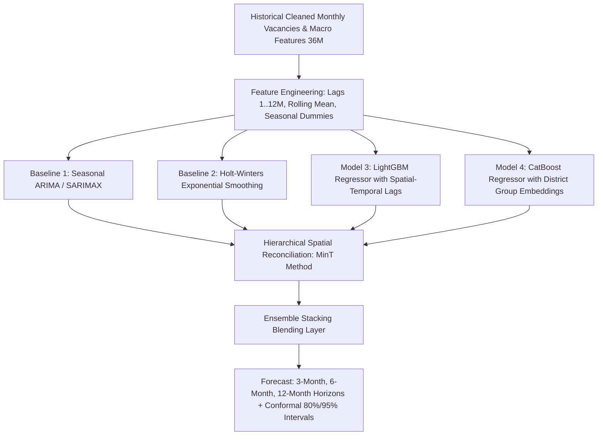

#### Multi-Horizon Forecasting Scope:
- **3-Month Horizon ($T+3$):** Tactical guidance for short-term skilling batches (PMKVY STT, Recognition of Prior Learning - RPL, bootcamps).
- **6-Month Horizon ($T+6$):** Mid-term planning for 6-month certificate programs and ITI mid-term module sanctions.
- **12-Month Horizon ($T+12$):** Strategic planning for annual ITI Craftsmen Training Scheme (CTS) admissions, capital equipment procurement, and new center affiliations.

#### Cold-Start & Sparse Data Mitigation for Tier-2/3 Rural Districts:
In rural districts with near-zero online vacancies:
1. **Empirical Bayesian Shrinkage:** The district estimate borrows statistical strength from the State-level Sectoral Demand growth rate:
   $$\hat{D}_{\text{district}} = \lambda_j \cdot D_{\text{local}} + (1 - \lambda_j) \cdot \left(\frac{\text{Pop}_{\text{district}}}{\text{Pop}_{\text{state}}} \cdot D_{\text{state}}\right)$$
   where $\lambda_j \in [0, 1]$ is proportional to the historical vacancy volume of district $j$.
2. **Infrastructure Proxy Coupling:** If a district receives a sanction for a National Highway, PM Mega Integrated Textile Region and Apparel (PM MITRA) park, or Solar Park, the engine activates an input-output coefficient table mapping investment rupees to trade demand.

---

## 6. Dynamic Workforce Supply Pipeline Engine (The Leaky Funnel)

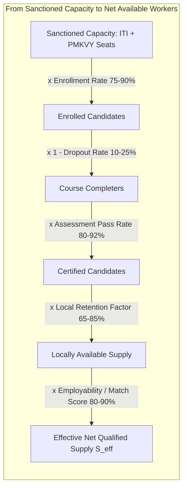

---

### 6.1 Formal Supply Equation

For Trade $i$ in District $j$ over forecast horizon $H$:

$$S_{\text{eff}}(i, j, H) = S_{\text{stock}}(i, j) \cdot (1 - \delta)^H + \sum_{k \in \text{Institutions}} \left[ C_{i, j, k} \cdot \alpha_{i, k} \cdot (1 - \beta_{i, k}) \cdot \gamma_{i, k} \cdot \mu_{i, j} \right] + S_{\text{informal}}(i, j, H)$$

Where:
- $S_{\text{stock}}(i, j)$: Estimated pool of currently qualified unemployed or underemployed job-seekers residing in the district.
- $\delta$: Monthly natural attrition rate (retirement, out-migration, career pivot), set empirically between $0.005$ and $0.015$.
- $C_{i, j, k}$: Approved/sanctioned seat capacity of institution $k$ in trade $i$ scheduled to graduate within horizon $H$.
- $\alpha_{i, k}$: **Enrolment Coefficient** (Historical ratio of actual admissions to sanctioned capacity).
- $\beta_{i, k}$: **Dropout Coefficient** (Historical proportion of enrolled candidates abandoning the program prior to completion).
- $\gamma_{i, k}$: **Assessment & Certification Pass Rate** (Historical ratio of certified to appeared candidates).
- $\mu_{i, j}$: **Geographic Retention & Labor Participation Factor** (Proportion of certified candidates who actively seek employment within District $j$ rather than migrating to Tier-1 metros or exiting the labor force).
- $S_{\text{informal}}(i, j, H)$: Calibrated inflow of informal experienced workers registering on e-Shram or seeking RPL certification, weighted by a discount factor $\theta = 0.35$.

---

### 6.2 Pipeline Parameter Default Baselines (Empirically Calibrated)

| Trade Category (Sample) | Typical Sanctioned Seats per Unit | Enrolment Rate ($\alpha$) | Dropout Rate ($\beta$) | Certification Rate ($\gamma$) | Local Retention ($\mu$) | Net Conversion Yield |
| :--- | :--- | :--- | :--- | :--- | :--- | :--- |
| **Industrial CNC Machinist (ITI 2-Yr)** | 100 | $92\%$ | $11\%$ | $88\%$ | $72\%$ | **$51.9\%$** |
| **Solar PV Technician (PMKVY 3-Mo)** | 100 | $84\%$ | $16\%$ | $82\%$ | $68\%$ | **$39.4\%$** |
| **Data Entry Operator (Short-Term)** | 100 | $95\%$ | $22\%$ | $79\%$ | $52\%$ | **$30.4\%$** |
| **Allied Health / GDA (6-Mo)** | 100 | $88\%$ | $14\%$ | $91\%$ | $78\%$ | **$53.6\%$** |

> **Significance:** In Data Entry, out of 100 sanctioned seats, only ~30 net workers actually become locally available candidates. In CNC Machining, ~52 become available. Failing to model this pipeline leads planners to overestimate supply by 2x to 3x!

---

## 7. Demand-Supply Gap Analytics & Early Warning Matrix

### 7.1 Gap Formulation

1. **Absolute Mismatch Gap ($\Delta_{\text{abs}}$):**
   $$\Delta_{\text{abs}}(i, j, H) = D_{\text{abs}}(i, j, H) - S_{\text{eff}}(i, j, H)$$
   - $\Delta_{\text{abs}} > 0$: Net Worker Shortage (Under-supply).
   - $\Delta_{\text{abs}} < 0$: Net Worker Surplus (Oversupply).

2. **Relative Tension Ratio ($\tau_{\text{rel}}$):**
   $$\tau_{\text{rel}}(i, j, H) = \frac{D_{\text{abs}}(i, j, H)}{S_{\text{eff}}(i, j, H) + \epsilon}$$
   - A rural district with $D = 200, S = 50$ has $\Delta_{\text{abs}} = +150$ and $\tau_{\text{rel}} = 4.0$ (Severe 4x shortage).
   - An urban district with $D = 5000, S = 4850$ has $\Delta_{\text{abs}} = +150$ and $\tau_{\text{rel}} = 1.03$ (Broad balance).
   - **Crucial Rule:** Planners must inspect both $\Delta_{\text{abs}}$ and $\tau_{\text{rel}}$ simultaneously.

---

### 7.2 The 5-State Early Warning Taxonomy

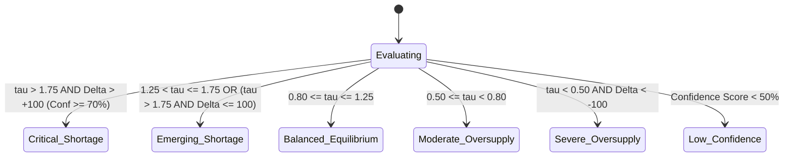

| System Flag | Visual Indicator | Quantitative Trigger Condition | Administrative Meaning | Recommended Planning Action |
| :--- | :--- | :--- | :--- | :--- |
| **Critical Shortage Risk** | Red Hexagon (#D32F2F) | $\tau_{\text{rel}} \ge 1.75$ AND $\Delta_{\text{abs}} \ge +100$ (Confidence $\ge 70\%$) | Severe labor deficit; employers cannot fill essential vacancies. | Sanction additional training batches; accredit new private/public centers; fast-track RPL. |
| **Emerging Shortage** | Amber Triangle (#F57C00) | $1.25 \le \tau_{\text{rel}} < 1.75$ (Confidence $\ge 60\%$) | Demand is pulling ahead of historical training seat throughput. | Monitor next quarter; notify District Skill Committee to prepare expansion contingency. |
| **Balanced Equilibrium** | Green Circle (#388E3C) | $0.80 \le \tau_{\text{rel}} \le 1.25$ | Training capacity matches projected employer demand within healthy 20% tolerance. | Maintain sanctioned seat quotas; focus on training quality and assessment rigor. |
| **Moderate Saturation** | Blue Diamond (#1976D2) | $0.50 \le \tau_{\text{rel}} < 0.80$ | Supply moderately exceeds absorption capacity; placement rates likely to decline. | Freeze seat increases; offer dual-skilling or cross-skilling modules to trainees. |
| **Severe Oversupply Risk** | Purple Square (#7B1FA2) | $\tau_{\text{rel}} < 0.50$ AND $\Delta_{\text{abs}} \le -100$ | Chronic overproduction; certified youth face severe unemployment or wage dilution. | Downscale sanctioned seats; mandate course diversification into adjacent sunrise trades. |
| **Low Confidence / Data Sparse** | Gray Dashed Circle (#757575) | Data Quality Index $< 0.50$ OR Conformal Band $> \pm 80\%$ | Extreme data sparsity; unreliable historical time-series or conflicting signals. | Initiate ground-truth District Skill Survey; collect employer cluster data before policy changes. |

---

### 7.3 Composite Vulnerability & Opportunity Score (CVOS) for Trade Ranking
To rank all trades nationally or within a state, the system computes the CVOS index:

$$\text{CVOS}_{i} = \omega_1 \cdot |\tau_{\text{rel}} - 1.0| + \omega_2 \cdot |\Delta_{\text{abs}}| + \omega_3 \cdot \text{GrowthRate} + \omega_4 \cdot (1 - \text{Confidence})$$

This ranks trades that represent the greatest economic risk or highest strategic urgency to the top of the planner's triage queue.

---

## 8. Policy Decision Support & "What-If" Scenario Simulation Engine

```mermaid
graph TD
    CurrentState[Current State: Sanctioned Seats, Projected Shortage: +1,800] --> UI[Planner Adjusts Parameters in Simulation Sandbox]
    
    subgraph Sandbox Controls
        UI --> C1[Slider: Add +10 Batches to ITI 1 & 2]
        UI --> C2[Toggle: Convert 4 Dead Secretarial Batches to Solar]
        UI --> C3[Slider: Adjust Assumed Retention Factor from 70% to 85%]
    end

    Sandbox Controls --> Engine[Simulation Computational Core]
    Engine --> RecalcSupply[Recalculate Net Pipeline Yield]
    RecalcSupply --> NewGap[New Projected Gap: +120 Balanced Equilibrium]
    NewGap --> Output[Comparative Impact Report: Placement %, Budget Delta, Infra Feasibility]
```

### 8.1 Simulation Capabilities
1. **Seat Reallocation Simulation:** Move sanctioned capacity from an oversupplied trade to a critical shortage trade within the same ITI campus or cluster.
2. **Infra Lead-Time Modeling:** Incorporates realistic lag times (e.g., sanctioning a new Solar Lab requires 4 months of procurement before batch 1 can commence).
3. **Budget Impact Estimation:** Computes the fiscal implications under PMKVY common cost norms (per candidate hour cost) or DGT capital expenditure schemes.
4. **Counterfactual History Check:** Evaluates: "If we had reduced Data Entry seats by 40% two years ago, what would the estimated placement rate and government training expenditure savings have been?"

---

## 9. Interactive Dashboard & Visualization Specifications

### 9.1 Information Architecture & Navigation Hierarchy

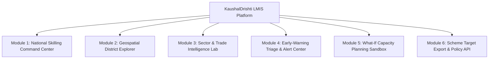

---

### 9.2 Detailed Screen-by-Screen Functional Specifications

#### Screen 1: National Skilling Command Center (Executive View)
- **Top Metric Cards (KPI Strip):**
  - *National Projected Demand (12M):* e.g., 4.2M (with $\pm$ 4.8% error band)
  - *National Projected Supply Pipeline (12M):* e.g., 3.8M
  - *Net National Gap:* +400,000 (Shortage)
  - *High-Risk Distress Districts:* 68 Districts flagged with Critical Shortages; 112 with Severe Saturation
  - *Data Freshness Beacon:* "Last sync: Today at 03:00 IST | Coverage: 742 LGD Districts"
- **Interactive Choropleth Map of India:**
  - Color-coded by Net Tension Ratio ($\tau_{\text{rel}}$) or Absolute Gap.
  - Controls: Filter by Sector, NSQF Level (1-10), Forecast Horizon (3M, 6M, 12M).
  - Hover tooltip: District Name, Dominant Shortage Trade, Dominant Surplus Trade, Total Gap, Confidence Tier.
  - Click action: Seamless drill-down into District Explorer.
- **Top 10 Critical Shortages & Oversupply Leaderboard:**
  - Ranked bar charts showing trade name, Sector, $\Delta_{\text{abs}}$, and Early Warning badge.

#### Screen 2: Geospatial District Explorer (Operational Planner View)
- **District Context Header:** Canonical Name (e.g., *Pune, Maharashtra - LGD 492*), Population, Industrial Cluster tags (Automotive, IT/Software, Manufacturing).
- **Dual Funnel Breakdown Chart:**
  - Left Funnel: Demand signals (NCS, online portals, MSME investments, Tender pull).
  - Right Funnel: Supply pipeline (Sanctioned seats $\rightarrow$ Admissions $\rightarrow$ Expected Pass $\rightarrow$ Retained Pool).
- **Trade-by-Trade Diagnostic Matrix Table:**
  - Columns: Trade Name, NCO Code, NSQF Level, 12M Demand Forecast, Current Sanctioned Capacity, Projected Certified Supply, Net Gap ($\Delta$), Tension ($\tau$), Status Flag, Confidence Index, Actions.
  - Sortable, searchable, filterable by Risk Category.

#### Screen 3: Trade & Sector Deep-Dive (Curriculum & SSC View)
- **Multi-Line Time Series Forecast Chart:**
  - X-axis: 24 Months Historical (Actuals) + 12 Months Forward (Forecast).
  - Solid Line 1: Historical & Projected Demand with shaded 80% and 95% conformal prediction intervals.
  - Solid Line 2: Historical & Projected Skilled Supply.
  - Visual Area between lines: Shaded Red (Shortage window) or Shaded Purple (Oversupply window).
- **Competency & Skill Cloud Breakdown:**
  - Keywords extracted from active employer descriptions compared against standard NSQF syllabus items.
  - Green highlights: Taught in current curriculum.
  - Red highlights: High employer frequency, missing from syllabus (Curriculum Deficit).

#### Screen 4: "What-If" Policy Simulator Sandbox
- **Left Panel (Configuration Controls):**
  - Add/Remove Batches per Trade.
  - Adjust Infrastructure Constraints (Equipment cap, Trainer availability).
  - Modify Dropout and Retention assumptions.
- **Right Panel (Real-Time Impact Simulation):**
  - Before vs After Gap comparison charts.
  - Budgetary variance indicator (Estimated cost under PMKVY / DGT norms).
  - Projected local placement rate shift.
  - "Commit to Draft Plan" button.

---

### 9.3 Multilingual & Accessibility Compliance (WCAG 2.1 AA)
- **Bilingual Core Support:** Complete interface localized in English and Hindi (हिन्दी), with foundational architecture ready for 10 Scheduled Indian languages (Marathi, Tamil, Telugu, Bengali, Kannada, Gujarati, Odia, Punjabi, Malayalam, Assamese).
- **No Reliance on Color Alone:** Every status badge combines an accessible color with an explicit semantic icon and text label (e.g., Red Hexagon + `[!] Critical Shortage Risk`).
- **Screen Reader Readiness:** ARIA attributes (`aria-expanded`, `aria-live`, `aria-describedby`) for dynamic charts, tables, and modal windows.
- **Contrast Ratios:** Minimum contrast ratio of 4.5:1 for standard text and 3:1 for graphical UI components.

---

## 10. API Specifications, Data Schema & Interoperability Layer

The system exposes an enterprise-grade RESTful API compliant with OpenAPI 3.0 standards to allow direct integration into MSDE's **Skill India Digital Hub (SIDH)**, State SSDM portals, and District Planning ERPs.

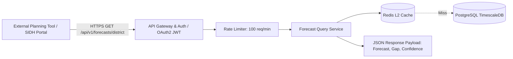

---

### 10.1 Key Endpoints Specification

#### 1. Retrieve District Forecast & Mismatch Records
- **Route:** `GET /api/v1/intelligence/forecasts`
- **Query Parameters:**
  - `state_lgd`: integer (e.g., `27` for Maharashtra)
  - `district_lgd`: integer (optional, e.g., `492` for Pune)
  - `sector_id`: string (optional, e.g., `SEC_GREEN_ENERGY`)
  - `horizon`: string (`3M` | `6M` | `12M`, default: `12M`)
  - `risk_category`: string (optional, `CRITICAL_SHORTAGE` | `OVERSUPPLY`)

##### Response Schema (`application/json`):
```json
{
  "status": "success",
  "api_version": "1.0.0",
  "generated_at": "2026-10-15T04:30:00Z",
  "metadata": {
    "state_lgd": 27,
    "district_lgd": 492,
    "district_name": "Pune",
    "forecast_horizon": "12M",
    "methodology_version": "KD-v1.4-Ensemble"
  },
  "data": [
    {
      "trade_code": "NCO-7411.0101",
      "trade_name": "Solar PV Installation & Maintenance Technician",
      "sector_name": "Green Jobs",
      "nsqf_level": 4,
      "demand_metrics": {
        "composite_demand_index": 88.4,
        "absolute_demand_forecast": 3200,
        "conformal_interval_80": [2950, 3480],
        "demand_trend_pct_yoy": +34.2
      },
      "supply_metrics": {
        "sanctioned_seats": 1400,
        "active_enrollment": 1210,
        "expected_completions": 1050,
        "projected_certified_supply": 924,
        "effective_available_supply": 785
      },
      "gap_analysis": {
        "absolute_gap": 2415,
        "tension_ratio": 4.07,
        "risk_category": "CRITICAL_SHORTAGE_RISK",
        "confidence_score": 0.86,
        "primary_drivers": [
          "Sanction of 250MW industrial rooftop solar policy in Chakan MIDC",
          "High vacancy growth momentum (+84% YoY across NCS & industrial portals)",
          "Low institutional seat conversion rate (56%)"
        ]
      },
      "data_freshness": {
        "ncs_last_updated": "2026-10-14",
        "portal_scrapes_last_updated": "2026-10-13",
        "iti_census_period": "2025-2026"
      }
    }
  ]
}
```

---

#### 2. Execute What-If Capacity Simulation
- **Route:** `POST /api/v1/simulation/simulate-gap`
- **Request Body Schema:**
```json
{
  "district_lgd": 492,
  "trade_code": "NCO-7411.0101",
  "horizon": "12M",
  "simulation_parameters": {
    "seat_capacity_delta": +600,
    "assumed_enrollment_rate": 0.90,
    "assumed_retention_rate": 0.85
  }
}
```
##### Response Payload:
```json
{
  "simulation_id": "sim_84920491",
  "trade_code": "NCO-7411.0101",
  "baseline": {
    "absolute_gap": 2415,
    "tension_ratio": 4.07,
    "risk_category": "CRITICAL_SHORTAGE_RISK"
  },
  "simulated": {
    "simulated_additional_effective_supply": +413,
    "new_absolute_gap": 2002,
    "new_tension_ratio": 2.67,
    "new_risk_category": "CRITICAL_SHORTAGE_RISK",
    "gap_reduction_pct": 17.1
  },
  "policy_feedback": "Adding 600 seats mitigates 17% of the deficit. Recommended: Complement with State RPL Certification Drive (+1,500 target) to achieve equilibrium."
}
```

---

## 11. System Architecture & Scalability Non-Functional Requirements (NFRs)

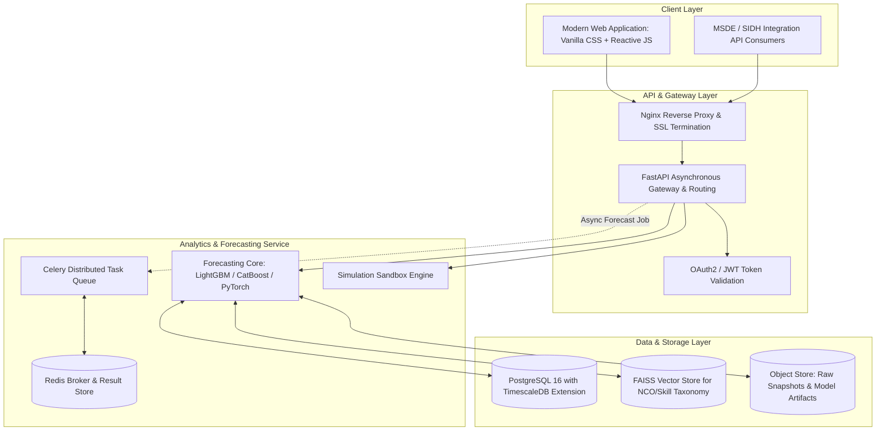

---

### 11.1 Non-Functional Requirements (NFRs) Specification

| Dimension | Metric / Target | Implementation Architecture |
| :--- | :--- | :--- |
| **Response Latency** | $\le 120\text{ms}$ for cached district views; $\le 850\text{ms}$ for complex What-If simulations | In-memory Redis caching of pre-aggregated district tensors; optimized TimescaleDB continuous aggregates. |
| **Throughput & Concurrency** | 500 concurrent planners; peak capacity 2,500 requests/minute | Asynchronous FastAPI workers with Uvicorn, horizontal pod autoscaling. |
| **Data Freshness (SLA)** | Job portal signals: $\le 7$ days; NCS signals: $\le 24$ hours; Seat updates: Monthly | Automated Airflow/Cron ETL pipelines with data validation circuit breakers. |
| **Availability** | $99.9\%$ uptime during business hours (08:00 - 20:00 IST) | Multi-AZ deployment with active-passive read replicas. |
| **Auditability & Traceability** | 100% of forecast outputs must log model ID, input dataset timestamp, and weights | Append-only audit table storing JSON snapshot of all model parameters at inference. |
| **Data Privacy & Governance** | Strict compliance with Digital Personal Data Protection (DPDP) Act 2023 | Zero PII ingestion. e-Shram and Aadhaar data is processed strictly at aggregated district-trade counts ($k \ge 50$ anonymization). |

---

## 12. Pilot Deployment Strategy & Model Evaluation Framework

### 12.1 Defined Pilot Scope
To validate the system convincingly, the initial production-ready prototype focuses on **4 High-Impact Sectors** across **3 Economically Diverse Pilot States**:

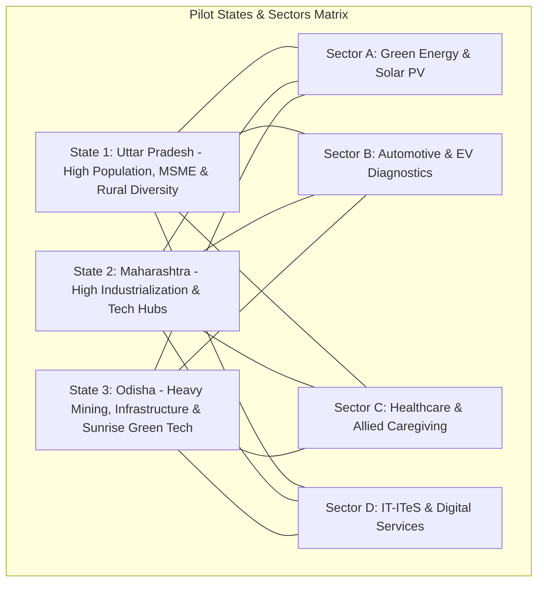

---

### 12.2 Data Strategy for Evaluation: Multi-Tiered Data Separation
The validation environment combines official public statistics with realistic evaluation datasets:

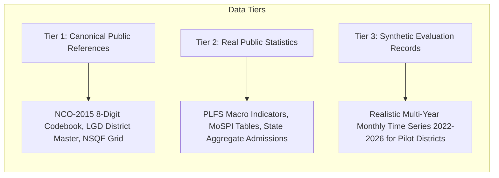

- **Integrity Rule:** All generated records must be explicitly tagged as `is_simulated: true` in the database to prevent accidental conflation with audited government records during deployment validation.
- **Realistic Noise & Shock Injection:** Synthetic evaluation datasets will incorporate real-world phenomena:
  - Seasonal hiring spikes (e.g., festive logistics surge in Q3).
  - Economic shocks (e.g., localized factory expansions).
  - Data sparsity in remote tribal districts (e.g., Gadchiroli, MH or Sonbhadra, UP).

---

### 12.3 Rigorous Model Validation Protocol

| Evaluation Dimension | Metric | Benchmark Target | Evaluation Methodology |
| :--- | :--- | :--- | :--- |
| **Demand Forecast Accuracy** | Mean Absolute Percentage Error (MAPE) & RMSE | $\text{MAPE} \le 18.5\%$ on dense districts; $\le 28.0\%$ on sparse | Walk-forward rolling origin backtesting over 12 held-out months of observations. |
| **Baseline Superiority** | Relative MAE vs Naive Baselines | $\frac{\text{MAE}_{\text{Model}}}{\text{MAE}_{\text{MovingAverage}}} \le 0.75$ | Formal comparison proving that the ML ensemble outperforms simple trend projections by at least 25%. |
| **Alert Trigger F1-Score** | Precision, Recall, Macro F1 for Shortage/Surplus flags | $\text{F1} \ge 0.82$ on Critical Flags | Evaluation against subsequent historical outcome ground truth (did severe shortages manifest as unfilled jobs?). |
| **Deduplication Precision** | Precision of SimHash clustering | $\text{Precision} \ge 94\%$ | Manual forensic audit of 500 sampled duplicate pairs. |
| **Planner Usability** | Task Completion Time (DSDP Target Export) | $\le 3$ minutes for an untrained District Officer | Usability evaluation simulating an end-to-end target revision session. |

---

## 13. Risk Management, Limitations, Edge Cases & Ethical Governance

### 13.1 Analytical Pitfalls & Built-In Defenses

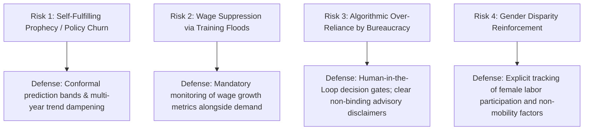

1. **The Self-Fulfilling Prophecy Hazard:**
   - *Risk:* If the system forecasts a shortage of 2,000 workers and 5 institutions simultaneously expand by 2,000, the market will rapidly flip to severe oversupply in year 2.
   - *Mitigation:* The system tracks *cumulative sanctioned pipeline changes in real-time*. Once District A adds 500 seats, the remaining shortage metric automatically adjusts downward for subsequent planners.
2. **Wage Suppression vs Genuine Labor Shortage:**
   - *Risk:* Employers may claim a "labor shortage" simply because they offer below-market wages that local workers reject.
   - *Mitigation:* The demand model cross-references vacancy volume with *offered wage levels*. If vacancies are high but wages are below the State Minimum Wage or PLFS median for that NCO, the alert is classified as a "Wage Disincentive Anomaly" rather than a true skill shortage.
3. **Severe Localized Economic Shocks:**
   - *Edge Case:* Sudden industrial plant closure or natural disaster.
   - *Mitigation:* Manual "Policy Override & Shock Injection" module in the Admin Panel allowing State Directors to manually set temporary demand ceilings or floors with documented justifications.

---

## 14. Phased Implementation Roadmap

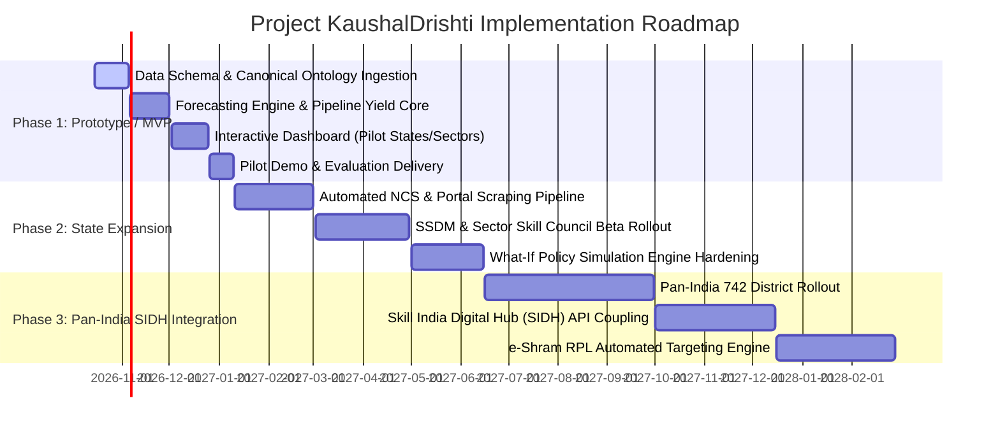

---

## 15. Comprehensive Appendices & Reference Artifacts

### Appendix A: Complete Classification Cross-Reference Sample

| Trade / Occupation Title | NCO-2015 8-Digit Code | NSQF Level | Sector Skill Council | Qualification Pack (QP) Code | Associated DGT CTS Code |
| :--- | :--- | :--- | :--- | :--- | :--- |
| **Solar Panel Installation Technician** | 7411.0101 | 4 | Green Jobs (SCGJ) | SGJ/Q0101 | DGT/1084 |
| **CNC Operator - Machining** | 7223.0501 | 3 | Capital Goods (CGSC) | CSC/Q0115 | DGT/0224 |
| **General Duty Assistant (GDA)** | 5321.0100 | 4 | Healthcare (HSSC) | HSS/Q5101 | DGT/2041 |
| **Automotive Service Technician (EV)** | 7231.0102 | 4 | Automotive (ASDC) | ASC/Q1411 | DGT/1120 |
| **Domestic Data Entry Operator** | 4132.0100 | 3 | IT-ITeS (NASSCOM) | SSC/Q2212 | DGT/0150 |
| **Self Employed Tailor** | 7531.0101 | 3 | Apparel (AMHSSC) | AMH/Q1947 | DGT/0038 |

---

### Appendix B: Mathematical Notation & Glossary

| Term / Notation | Definition |
| :--- | :--- |
| **LMIS** | Labour Market Intelligence System: An integrated technological and institutional platform that aggregates, analyzes, and visualizes labor demand and supply signals to guide human capital policy. |
| **$D_{\text{abs}}(i, j, H)$** | Forecasted absolute number of job openings requiring worker hiring in Trade $i$, District $j$, over Horizon $H$. |
| **$S_{\text{eff}}(i, j, H)$** | Forecasted effective supply of certified, employable, and locally available candidates in Trade $i$, District $j$, over Horizon $H$. |
| **$\text{CDI}_{i,j,t}$** | Composite Demand Index: A normalized multi-signal metric (0 to 100) capturing relative employer demand intensity. |
| **$\Delta_{\text{abs}}$** | Net Absolute Gap ($D_{\text{abs}} - S_{\text{eff}}$). Positive indicates shortage; negative indicates surplus. |
| **$\tau_{\text{rel}}$** | Tension Ratio ($D_{\text{abs}} / S_{\text{eff}}$). Values $> 1.25$ indicate significant shortage; $< 0.80$ indicate saturation. |
| **LGD** | Local Government Directory: The authoritative Indian standard for state, district, sub-district, and block geographic codes. |
| **NCO** | National Classification of Occupations: The 8-digit occupational taxonomy aligned with international ISCO-08 standards. |
| **NSQF** | National Skills Qualifications Framework: A nationally integrated education and competency-based skill framework organizing qualifications from Level 1 to Level 10. |
| **Conformal Prediction** | A distribution-free mathematical framework that guarantees finite-sample coverage validity for forecast uncertainty intervals (e.g., 80% or 95%). |
| **MinT Reconciliation** | Minimum Trace Hierarchical Reconciliation: An algorithm that mathematically ensures district forecasts aggregate consistently to state and national totals. |

---
*End of Product Requirements Document — Project KaushalDrishti*
