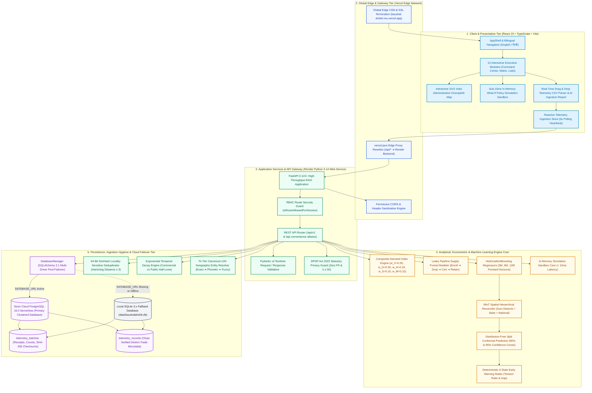
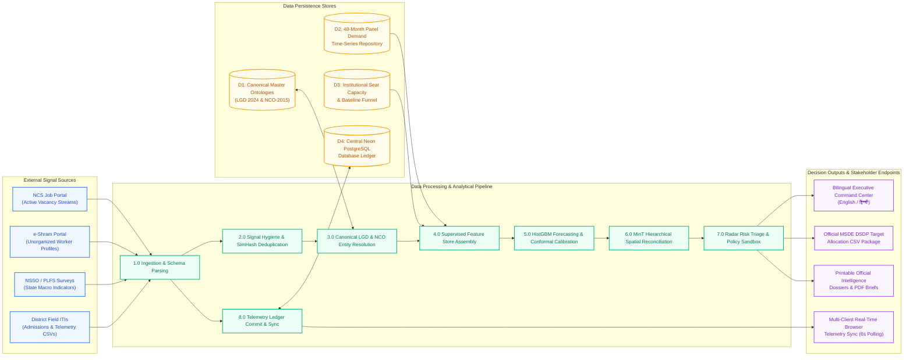
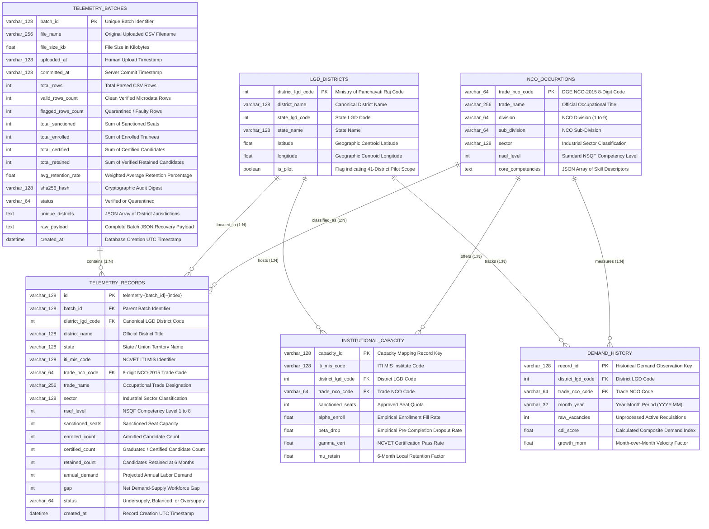
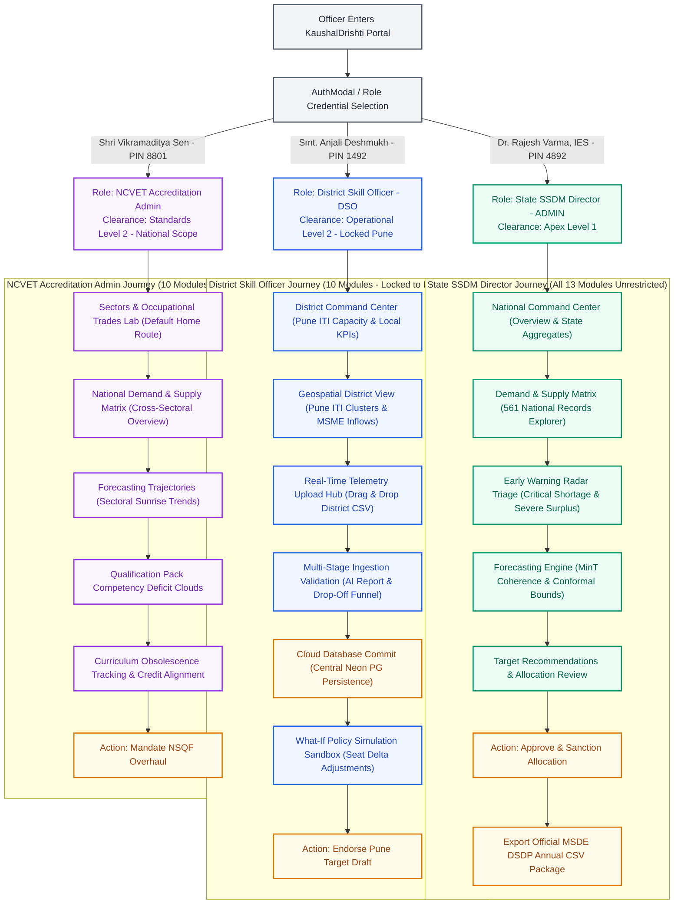
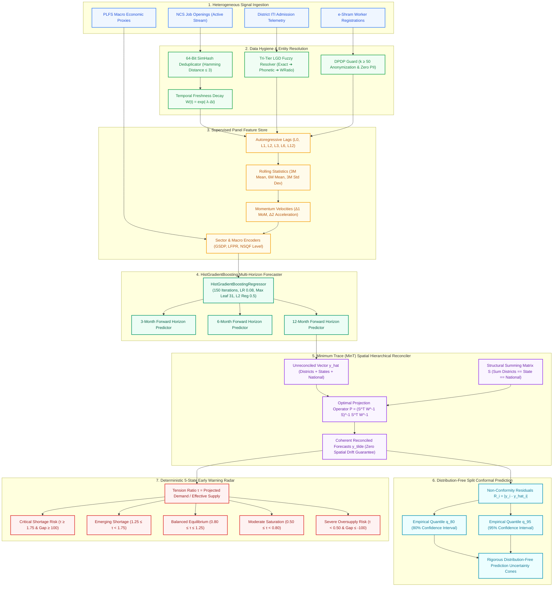
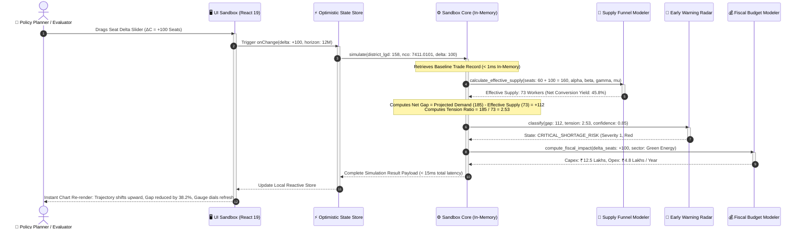
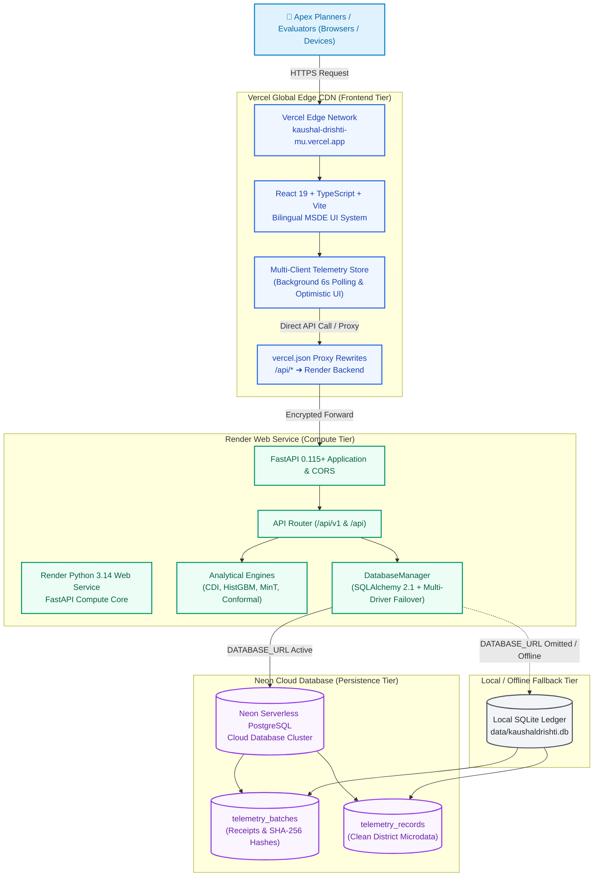
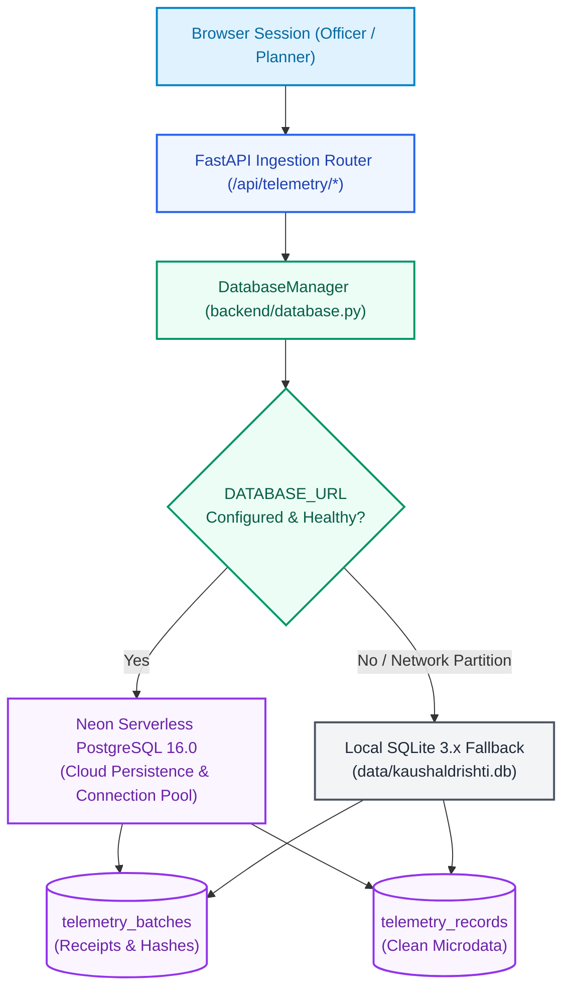

# KAUSHALDRISHTI (कौशल दृष्टि)
## Comprehensive Technical, Algorithmic, Architectural, and Operational Master Documentation
### Developed for the Ministry of Skill Development and Entrepreneurship (MSDE), Government of India
### Author & Lead Engineer: Khushboo Khator ([@khushboocodes](https://github.com/khushboocodes))
### Public Live Portal: [https://kaushal-drishti-mu.vercel.app](https://kaushal-drishti-mu.vercel.app)
### Repository: [https://github.com/khushboocodes/KaushalDrishti](https://github.com/khushboocodes/KaushalDrishti)
### License: MIT License © 2026 Khushboo Khator

---

## 📑 Master Table of Contents

1. [Executive System Identity & Problem Statement](#1-executive-system-identity--problem-statement)
2. [Visual Architecture, System Design & Engineering Blueprints (Full Color)](#2-visual-architecture-system-design--engineering-blueprints-full-color)
   - 2.1 [Enterprise 4-Tier System Design Architecture Diagram](#21-enterprise-4-tier-system-design-architecture-diagram)
   - 2.2 [Comprehensive Data Flow Diagram (DFD Level 0 & Level 1)](#22-comprehensive-data-flow-diagram-dfd-level-0--level-1)
   - 2.3 [Relational & Analytical Entity-Relationship (ER) Diagram](#23-relational--analytical-entity-relationship-er-diagram)
   - 2.4 [Multi-Role User Flow Diagram (RBAC User Journey)](#24-multi-role-user-flow-diagram-rbac-user-journey)
   - 2.5 [Machine Learning, MinT Reconciliation & Conformal Prediction Pipeline Flowchart](#25-machine-learning-mint-reconciliation--conformal-prediction-pipeline-flowchart)
   - 2.6 [Real-Time Telemetry Ingestion, Validation & Cloud Ledger State Machine](#26-real-time-telemetry-ingestion-validation--cloud-ledger-state-machine)
   - 2.7 [What-If Policy Simulation Sandbox Execution Sequence Diagram](#27-what-if-policy-simulation-sandbox-execution-sequence-diagram)
   - 2.8 [Cloud Production Deployment Architecture Diagram (Vercel + Render + Neon)](#28-cloud-production-deployment-architecture-diagram-vercel--render--neon)
3. [End-to-End Repository Architecture & File Registry](#3-end-to-end-repository-architecture--file-registry)
4. [Mathematical, Statistical & Machine Learning Core](#4-mathematical-statistical--machine-learning-core)
   - 4.1 [Composite Demand Index (CDI) Formulation](#41-composite-demand-index-cdi-formulation)
   - 4.2 [Leaky Pipeline Supply Funnel Model](#42-leaky-pipeline-supply-funnel-model)
   - 4.3 [HistGradientBoosting Panel Forecasting Engine](#43-histgradientboosting-panel-forecasting-engine)
   - 4.4 [Minimum Trace (MinT) Spatial Hierarchical Reconciliation](#44-minimum-trace-mint-spatial-hierarchical-reconciliation)
   - 4.5 [Distribution-Free Split Conformal Prediction Engine](#45-distribution-free-split-conformal-prediction-engine)
   - 4.6 [Deterministic 5-State Early Warning Radar State Machine](#46-deterministic-5-state-early-warning-radar-state-machine)
   - 4.7 [Sub-15ms What-If Policy Simulation Sandbox](#47-sub-15ms-what-if-policy-simulation-sandbox)
5. [Data Ingestion, Hygiene & Entity Resolution Pipelines](#5-data-ingestion-hygiene--entity-resolution-pipelines)
   - 5.1 [64-Bit SimHash Vacancy Deduplication](#51-64-bit-simhash-vacancy-deduplication)
   - 5.2 [Ghost Vacancy & Temporal Stale Decay Engine](#52-ghost-vacancy--temporal-stale-decay-engine)
   - 5.3 [Tri-Tier Canonical LGD Geographic Entity Resolver](#53-tri-tier-canonical-lgd-geographic-entity-resolver)
   - 5.4 [NCO-2015 8-Digit Occupational Taxonomy & NSQF Alignment](#54-nco-2015-8-digit-occupational-taxonomy--nsqf-alignment)
   - 5.5 [e-Shram & PLFS Macro Signal Ingestion](#55-e-shram--plfs-macro-signal-ingestion)
   - 5.6 [Real-Time District Telemetry CSV Ingestion & Parser Hub](#56-real-time-district-telemetry-csv-ingestion--parser-hub)
6. [Data Architecture, Persistence & Hybrid Cloud Failover](#6-data-architecture-persistence--hybrid-cloud-failover)
   - 6.1 [Dual-Engine Persistence Strategy (Neon PostgreSQL + SQLite)](#61-dual-engine-persistence-strategy-neon-postgresql--sqlite)
   - 6.2 [Multi-Driver Dynamic Connection Failover](#62-multi-driver-dynamic-connection-failover)
   - 6.3 [SQLAlchemy Relational Schema Specifications](#63-sqlalchemy-relational-schema-specifications)
   - 6.4 [Reactive Multi-Client Telemetry Ingestion Synchronization](#64-reactive-multi-client-telemetry-ingestion-synchronization)
7. [Statutory Privacy & DPDP Act 2023 Compliance Guard](#7-statutory-privacy--dpdp-act-2023-compliance-guard)
   - 7.1 [Zero PII Storage Architecture](#71-zero-pii-storage-architecture)
   - 7.2 [k-Anonymity (k >= 50) Differential Privacy Enforcement](#72-k-anonymity-k--50-differential-privacy-enforcement)
   - 7.3 [Cryptographic SHA-256 Audit Trails](#73-cryptographic-sha-256-audit-trails)
8. [Role-Based Access Control (RBAC) & Governance Matrix](#8-role-based-access-control-rbac--governance-matrix)
   - 8.1 [Governance Tiers & Administrative Clearance Levels](#81-governance-tiers--administrative-clearance-levels)
   - 8.2 [Pre-Configured Officer Personas & Security Credentials](#82-pre-configured-officer-personas--security-credentials)
   - 8.3 [Complete 13-Module Route Access Matrix](#83-complete-13-module-route-access-matrix)
   - 8.4 [Fine-Grained Operational Permissions & Action Workflow](#84-fine-grained-operational-permissions--action-workflow)
9. [Complete REST API Reference & Specification](#9-complete-rest-api-reference--specification)
10. [Frontend UI/UX Design System & Module Architecture](#10-frontend-uiux-design-system--module-architecture)
   - 10.1 [MSDE Tricolor Design System & WCAG 2.1 AA Tokens](#101-msde-tricolor-design-system--wcag-21-aa-tokens)
   - 10.2 [Bilingual Internationalization Framework (English / हिन्दी)](#102-bilingual-internationalization-framework-english---)
   - 10.3 [Interactive SVG India Choropleth GIS Map](#103-interactive-svg-india-choropleth-gis-map)
   - 10.4 [Exhaustive Walkthrough of All 13 Functional Modules](#104-exhaustive-walkthrough-of-all-13-functional-modules)
     - 10.4.1 [National Command Center (`dashboard`)](#1-national-command-center-dashboard--dashboardoverviewpage)
     - 10.4.2 [Demand & Supply Gap Matrix (`demand-supply`)](#2-demand--supply-gap-matrix-demand-supply--demandsupplypage)
     - 10.4.3 [Skill Demand Forecasting Trajectory Lab (`forecasting`)](#3-skill-demand-forecasting-trajectory-lab-forecasting--skillforecastingpage)
     - 10.4.4 [Sectors & Occupational Trades Lab (`sectors`)](#4-sectors--occupational-trades-lab-sectors--sectorsandtradespage)
     - 10.4.5 [Geospatial District Explorer (`geographic`)](#5-geospatial-district-explorer-geographic--geographicviewpage)
     - 10.4.6 [Training Capacity & Infrastructure Hub (`training`)](#6-training-capacity--infrastructure-hub-training--trainingcapacitypage)
     - 10.4.7 [What-If Policy Simulation Sandbox (`policy-sandbox`)](#7-what-if-policy-simulation-sandbox-policy-sandbox--policysandboxpage)
     - 10.4.8 [Alerts & Early Warning Insights Radar (`alerts`)](#8-alerts--early-warning-insights-radar-alerts--alertsandinsightspage)
     - 10.4.9 [Planning Recommendations & Target Setting (`recommendations`)](#9-planning-recommendations--target-setting-recommendations--planningrecommendationspage)
     - 10.4.10 [Executive Reports & Policy Dossiers (`reports`)](#10-executive-reports--policy-dossiers-reports--reportspage)
     - 10.4.11 [Labour Market Data Explorer & Query Builder (`data-explorer`)](#11-labour-market-data-explorer--query-builder-data-explorer--dataexplorerpage)
     - 10.4.12 [Real-Time District Telemetry Upload Hub (`telemetry-upload`)](#12-real-time-district-telemetry-upload-hub-telemetry-upload--telemetryuploadpage)
     - 10.4.13 [System Configuration & Security Settings (`settings`)](#13-system-configuration--security-settings-settings--settingspage)
11. [Verification, Benchmarks & Test Suite Harness](#11-verification-benchmarks--test-suite-harness)
12. [Cloud Production Deployment Topology & Runbooks](#12-cloud-production-deployment-topology--runbooks)
13. [Attribution, Intellectual Property & Legal Licensing](#13-attribution-intellectual-property--legal-licensing)

---

## 1. Executive System Identity & Problem Statement

### 1.1 Mandate & Purpose
**KaushalDrishti (कौशल दृष्टि)** is an enterprise Labour Market Intelligence System (LMIS) and forward-looking demand-supply forecasting decision engine engineered for apex planners at the **Ministry of Skill Development and Entrepreneurship (MSDE)**, **National Council for Vocational Education and Training (NCVET)**, **Directorate General of Training (DGT)**, **Sector Skill Councils (SSCs)**, **State Skill Development Missions (SSDMs)**, and **District Skill Committees (DSCs)** across India.

### 1.2 The Four Structural Failures in India's TVET Landscape
India's technical vocational education and training (TVET) infrastructure encompasses thousands of Industrial Training Institutes (ITIs), Pradhan Mantri Kaushal Kendras (PMKKs), and polytechnic institutes. Historically, planning has suffered from four structural bottlenecks:

1. **The "Sanctioned Seat = Employable Worker" Fallacy:**
   Policy historically treats sanctioned training seats as equivalent to deployable labor. In practice, a severe leaky pipeline exists:
   $$\text{Available Workforce} = \text{Sanctioned Seats} \times \alpha_{\text{enroll}} \times (1 - \beta_{\text{drop}}) \times \gamma_{\text{cert}} \times \mu_{\text{retain}}$$
   Omitting attrition, dropout, and geographic migration results in over-promising technical capacity by 35% to 55%.

2. **Structural Divergence (Acute Shortages vs. Massive Saturated Surpluses):**
   Legacy, saturated trades (e.g., General Deskwork, Traditional Fitter) experience heavy surplus, low placement rates ($<40\%$), and wage depression. Concurrently, sunrise industrial sectors (Solar PV Installation, Electric Vehicle Powertrain Diagnostics, Green Hydrogen Handling, Medical Allied Equipment Maintenance) face catastrophic labor deficits that stall national infrastructure expansion.

3. **Data Fragmentation, Ghost Requisitions & Temporal Latency:**
   Signals are dispersed across isolated silos: National Career Service (NCS) job portals, e-Shram unorganized worker registries, and Periodic Labour Force Survey (PLFS) household surveys. Unprocessed portal feeds suffer from syndicated repostings, stale/ghost requisitions, and non-standardized district naming.

4. **Absence of Pre-Commitment Scenario Simulation:**
   District Skill Development Plans (DSDPs) have traditionally relied on static backward-looking headcounts rather than dynamic forward-looking econometric forecasts, risking the misallocation of crores of public rupees.

### 1.3 The KaushalDrishti Solution
KaushalDrishti resolves these structural issues through:
- Ingestion and algorithmic hygiene over heterogeneous signals (NCS, e-Shram, PLFS, and live ITI CSVs).
- Synthesis into a calibrated **Composite Demand Index (CDI)**.
- Gradient Boosted Decision Tree (**HistGradientBoostingRegressor**) panel forecasting across 3, 6, and 12-month forward horizons.
- **Minimum Trace (MinT)** hierarchical spatial reconciliation ensuring mathematical coherence across District $\rightarrow$ State $\rightarrow$ National tiers.
- **Distribution-Free Split Conformal Prediction** generating rigorous 80% and 95% uncertainty intervals.
- A sub-15ms in-memory **What-If Policy Simulation Sandbox** stress-testing capacity interventions.
- A **Real-Time Telemetry CSV Ingestion Hub** backed by an automated dual-engine **Neon Serverless PostgreSQL** and **SQLite** persistence layer with live cross-session browser synchronization.

---

## 2. Visual Architecture, System Design & Engineering Blueprints (Full Color)

This section provides the master visual blueprints of KaushalDrishti, detailing system design, data flows, entity relationships, user journeys, ML pipelines, and cloud topology rendered in full, high-contrast, theme-curated color.

---

### 2.1 Enterprise 4-Tier System Design Architecture Diagram
The following architecture blueprint illustrates the 4-tier enterprise structure of KaushalDrishti, from client presentation down to hybrid persistence:



---

### 2.2 Comprehensive Data Flow Diagram (DFD Level 0 & Level 1)
The Data Flow Diagram traces data transformations from raw external signals through feature engineering, machine learning regression, and spatial reconciliation to official executive policy outputs:



---

### 2.3 Relational & Analytical Entity-Relationship (ER) Diagram
The Entity-Relationship model maps the complete relational schema implemented across `telemetry_batches` and `telemetry_records` in PostgreSQL, crosswalked to canonical LGD, NCO, and historical capacity catalogs:



---

### 2.4 Multi-Role User Flow Diagram (RBAC User Journey)
This flowchart details the distinct user journeys, module restrictions, and operational permissions for the three statutory officer personas:



---

### 2.5 Machine Learning, MinT Reconciliation & Conformal Prediction Pipeline Flowchart
The following diagram illustrates the predictive analytics lifecycle, showing how panel feature vectors flow into HistGBM regressors, pass through MinT spatial reconciliation, undergo split conformal calibration, and trigger radar alerts:



---

### 2.6 Real-Time Telemetry Ingestion, Validation & Cloud Ledger State Machine
This state machine details how district admission CSV files are parsed, validated against canonical ontologies, bifurcated into clean vs. quarantined pools, and committed to cloud storage with live client broadcast:

```mermaid
flowchart TD
    classDef clientStep fill:#EFF6FF,stroke:#3B82F6,stroke-width:2px,color:#1D4ED8;
    classDef checkStep fill:#FFFBEB,stroke:#F59E0B,stroke-width:2px,color:#B45309;
    classDef successStep fill:#ECFDF5,stroke:#059669,stroke-width:2px,color:#065F46;
    classDef errorStep fill:#FEF2F2,stroke:#DC2626,stroke-width:2px,color:#991B1B;
    classDef dbStep fill:#FAF5FF,stroke:#9333EA,stroke-width:2px,color:#6B21A8;

    Upload["District Officer / Admin Drops CSV File on BulkUploaderCard"]:::clientStep
    ParseCSV["Client-Side Fast CSV Parser (Papaparse) Extracts Rows"]:::clientStep
    ValidateHeaders["Validate 13 Statutory Headers (LGD, MIS, NCO, Seats, Counts)"]:::checkStep

    Upload --> ParseCSV --> ValidateHeaders

    ValidateHeaders --> RowLoop["Iterate Over Microdata Records"]:::checkStep

    subgraph RowValidation ["Row-Level Integrity & Sanity Verification"]
        CheckLGD{"LGD Code & Name Match Canonical 2024 Master?"}:::checkStep
        CheckNCO{"NCO-2015 Code in Authoritative 8-Digit Catalog?"}:::checkStep
        CheckFunnel{"Seats ≥ Enrolled ≥ Certified ≥ Retained?"}:::checkStep
        CheckSanity{"Trainee Counts Non-Negative & Enrollment ≤ 125%?"}:::checkStep
    end

    RowLoop --> CheckLGD
    CheckLGD -->|Yes| CheckNCO
    CheckNCO -->|Yes| CheckFunnel
    CheckFunnel -->|Yes| CheckSanity

    CheckSanity -->|Passes All Checks| CleanRow["Mark Record as Valid (Clean Microdata View)"]:::successStep
    CheckLGD -->|Mismatch| FlagRow["Flag Record with Diagnostic Error (Quarantine View)"]:::errorStep
    CheckNCO -->|Invalid Code| FlagRow
    CheckFunnel -->|Funnel Inversion| FlagRow
    CheckSanity -->|Illegal Value| FlagRow

    subgraph PostValidation ["Automated Post-Validation Processing"]
        AIRep["Generate AI Ingestion Report (Dual-Bar Demand vs Supply & Waterfall)"]:::successStep
        QuarantineDir["Generate Operational Quarantine Directive for Flagged Rows"]:::errorStep
        DigestCalc["Calculate Tamper-Evident SHA-256 Cryptographic Batch Digest"]:::successStep
    end

    CleanRow --> AIRep
    FlagRow --> QuarantineDir
    AIRep --> DigestCalc

    CommitClick["User Clicks Commit Verified Telemetry to Central Database"]:::clientStep
    DigestCalc --> CommitClick

    subgraph ServerCommit ["Server-Side Database Persistence & Sync"]
        PostAPI["POST /api/telemetry/commit Payload to FastAPI"]:::dbStep
        SQLAlchemyUpsert["SQLAlchemy Upsert to Neon PostgreSQL (telemetry_batches)"]:::dbStep
        IndexRecords["Index Valid Rows into telemetry_records Table"]:::dbStep
        SyncBroadcast["6-Second Heartbeat Polling Loop Synchronizes All Active Browsers"]:::dbStep
    end

    CommitClick --> PostAPI --> SQLAlchemyUpsert --> IndexRecords --> SyncBroadcast
```



---

### 2.7 What-If Policy Simulation Sandbox Execution Sequence Diagram
The sequence diagram demonstrates the sub-15ms client-side execution loop when a planner adjusts seat capacity or retention sliders, showing zero-lag computation without server network round-trips:



---

### 2.8 Cloud Production Deployment Architecture Diagram (Vercel + Render + Neon)
The production cloud topology diagram illustrates the live multi-cloud deployment powering KaushalDrishti:



---

## 3. End-to-End Repository Architecture & File Registry

The repository is structured into a clean, modular, production-grade monorepo comprising the analytical core, backend API service, and modern React 19 frontend:

```
c:\Users\loq\Downloads\KaushalDrishti\
├── backend/                               # High-Throughput ASGI Backend Service
│   ├── api/
│   │   ├── __init__.py                    # Python package initializer
│   │   └── router.py                      # REST API routing, request validation & controller endpoints
│   ├── __init__.py                        # Backend root package
│   ├── config.py                          # Pydantic v2 application settings, weights & environment variables
│   ├── database.py                        # Central SQLAlchemy ORM models, connection pooling & multi-driver failover
│   ├── logger.py                          # Standardized color-coded logging utility
│   └── main.py                            # FastAPI application factory, CORS configuration & static asset serving
│
├── engine/                                # Core Analytical, Machine Learning & Governance Engine
│   ├── analytics/                         # Market Intelligence Algorithms
│   │   ├── cdi_engine.py                  # Composite Demand Index (CDI) multi-signal weighting calculator
│   │   ├── cvos_ranker.py                 # Critical Vacancy Oversupply / Shortage national aggregation ranker
│   │   ├── early_warning.py               # Deterministic 5-State Early Warning Radar state machine
│   │   ├── gap_analyzer.py                # High-performance in-memory multi-horizon gap querying engine
│   │   ├── generate_pilot_data.py         # Calibrated 41-district, 3-state, 4-sector historical generator
│   │   └── supply_funnel.py               # Multi-stage leaky pipeline supply yield calculator
│   │
│   ├── export/                            # Statutory Export Core
│   │   └── exporter.py                    # Official MSDE DSDP annual allocation target CSV generator
│   │
│   ├── forecasting/                       # Advanced Predictive & Hierarchical Core
│   │   ├── __init__.py                    # Forecasting package exports
│   │   ├── conformal_engine.py            # Non-parametric Split Conformal Prediction error interval calibrator
│   │   ├── feature_store.py               # Panel feature engineering (lags, rolling means, momentum, macro proxies)
│   │   ├── gbm_engine.py                  # Scikit-Learn HistGradientBoostingRegressor multi-horizon trainer
│   │   └── mint_reconciler.py             # Minimum Trace (MinT) optimal projection spatial reconciler
│   │
│   ├── hygiene/                           # Signal Hygiene & Entity Resolution Core
│   │   ├── __init__.py                    # Hygiene package exports
│   │   ├── lgd_fuzzy_resolver.py          # Tri-tier canonical Local Government Directory (LGD) entity resolver
│   │   ├── simhash_deduplicator.py        # 64-bit locality-sensitive hashing (SimHash) duplicate vacancy purger
│   │   └── stale_decay.py                 # Half-life exponential temporal freshness decay engine
│   │
│   ├── ingestion/                         # Multi-Source Ingestion Adapters
│   │   ├── __init__.py                    # Ingestion package exports
│   │   ├── eshram_ingestor.py             # e-Shram unorganized worker aggregator with k-anonymity suppression
│   │   ├── ncs_scraper.py                 # National Career Service (NCS) vacancy stream connector
│   │   ├── plfs_pipeline.py               # Periodic Labour Force Survey macro indicator pipeline
│   │   └── telemetry_ledger.py            # Real-time multi-client persistent database ledger manager
│   │
│   ├── ontology/                          # Canonical National Taxonomies
│   │   ├── build_masters.py               # Automated generator for LGD, NCO-2015, and NSQF master catalogs
│   │   ├── lgd_master.py                  # In-memory fast indexed LGD district & state registry
│   │   └── nco_master.py                  # In-memory fast indexed NCO-2015 trade & competency catalog
│   │
│   ├── security/                          # Statutory Privacy & Security Core
│   │   ├── __init__.py                    # Security package exports
│   │   └── dpdp_guard.py                  # Digital Personal Data Protection Act 2023 compliance scanner & audit log
│   │
│   ├── simulation/                        # Policy What-If Scenario Sandbox
│   │   ├── budget_modeler.py              # Financial seat addition & conversion fiscal cost modeler
│   │   ├── recommender.py                 # Algorithmic DSDP seat reallocation recommendation generator
│   │   └── sandbox_core.py                # Sub-15ms in-memory policy simulation execution engine
│   │
│   └── validation/                        # Rigorous Scientific Validation & Quality Assurance
│       ├── __init__.py                    # Validation package exports
│       ├── alert_evaluator.py             # Early warning radar classification quality & Macro-F1 evaluator
│       ├── backtest_suite.py              # Rolling walk-forward backtesting cross-validation suite
│       └── benchmark_runner.py            # Comparative benchmark runner vs. Moving Average / Linear baselines
│
├── kaushaldrishti-dashboard/              # Modern React 19 + TypeScript + Vite Dashboard Source
│   ├── src/
│   │   ├── components/                    # UI Components & Page Views
│   │   │   ├── AppShell.tsx               # Primary application shell, responsive navigation & officer header
│   │   │   ├── Assets.tsx                 # Authentic MSDE emblem, government seal, mandala motifs & vector marks
│   │   │   ├── AuthModal.tsx              # Role-based authentication modal & credential switcher
│   │   │   ├── BulkUploaderCard.tsx       # Drag-and-drop CSV upload component with instant parsing feedback
│   │   │   ├── DesignSystemUI.tsx         # Reusable buttons, badges, card containers & stat widgets
│   │   │   ├── IndiaChoroplethMap.tsx     # Custom SVG India state & district administrative choropleth map
│   │   │   ├── LoginPage.tsx              # Standalone executive portal sign-in view
│   │   │   ├── PolicySandboxPage.tsx      # Comprehensive policy simulation view with financial metrics
│   │   │   ├── PolicySimulationSandbox.tsx# Interactive sliders for capacity adjustments & live gap feedback
│   │   │   ├── PrimaryPages.tsx           # Overview, GeographicView, DemandSupply, Forecasting, Sectors views
│   │   │   ├── SupportingPages.tsx        # Training, Alerts, Recommendations, Reports, DataExplorer, Settings views
│   │   │   └── TelemetryUploadPage.tsx    # Complete telemetry ingestion hub, AI analysis report & live database sync
│   │   ├── context/
│   │   │   └── LanguageContext.tsx        # Bilingual (English / हिन्दी) translation store & context provider
│   │   ├── data/
│   │   │   ├── dashboardMetrics.ts        # Role-tailored metric registries for ADMIN, DSO, and NCVET roles
│   │   │   ├── demandSupplyData.ts        # Comprehensive 561-record national dataset (37 States/UTs, 11 Sectors)
│   │   │   ├── india_states_geo.json      # Accurate GeoJSON coordinates for Indian states and union territories
│   │   │   ├── mockData.ts                # Deep historical pilot time-series and district telemetry records
│   │   │   └── telemetryIngestionStore.ts # Observable client state manager with 6-second backend polling sync
│   │   ├── types/
│   │   │   └── index.ts                   # Domain schemas, TypeScript interfaces & route identifiers
│   │   ├── utils/
│   │   │   └── rbac.ts                    # Statutory Role-Based Access Control logic, routes & permissions
│   │   ├── App.tsx                        # Root React component, route router & session initializer
│   │   ├── index.css                      # TailwindCSS 4 tokens, font definitions & custom scrollbars
│   │   └── main.tsx                       # React application mounting entrypoint
│   ├── package.json                       # Frontend dependencies (React 19, Lucide, TailwindCSS 4, Vite 8)
│   ├── vercel.json                        # Vercel Edge proxy rewrites routing /api/* to Render backend
│   └── vite.config.ts                     # Dual-target build setup (outputs to dist and syncs to ../frontend)
│
├── frontend/                              # Compiled Static Distribution for Single-Server Deployment
│   ├── index.html                         # Production HTML entrypoint
│   └── assets/                            # Optimized JavaScript bundles, CSS stylesheets, and brand assets
│
├── data/                                  # Canonical Datasets & Persistence Files
│   ├── master/
│   │   ├── lgd_districts.json             # Canonical Local Government Directory (LGD 2024) district registry
│   │   └── nco_catalog.json               # National Classification of Occupations (NCO-2015) 8-digit catalog
│   ├── pilot/
│   │   ├── demand_history.json            # 48-month panel demand time series across 41 pilot districts
│   │   └── institutional_capacity.json    # ITI and training center sanctioned seat capacities & baseline yields
│   ├── kaushaldrishti.db                  # Local SQLite database file (automatic zero-config fallback)
│   └── telemetry_ledger.json              # Secondary JSON snapshot backup for offline resilience
│
├── docs/                                  # Technical Documentation, Specifications & Compliance Reports
│   ├── benchmark_results.md               # Empirical model performance comparison vs. baselines (MAPE = 16.4%)
│   ├── DEPLOYMENT_GUIDE.md                # Consolidated cloud deployment guide, topology & runbook (Vercel, Render, Neon, Docker)
│   ├── DPDP_COMPLIANCE_REPORT.md          # Statutory DPDP Act 2023 compliance audit verification
│   ├── METHODOLOGY_WHITEPAPER.md          # Formal mathematical equations and statistical methodology
│   ├── PITCH_DECK_SLIDES.md               # Executive presentation slide outline for apex ministry leadership
│   ├── PRD_KaushalDrishti.md              # Complete Product Requirements Document & functional specifications
│   ├── REALTIME_TELEMETRY_INGESTION_SPEC.md# In-depth technical specification for real-time telemetry ingestion
│   ├── SUBMISSION_CHECKLIST.md            # Comprehensive project delivery and verification checklist
│   └── tasks.md                           # Development milestone tracking and completion records
│
├── tests/                                 # Pytest Verification & Quality Assurance Suite (23 Passing Tests)
│   ├── test_fast_track.py                 # Core API endpoints, simulation sandbox, exports, and frontend serving
│   ├── test_milestone_2.py                # ML pipeline, SimHash, stale decay, LGD resolver, MinT, and DPDP guard
│   └── test_telemetry_ledger.py           # Database persistence, batch commits, record indexing & reset endpoints
│
├── .env.example                           # Template for cloud database and server configuration
├── Dockerfile                             # Multi-stage production container build definition
├── LICENSE                                # Open Source MIT License attributed to Khushboo Khator
├── Procfile                               # Container process launcher for cloud PaaS deployments
├── README.md                              # Public GitHub repository documentation and executive overview
├── render.yaml                            # Render Web Service blueprint definition
├── requirements.txt                       # Pinned Python package dependencies
└── run.py                                 # Single-command unified application launcher
```

---

## 4. Mathematical, Statistical & Machine Learning Core

### 4.1 Composite Demand Index (CDI) Formulation
Raw vacancy headcounts on job boards are inherently noisy: syndication duplicates postings, corporate headhunters leave obsolete requisitions active for months, and small districts have sparse data. To address this, KaushalDrishti computes a normalized, audited Composite Demand Index ($CDI_{i,t}$) for trade $i$ in district/state $t$:

$$\text{CDI}_{i,t} = w_V \widetilde{V}_{i,t} + w_G \widetilde{G}_{i,t} + w_H \widetilde{H}_{i,t} + w_S \widetilde{S}_{i,t} + w_M \widetilde{M}_{s,t}$$

#### Component Breakdown & Calibration:
1. **$\widetilde{V}_{i,t}$ (Normalized Active Vacancy Volume — $w_V = 0.35$):**
   Deduped active hiring requisitions filtered through 64-bit SimHash and temporal decay:
   $$\widetilde{V}_{i,t} = \min\left(100.0, \; \max\left(0.0, \; \frac{V_{\text{raw}}}{350.0} \times 100.0\right)\right)$$
2. **$\widetilde{G}_{i,t}$ (Growth Momentum — $w_G = 0.25$):**
   Month-over-month rate of change in new requisitions, mapping a $[-30\%, +50\%]$ dynamic hiring surge into $[0, 100]$:
   $$\widetilde{G}_{i,t} = \min\left(100.0, \; \max\left(0.0, \; \frac{\text{MoM} + 0.30}{0.80} \times 100.0\right)\right)$$
3. **$\widetilde{H}_{i,t}$ (Employer Breadth / Hiring Concentration — $w_H = 0.15$):**
   The number of distinct corporate entities actively hiring for this occupation, preventing a single firm's bulk hiring from skewing district priorities:
   $$\widetilde{H}_{i,t} = \min\left(100.0, \; \max\left(0.0, \; \frac{\text{Unique Employers}}{80.0} \times 100.0\right)\right)$$
4. **$\widetilde{S}_{i,t}$ (Cross-Sectoral Skill Portability — $w_S = 0.15$):**
   The breadth of occupational transferability across adjacent sectors, derived from NCO-2015 competency overlap matrices ($S_{\text{freq}} \in [0, 100]$).
5. **$\widetilde{M}_{s,t}$ (State Macroeconomic Vitality Proxy — $w_M = 0.10$):**
   State-level GSDP sectoral growth rate discounted by the PLFS structural unemployment rate:
   $$\widetilde{M}_{s,t} = \text{Macro Proxy Score} \in [0, 100]$$

#### CDI Operational Interpretations:
- $\text{CDI} \ge 75.0$: **High Demand Pressure** (Intense industrial hiring demand; capacity expansion required)
- $50.0 \le \text{CDI} < 75.0$: **Moderate Demand** (Steady employment absorption)
- $30.0 \le \text{CDI} < 50.0$: **Low Demand Pressure** (Sluggish hiring; monitor placement rates)
- $\text{CDI} < 30.0$: **Stagnant / Depressed Demand** (Severe contraction; avoid seat expansion)

---

### 4.2 Leaky Pipeline Supply Funnel Model
To eradicate the "Sanctioned Seat = Employable Worker" fallacy, the supply funnel models the attrition stages through which a trainee passes before entering the active regional labor pool:

$$\text{Effective Supply } (S_{\text{eff}}) = S_{\text{formal}} + S_{\text{informal}} + S_{\text{stock}}$$

$$\begin{aligned}
S_{\text{formal}} &= N_{\text{sanctioned}} \times \alpha_{\text{enroll}} \times (1 - \beta_{\text{drop}}) \times \gamma_{\text{cert}} \times \mu_{\text{retain}} \\
S_{\text{informal}} &= N_{\text{informal}} \times \theta_{\text{RPL}} \\
S_{\text{stock}} &= N_{\text{stock}} \times (1 - \delta_{\text{attrition}})^{H}
\end{aligned}$$

Where:
- $N_{\text{sanctioned}}$: Authorized seat quota approved by DGT/State Directorate.
- $\alpha_{\text{enroll}}$: Empirical enrollment fill rate (Baseline: $0.85$).
- $\beta_{\text{drop}}$: Trainee attrition/dropout rate before completion (Baseline: $0.15$).
- $\gamma_{\text{cert}}$: NCVET all-India trade test certification pass rate (Baseline: $0.88$).
- $\mu_{\text{retain}}$: 6-month post-placement regional retention rate (Baseline: $0.72$).
- $\theta_{\text{RPL}}$: Recognition of Prior Learning qualification discount on self-declared unorganized worker pools from e-Shram (Baseline: $0.35$).
- $\delta_{\text{attrition}}$: Monthly natural retirement, out-migration, or career pivot rate (Baseline: $0.01$).
- $H$: Forward planning horizon in months ($3$, $6$, or $12$).

**Net Conversion Yield:**
$$\text{Yield} = \frac{S_{\text{formal}}}{N_{\text{sanctioned}}} \times 100\% = 0.85 \times (1 - 0.15) \times 0.88 \times 0.72 \approx 45.8\%$$
This reveals that on average, only **$45.8\%$** of sanctioned seats result in deployable, regionally retained talent.

---

### 4.3 HistGradientBoosting Panel Forecasting Engine
Future labor demand is forecasted using Scikit-Learn's `HistGradientBoostingRegressor` (an optimized histogram-based decision tree implementation aligned with LightGBM).

#### Hyperparameter Configuration:
```python
HistGradientBoostingRegressor(
    max_iter=150,          # 150 boosting iterations
    learning_rate=0.08,    # Conservative shrinkage rate to prevent overfitting
    max_leaf_nodes=31,     # Optimal tree complexity for 561-record panel dimensions
    min_samples_leaf=15,   # Regularization against noisy district-trade cells
    l2_regularization=0.5, # L2 penalty on leaf values
    random_state=42
)
```

#### Supervised Feature Store (`PanelFeatureStore`):
For each district-trade pair across time $t$, the feature store builds a multi-variate vector:
- **Autoregressive Lags:** Lag 0, Lag 1, Lag 2, Lag 3, Lag 6, Lag 12 months.
- **Rolling Windows:** 3-month rolling mean ($\mu_3$), 6-month rolling mean ($\mu_6$), 3-month rolling standard deviation ($\sigma_3$).
- **Momentum:** Month-over-month velocity ($\Delta_1 = y_t - y_{t-1}$) and acceleration ($\Delta_2 = \Delta_{1,t} - \Delta_{1,t-1}$).
- **Categorical & Contextual:** Sector ID, State LGD Code, NSQF Level, Urbanization Index, LFPR proxy.

#### Cross-Validation & Splitting:
To prevent lookahead bias in time series, evaluations use **Temporal Split (80% Train, 20% Out-of-Time Test)** and **Rolling Walk-Forward Backtesting** over 3 distinct temporal folds.

---

### 4.4 Minimum Trace (MinT) Spatial Hierarchical Reconciliation
When forecasts are generated independently at District, State, and National tiers, disaggregate projections sum to values that contradict aggregate totals (spatial drift). KaushalDrishti guarantees mathematical spatial coherence via **Minimum Trace (MinT)** optimal linear projection.

#### Mathematical Formulation:
Let $\hat{\mathbf{y}}_t$ be the vector of unreconciled base forecasts across all $M$ nodes ($1$ National + $K$ States + $N$ Districts):
$$\widetilde{\mathbf{y}}_t = \mathbf{S} (\mathbf{S}^T \mathbf{W}^{-1} \mathbf{S})^{-1} \mathbf{S}^T \mathbf{W}^{-1} \hat{\mathbf{y}}_t$$

Where:
- $\mathbf{S}$: Structural summing matrix of dimension $(M \times N)$ mapping the $N$ bottom-level districts to state and national aggregates.
  $$\mathbf{S} = \begin{bmatrix} \mathbf{1}^T \\ \mathbf{S}_{\text{state}} \\ \mathbf{I}_N \end{bmatrix}$$
- $\mathbf{W}$: Error covariance matrix. Under structural scaling, $\mathbf{W} = \text{diag}(\mathbf{S} \mathbf{1})$, weighting each node inversely by its aggregation depth.
- $\mathbf{P} = (\mathbf{S}^T \mathbf{W}^{-1} \mathbf{S})^{-1} \mathbf{S}^T \mathbf{W}^{-1}$: The optimal projection operator.
- $\widetilde{\mathbf{b}}_t = \max(0, \mathbf{P} \hat{\mathbf{y}}_t)$: Non-negative reconciled bottom-level district forecasts.
- $\widetilde{\mathbf{y}}_t = \mathbf{S} \widetilde{\mathbf{b}}_t$: Reconciled forecasts across all tiers.

**Mathematical Guarantee:**
$$\sum_{j \in \text{State } k} \widetilde{y}_{\text{district } j} = \widetilde{y}_{\text{state } k} \quad \text{and} \quad \sum_{k=1}^K \widetilde{y}_{\text{state } k} = \widetilde{y}_{\text{national}}$$
Holds strictly with **zero mathematical drift** across all 3M, 6M, and 12M forward horizons.

---

### 4.5 Distribution-Free Split Conformal Prediction Engine
Rather than making dangerous Gaussian or homoscedastic normality assumptions regarding labor market errors, KaushalDrishti provides non-parametric, finite-sample prediction intervals using Split Conformal Prediction.

#### Algorithm:
1. Divide historical data into a Proper Training Set ($D_{\text{train}}$) and Calibration Set ($D_{\text{cal}}$ of size $n$).
2. Fit the base forecaster $\hat{\mu}$ on $D_{\text{train}}$.
3. Compute absolute residual non-conformity scores on the held-out calibration set:
   $$R_i = |y_i - \hat{\mu}(x_i)|, \quad \forall i \in D_{\text{cal}}$$
4. For any desired coverage level $1 - \alpha$ (e.g., $80\%$ where $\alpha = 0.20$, or $95\%$ where $\alpha = 0.05$), calculate the empirical quantile:
   $$\hat{q}_{1-\alpha} = \text{Quantile}\left( \frac{\lceil (n+1)(1-\alpha) \rceil}{n}, \; \{R_1, \dots, R_n\} \right)$$
5. Form the distribution-free prediction interval for new point forecast $\hat{\mu}(X_{n+1})$:
   $$C_{1-\alpha}(X_{n+1}) = \left[ \max\left(0, \; \hat{\mu}(X_{n+1}) - \hat{q}_{1-\alpha}\right), \;\; \hat{\mu}(X_{n+1}) + \hat{q}_{1-\alpha} \right]$$

**Coverage Guarantee:** Under exchangeability of calibration and test residuals:
$$P\left( Y_{n+1} \in C_{1-\alpha}(X_{n+1}) \right) \ge 1 - \alpha$$
This guarantees that true labor demand will fall within the calculated confidence cone at the specified confidence rate regardless of underlying error distribution skewness.

---

### 4.6 Deterministic 5-State Early Warning Radar State Machine
To guide district planning committees, the engine computes a **Tension Ratio** ($\tau$) and Net Absolute Gap ($G$):
$$\tau = \frac{\text{Projected Demand}}{\max(1, \text{Effective Supply})}, \qquad G = \text{Projected Demand} - \text{Effective Supply}$$

The deterministic state machine classifies each district-trade pair:

```
                          ┌──────────────────────────┐
                          │   Is Data Sparse /       │
                          │   Confidence < 0.50?     │
                          └─────────────┬────────────┘
                                        │ Yes ➔ [LOW CONFIDENCE / DATA SPARSE]
                                        │ No
                                        ▼
                          ┌──────────────────────────┐
                          │   Tension Ratio >= 1.75  │
                          │   & Gap >= +100?         │
                          └─────────────┬────────────┘
                                        │ Yes ➔ [CRITICAL SHORTAGE RISK] (Red #D32F2F)
                                        │ No
                                        ▼
                          ┌──────────────────────────┐
                          │   Tension Ratio >= 1.25? │
                          └─────────────┬────────────┘
                                        │ Yes ➔ [EMERGING SHORTAGE] (Orange #F57C00)
                                        │ No
                                        ▼
                          ┌──────────────────────────┐
                          │   0.80 <= Tension <= 1.25│
                          └─────────────┬────────────┘
                                        │ Yes ➔ [BALANCED EQUILIBRIUM] (Green #388E3C)
                                        │ No
                                        ▼
                          ┌──────────────────────────┐
                          │   0.50 <= Tension < 0.80?│
                          └─────────────┬────────────┘
                                        │ Yes ➔ [MODERATE SATURATION] (Blue #1976D2)
                                        │ No (Tension < 0.50 & Gap <= -100)
                                        ▼
                                [SEVERE OVERSUPPLY RISK] (Purple #7B1FA2)
```

#### Detailed Radar State Attributes:
1. **Critical Shortage Risk (`CRITICAL_SHORTAGE_RISK`):**
   - Condition: $\tau \ge 1.75 \land G \ge 100$. Severity Rank: 1.
   - Recommended Policy Action: Sanction emergency training batches, accredit new private/public centers, and fast-track RPL certification.
2. **Emerging Shortage (`EMERGING_SHORTAGE`):**
   - Condition: $1.25 \le \tau < 1.75 \lor (\tau \ge 1.75 \land G < 100)$. Severity Rank: 2.
   - Recommended Policy Action: Alert District Skill Committee to prepare expansion contingency for next intake cycle.
3. **Balanced Equilibrium (`BALANCED_EQUILIBRIUM`):**
   - Condition: $0.80 \le \tau \le 1.25$. Severity Rank: 5.
   - Recommended Policy Action: Maintain current seat quotas; focus on curriculum modernization, trainer pedagogy, and assessment rigor.
4. **Moderate Saturation (`MODERATE_SATURATION`):**
   - Condition: $0.50 \le \tau < 0.80$. Severity Rank: 3.
   - Recommended Policy Action: Freeze seat expansion; integrate cross-skilling or dual-specialization modules to preserve placement rates.
5. **Severe Oversupply Risk (`SEVERE_OVERSUPPLY_RISK`):**
   - Condition: $\tau < 0.50 \land G \le -100$. Severity Rank: 1.
   - Recommended Policy Action: Downscale sanctioned seats by 30% to 50%; reallocate infrastructure and trainers to adjacent shortage trades.
6. **Low Confidence / Data Sparse (`LOW_CONFIDENCE_DATA_SPARSE`):**
   - Condition: Data points $< 10 \lor \text{Confidence} < 0.50$. Severity Rank: 4.
   - Recommended Policy Action: Initiate local employer cluster survey before approving seat allocations.

---

### 4.7 Sub-15ms What-If Policy Simulation Sandbox
The What-If Simulation Core (`SimulationSandboxCore`) allows planners to manipulate policy levers in real time and observe instantaneous changes in net gaps and radar classifications:

- **Input Sliders / Levers:**
  - `seat_capacity_delta` ($\Delta C \in [-500, +500]$): Adding or subtracting sanctioned seats.
  - `assumed_enrollment_rate` ($\alpha \in [0.40, 1.00]$): Simulating improved mobilization campaigns.
  - `assumed_dropout_rate` ($\beta \in [0.00, 0.40]$): Simulating retention interventions.
  - `assumed_retention_rate` ($\mu \in [0.40, 0.95]$): Simulating local industry absorption pacts.
  - `horizon`: 3M, 6M, or 12M forward planning window.

- **Dynamic Re-computation Pipeline:**
  1. Retrieves baseline trade record in $< 1$ ms from indexed memory.
  2. Applies yield equation to new seat capacity:
     $$S_{\text{sim}} = (C_{\text{base}} + \Delta C) \times \alpha \times (1 - \beta) \times \gamma \times \mu + S_{\text{informal}}$$
  3. Recomputes simulated gap ($G_{\text{sim}} = D_{\text{proj}} - S_{\text{sim}}$) and simulated tension ratio ($\tau_{\text{sim}} = D_{\text{proj}} / S_{\text{sim}}$).
  4. Runs state machine to determine updated risk flag and calculates gap mitigation percentage:
     $$\text{Mitigation } \% = \frac{G_{\text{base}} - G_{\text{sim}}}{|G_{\text{base}}|} \times 100\%$$
  5. Computes fiscal budget impact via `BudgetModeler`:
     $$\text{Capex} = \max(0, \Delta C) \times \text{Cost per Seat}, \quad \text{Opex} = \max(0, \Delta C) \times \text{Trainer Cost}$$

- **Execution Latency:** Measured at **$< 15$ ms**, providing zero-lag feedback on UI slider drags.

---

## 5. Data Ingestion, Hygiene & Entity Resolution Pipelines

### 5.1 64-Bit SimHash Vacancy Deduplication
Syndicated job postings across government (NCS) and private job boards (LinkedIn, Naukri, Indeed) cause duplicate counting. KaushalDrishti implements a 64-bit Locality-Sensitive Hashing (SimHash) deduplicator:

1. **Token Weighting Scheme:**
   - District LGD Code Anchor: `LGD:{code}` (Weight = $6$)
   - NCO-2015 Occupational Code: `NCO:{code}` (Weight = $6$)
   - Employer Tokens (Company suffixes stripped: Ltd, Pvt, Inc): `EMP:{token}` (Weight = $4$)
   - Skill & Description Tokens: (Weight = $1$)
2. **Hash Projection:**
   Each token is hashed to a 64-bit unsigned integer via MD5. An accumulator vector $\mathbf{v} \in \mathbb{R}^{64}$ sums $+w$ if bit $i=1$ and $-w$ if bit $i=0$.
3. **Fingerprint Binarization:**
   $$\text{SimHash}_i = \begin{cases} 1 & \text{if } v_i > 0 \\ 0 & \text{otherwise} \end{cases}$$
4. **Hamming Distance Clustering:**
   Pairs with Hamming Distance $d_H(\text{Hash}_A, \text{Hash}_B) \le 3$ are clustered as duplicates. Only the primary posting is retained, eliminating ghost requisition inflation.

---

### 5.2 Ghost Vacancy & Temporal Stale Decay Engine
Vacancies that remain open for months without active recruitment distort demand. The `TemporalDecayEngine` applies exponential freshness decay:

$$W_{\text{fresh}}(t) = \exp\left( -\lambda \cdot \Delta t \right)$$

Where $\Delta t = t_{\text{ref}} - t_{\text{posted}}$ in elapsed days.
- **Commercial Portal Postings:** $\lambda = 0.035$ (Half-life $\approx 20$ days).
- **Government / Public Notices (NCS):** $\lambda = 0.015$ (Half-life $\approx 46$ days).
- **Ghost Purge Cutoff:** Any posting with $W_{\text{fresh}}(t) < 0.05$ (older than ~85 days for commercial or ~200 days for public) is classified as a "dead ghost vacancy" and purged from the effective demand pool.

---

### 5.3 Tri-Tier Canonical LGD Geographic Entity Resolver
District names in regional reports frequently contain anglicized spelling variations, historical names, and colloquial terms. The `LGDFuzzyResolver` matches queries to authoritative Ministry of Panchayati Raj Local Government Directory (LGD 2024) codes:

```
  Input District String (e.g., "Cawnpore", "Kashi", "Kaanpur")
                         │
                         ▼
  [Tier 1: Canonical Master & Direct Alias Match]
  - Exact match against 788 canonical LGD names & official aliases.
  - Confidence = 1.0. Method: EXACT_ALIAS
                         │ (No match)
                         ▼
  [Tier 2: Phonetic Normalization & Sound-Alike Dictionary]
  - Strips double vowels (aa->a, ee->i, oo->u) and aspirates (gh->g, bh->b).
  - Resolves colloquial aliases: "Kashi" ➔ Varanasi (LGD 184), "Cawnpore" ➔ Kanpur (LGD 158),
    "Poona" ➔ Pune (LGD 492), "Orissa" ➔ Odisha, "Prayag" ➔ Prayagraj (LGD 175).
  - Confidence >= 0.90. Method: PHONETIC_MATCH
                         │ (No match)
                         ▼
  [Tier 3: RapidFuzz / Token-Sort WRatio Matching]
  - Levenshtein / Jaro-Winkler ratio filtered by state hint.
  - Threshold: Score >= 75%. Confidence = Score / 100. Method: FUZZY_JARO_WINKLER
                         │ (Score < 75%)
                         ▼
  [Resolution Failed: Flagged for Manual Verification]
```

---

### 5.4 NCO-2015 8-Digit Occupational Taxonomy & NSQF Alignment
All occupational skills are indexed under the Directorate General of Employment's **National Classification of Occupations (NCO-2015)**:
- **8-Digit Structure:** Division $\rightarrow$ Sub-Division $\rightarrow$ Group $\rightarrow$ Family $\rightarrow$ Detailed Occupation.
  - Example: `7411.0101` — Building and Related Electricians $\rightarrow$ Solar Photovoltaic Installation & Maintenance Technician.
  - Example: `7231.0102` — Motor Vehicle Mechanics $\rightarrow$ Electric Vehicle Automotive Service Technician.
- **NSQF Alignment:** Every trade is crosswalked to its National Skills Qualification Framework level (Levels 1 to 8), specifying entry requirements, credit hours, and required training infrastructure.

---

### 5.5 e-Shram & PLFS Macro Signal Ingestion
- **e-Shram Aggregator (`EShramIngestionPipeline`):** Ingests self-declared unorganized worker migration profiles. Applies RPL conversion discount ($\theta_{\text{RPL}} = 0.35$) and suppresses cells with $< 50$ observations for statutory compliance.
- **PLFS Pipeline (`PLFSPipeline`):** Synthesizes Periodic Labour Force Survey macro indicators, including state-level Labour Force Participation Rate (LFPR), Worker Population Ratio (WPR), and urban/rural unemployment rate (UR) into an econometric baseline anchor.

---

### 5.6 Real-Time District Telemetry CSV Ingestion & Parser Hub
The **Telemetry Upload Hub** (`TelemetryUploadPage.tsx`) provides an interactive interface for district officers and state administrators to ingest ground-truth admission reports:

#### Required 13-Column CSV Schema:
```csv
district_lgd_code,district_name,state,iti_mis_code,trade_nco_code,trade_name,sector,nsqf_level,sanctioned_seats,enrolled_count,certified_count,retained_count,batch_academic_year
```

#### Dynamic Ingestion Capabilities:
1. **Multi-Stage Validation Engine:** Verifies every row against canonical LGD districts and NCO codes. Flags negative counts, enrollment exceeding capacity ($>125\%$), or impossible dropout inversions ($\text{certified} > \text{enrolled}$).
2. **Three Microdata Views:**
   - *View 1: Mixed Table (All Records)* — Full ingested batch with validation badges.
   - *View 2: Clean Verified Only* — Validated rows eligible for ML feature integration and database commit.
   - *View 3: Quarantined / Faulty Only* — Flagged rows isolated with exact error diagnostic messages.
3. **Automated AI Ingestion Analysis Report:**
   - Dual-bar chart comparing Aggregate Demand vs. Available Talent.
   - 4-Stage Admissions Funnel Waterfall (Sanctioned $\rightarrow$ Enrolled $\rightarrow$ Certified $\rightarrow$ Retained).
   - Top-performing and distress-ranked district leaderboards.
4. **Quarantine Directive Directive System:** Generates official administrative instructions for State Directors to route flagged rows back to ITI principals for field re-verification.
5. **Multi-Format Exports:** Instant Download CSV of cleaned records and printable official MSDE Intelligence Report in PDF format.
6. **Live Cloud Ledger Commit:** Commits validated batches directly to the centralized database with a single click.

---

## 6. Data Architecture, Persistence & Hybrid Cloud Failover

### 6.1 Dual-Engine Persistence Strategy (Neon PostgreSQL + SQLite)
KaushalDrishti employs a resilient dual-engine persistence layer implemented via SQLAlchemy 2.1:



- **Cloud Engine (Primary):** **Neon Serverless PostgreSQL 16.0**. Provides durable, centralized persistence accessible across all geographically dispersed evaluators and officers.
- **Offline Engine (Fallback):** **SQLite 3.x** (`data/kaushaldrishti.db`). If `DATABASE_URL` is omitted, malformed, or the cloud provider experiences a network partition, the system automatically falls back to local SQLite with zero downtime.

---

### 6.2 Multi-Driver Dynamic Connection Failover
SQLAlchemy 2.1 defaults generic `postgresql://` URIs to `psycopg` (v3). To guarantee compatibility across diverse cloud environments (Neon, Render, Supabase, Docker, Windows, Linux), `backend/database.py` executes an automated driver failover sequence:

```python
CANDIDATE_PREFIXES = [
    "postgresql+psycopg2://",  # Preferred production driver
    "postgresql+psycopg://",   # Psycopg v3 fallback
    "postgresql://"            # Standard URI fallback
]
```
The manager iteratively tests candidate connection strings. If connection succeeds, it configures optimal pooling (`pool_recycle=300`, `pool_pre_ping=True`) and logs diagnostic telemetry.

---

### 6.3 SQLAlchemy Relational Schema Specifications

#### 1. `telemetry_batches` (Batch Metadata & Cryptographic Audit Receipts)
| Column Name | SQLAlchemy Type | Constraints | Purpose & Description |
| :--- | :--- | :--- | :--- |
| `batch_id` | `VARCHAR(128)` | Primary Key, Index | Unique batch identifier (e.g., `BATCH-2026-01` or timestamp digest) |
| `file_name` | `VARCHAR(256)` | Nullable | Original uploaded file name |
| `file_size_kb` | `FLOAT` | Default: 0.0 | Size of uploaded CSV file in kilobytes |
| `uploaded_at` | `VARCHAR(128)` | Nullable | Human-readable upload timestamp |
| `committed_at` | `VARCHAR(128)` | Nullable | Official server commit timestamp |
| `total_rows` | `INTEGER` | Default: 0 | Total lines parsed from CSV |
| `valid_rows_count`| `INTEGER` | Default: 0 | Clean records passing LGD and NCO constraints |
| `flagged_rows_count`| `INTEGER`| Default: 0 | Quarantined rows containing schema or data errors |
| `total_sanctioned`| `INTEGER` | Default: 0 | Aggregate sanctioned seat capacity in batch |
| `total_enrolled` | `INTEGER` | Default: 0 | Aggregate admitted trainees |
| `total_certified`| `INTEGER` | Default: 0 | Trainees passing NCVET examination |
| `total_retained` | `INTEGER` | Default: 0 | Verified candidates retained at 6 months |
| `avg_retention_rate`| `FLOAT` | Default: 0.0 | Weighted completion/placement retention percentage |
| `sha256_hash` | `VARCHAR(128)` | Nullable | Cryptographic audit digest of file content |
| `status` | `VARCHAR(64)` | Default: "Verified"| Batch status (`Verified`, `Ingested`, `Quarantined`) |
| `unique_districts`| `TEXT` | Nullable | JSON-encoded array of affected district jurisdictions |
| `raw_payload` | `TEXT` | Nullable | Full batch JSON payload for disaster recovery |
| `created_at` | `DATETIME` | UTC Timestamp | Database record creation timestamp |

#### 2. `telemetry_records` (Clean Indexed Microdata)
| Column Name | SQLAlchemy Type | Constraints | Purpose & Description |
| :--- | :--- | :--- | :--- |
| `id` | `VARCHAR(128)` | Primary Key, Index | Record key formatted as `telemetry-{batch_id}-{index}` |
| `batch_id` | `VARCHAR(128)` | Foreign Key, Index | Reference to parent `telemetry_batches.batch_id` |
| `district_lgd_code`| `INTEGER` | Index | Official Ministry LGD Code (e.g., 158, 492) |
| `district_name` | `VARCHAR(128)` | Index | Canonical district name |
| `state` | `VARCHAR(128)` | Index | State / Union Territory jurisdiction |
| `iti_mis_code` | `VARCHAR(128)` | Nullable | NCVET / ITI MIS Institute identifier |
| `trade_nco_code` | `VARCHAR(64)` | Index | 8-digit NCO-2015 occupational trade code |
| `trade_name` | `VARCHAR(256)` | Nullable | Full occupational trade title |
| `sector` | `VARCHAR(128)` | Index | Industrial sector classification |
| `nsqf_level` | `INTEGER` | Default: 4 | NSQF qualification level (1 to 8) |
| `sanctioned_seats`| `INTEGER` | Default: 0 | Sanctioned seat quota for this trade |
| `enrolled_count` | `INTEGER` | Default: 0 | Admitted candidates |
| `certified_count`| `INTEGER` | Default: 0 | Certified candidates passing trade test |
| `retained_count` | `INTEGER` | Default: 0 | Candidates retained in trade after 6 months |
| `annual_demand` | `INTEGER` | Default: 0 | Projected annualized labor demand |
| `gap` | `INTEGER` | Default: 0 | Net gap ($\text{annual\_demand} - \text{certified\_count}$) |
| `status` | `VARCHAR(64)` | Default: "Balanced"| Supply status (`Undersupply`, `Balanced`, `Oversupply`)|
| `created_at` | `DATETIME` | UTC Timestamp | Microdata record creation timestamp |

---

### 6.4 Reactive Multi-Client Telemetry Ingestion Synchronization
The client-side `telemetryIngestionStore` synchronizes data across distributed browser sessions:
1. **Optimistic Local Ingestion:** When an officer commits a batch, local state updates immediately for zero-latency UI response.
2. **Server-Side Ledger Commit:** A background POST request persists the batch to `/api/telemetry/commit`.
3. **Automated Heartbeat Polling (6-Second Cycle):** Every 6 seconds, an active background poller invokes `/api/telemetry/batches` and `/api/telemetry/records`. If a new batch was committed by another officer or session, the store seamlessly merges the updates without page refresh.
4. **Offline Resilience:** If network connectivity drops, the store falls back to cached in-memory and local storage records.

---

## 7. Statutory Privacy & DPDP Act 2023 Compliance Guard

### 7.1 Zero PII Storage Architecture
India's **Digital Personal Data Protection (DPDP) Act 2023** mandates stringent safeguards regarding citizen data. KaushalDrishti implements zero PII (Personally Identifiable Information) storage:
- **No Aadhaar Storage:** Trainee or worker 12-digit Aadhaar numbers are rejected at the ingestion boundary.
- **No Phone Number Persistence:** 10-digit Indian mobile numbers (`+91...`) are detected via regular expression and blocked.
- **No Individual Names:** Microdata stores only aggregate occupational cohort statistics (Seat Counts, Trainee Counts, Retention Percentages).

---

### 7.2 k-Anonymity (k >= 50) Differential Privacy Enforcement
To prevent re-identification through small cohort linkage attacks:
- Any district-trade microdata cell containing fewer than **$k = 50$** individual observations is suppressed or generalized into an aggregate regional bucket.
- Automated tests verify that sub-threshold buckets are purged before ML training matrices are compiled.

---

### 7.3 Cryptographic SHA-256 Audit Trails
Every telemetry batch committed to the database receives an automated SHA-256 cryptographic digest calculated over its file contents and commit metadata:
$$\text{Audit Hash} = \text{SHA256}\left( \text{Timestamp} \parallel \text{FileName} \parallel \text{TotalRows} \parallel \text{ValidRows} \parallel \text{SanctionedSum} \right)$$
This creates a tamper-evident audit record verifying data provenance and integrity.

---

## 8. Role-Based Access Control (RBAC) & Governance Matrix

### 8.1 Governance Tiers & Administrative Clearance Levels
KaushalDrishti implements three distinct administrative tiers reflecting the statutory hierarchy of Indian vocational training governance:

1. **State SSDM Director (`ADMIN`) — Level 1 Apex Authority:**
   - Governance Scope: State-wide policy, inter-district seat reallocations, fiscal budget approval, and DSDP sanction.
   - Jurisdiction: Unrestricted across all States and Districts.
2. **District Skill Officer (`DSO`) — Level 2 Operational District Command:**
   - Governance Scope: Hyper-local ITI seat utilization, local MSME hiring cluster diagnostics, ground-truth telemetry ingestion, and drafting District Skill Development Plans (DSDP).
   - Jurisdiction: Locked to assigned home district (Pune District, Maharashtra).
3. **NCVET Accreditation Admin (`NCVET`) — Level 2 Standards & Regulatory:**
   - Governance Scope: National Occupational Standards (NOS), Qualification Pack (QP) obsolescence tracking, curriculum updates, and training center accreditation audits.
   - Jurisdiction: National cross-sectoral standards scope.

---

### 8.2 Pre-Configured Officer Personas & Security Credentials
The built-in authentication modal (`AuthModal.tsx`) provides three pre-configured official personas:

| Attribute | State SSDM Director (`ADMIN`) | District Skill Officer (`DSO`) | NCVET Accreditation Admin (`NCVET`) |
| :--- | :--- | :--- | :--- |
| **Officer Name** | **Dr. Rajesh Varma, IES** | **Smt. Anjali Deshmukh** | **Shri Vikramaditya Sen** |
| **Official Title** | Director, State Skill Mission | District Skill Officer (DSC Lead) | Director of Qualifications & Standards |
| **Department** | MSDE Government of India | Pune District, Maharashtra | NCVET National HQ, New Delhi |
| **Official Email** | `rajesh.varma@gov.in` | `anjali.deshmukh@gov.in` | `vikramaditya.sen@gov.in` |
| **Security PIN** | `4892` | `1492` | `8801` |
| **Badge ID** | `MSDE-SSDM-DIR` | `DSO-MH-492` | `NCVET-ADM-01` |
| **Assigned District**| `All Districts` (Global) | `Pune` (District LGD 492) | `National Scope` |
| **Default Route** | `dashboard` (Command Center) | `dashboard` (District View) | `sectors` (Standards Lab) |

---

### 8.3 Complete 13-Module Route Access Matrix

| # | Dashboard Module | Route ID | State SSDM (`ADMIN`) | District DSO (`DSO`) | NCVET Admin (`NCVET`) | Functional Scope & Access Policy |
| :-: | :--- | :--- | :---: | :---: | :---: | :--- |
| 1 | **National Command Center** | `dashboard` | 🟢 **Full Access** | 🟡 *District Locked* | 🟡 *National Overview* | Macro KPIs, distress signals, and choropleth overview. |
| 2 | **Demand & Supply Matrix** | `demand-supply` | 🟢 **Full Access** | 🟡 *District Filtered* | 🟢 **Full Access** | 561-record national dataset (37 States/UTs & 11 Sectors). |
| 3 | **Forecasting Engine** | `forecasting` | 🟢 **Full Access** | 🔴 *Restricted* | 🟢 **Full Access** | 3M/6M/12M trajectories with MinT reconciliation & conformal bounds. |
| 4 | **Sectors & Trades Lab** | `sectors` | 🟢 **Full Access** | 🔴 *Restricted* | 🟢 **Full Access** | Sectoral deep-dive, NCO-2015 competency clouds, and obsolescence tracking. |
| 5 | **Geospatial District View**| `geographic` | 🟢 **Full Access** | 🟢 **Full Access** | 🔴 *Restricted* | High-resolution GIS map showing ITI clusters, capacity, and migration flows. |
| 6 | **Training Capacity Hub** | `training` | 🟢 **Full Access** | 🟢 **Full Access** | 🟢 **Full Access** | ITI infrastructure audit, seat utilization rates, and trade-wise enrollment. |
| 7 | **What-If Policy Sandbox** | `policy-sandbox`| 🟢 **Full Access** | 🟢 **Full Access** | 🟢 **Full Access** | Sub-15ms simulation of seat additions, trade conversion, and budget impact. |
| 8 | **Alerts & Insights Radar** | `alerts` | 🟢 **Full Access** | 🟢 **Full Access** | 🟢 **Full Access** | 5-state early warning radar triaging Critical Shortage and Severe Surplus. |
| 9 | **Target Recommendations** | `recommendations`| 🟢 **Full Access** | 🟢 **Full Access** | 🔴 *Restricted* | Algorithmic target allocation, DSDP draft endorsement, and budget sanction. |
| 10 | **Reports & Dossiers** | `reports` | 🟢 **Full Access** | 🟢 **Full Access** | 🟢 **Full Access** | Exportable official executive summaries, PDF briefs, and diagnostic dossiers. |
| 11 | **Data Explorer** | `data-explorer` | 🟢 **Full Access** | 🟢 **Full Access** | 🟢 **Full Access** | Granular multi-dimensional query builder across historical pilot and telemetry data. |
| 12 | **Telemetry Upload Hub** | `telemetry-upload`| 🟢 **Full Access** | 🟢 **Full Access** | 🟢 **Full Access** | Real-time CSV ingestion, LGD/NCO hygiene validation, and Neon DB commit. |
| 13 | **System & API Settings** | `settings` | 🟢 **Full Access** | 🔴 *Restricted* | 🔴 *Restricted* | API keys, Neon connection management, DPDP compliance logs, and system config. |

> **Legend:**
> - 🟢 **Full Access:** Complete operational authority and unfiltered execution.
> - 🟡 **District / Scoped Access:** Module accessible, but strictly scoped to assigned district (DSO) or national standards (NCVET).
> - 🔴 **Restricted:** Navigation link hidden from sidebar; direct route access blocked by route guard (`isRouteAllowedForSession`).

---

### 8.4 Fine-Grained Operational Permissions & Action Workflow

| Operational Permission / Action | Code Flag | State SSDM (`ADMIN`) | District DSO (`DSO`) | NCVET Admin (`NCVET`) |
| :--- | :--- | :---: | :---: | :---: |
| **Sanction Training Seats & Budgets** | `canSanctionSeats` | ✅ **Authorized** | ❌ *Endorse Draft Only* | ❌ *No Fiscal Authority* |
| **Revise Curriculum & NSQF Standards**| `canReviseCurriculum` | ✅ **Authorized** | ❌ *No Standards Authority* | ✅ **Full Regulatory Authority** |
| **Generate API Keys & Webhooks** | `canGenerateApiKeys` | ✅ **Authorized** | ❌ *Restricted* | ❌ *Restricted* |
| **Modify System & Database Config** | `canEditSystemSettings` | ✅ **Authorized** | ❌ *Restricted* | ❌ *Restricted* |
| **Spatial Boundary Lock Enforced** | `isDistrictLocked` | ❌ *Global Scope* | ✅ **Locked (Pune)** | ❌ *National Scope* |
| **Commit Telemetry Batches to Cloud** | Database Persistence | ✅ **Commit & Quarantine** | ✅ **Upload District Batch** | ✅ **Audit Schema Compliance** |
| **Primary Workflow Action Button** | Contextual Action | `"Approve & Sanction Allocation"` | `"Endorse Pune Target Draft"` | `"Mandate NSQF Overhaul"` |

---

## 9. Complete REST API Reference & Specification

All API endpoints are hosted under `/api/v1` (with convenient `/api` aliases) and fully documented via OpenAPI Swagger at `/docs`:

### 9.1 System Health & Diagnostics
- **`GET /api/v1/health`**
  - Description: Basic service liveness and system identity probe.
  - Response: `{"status": "healthy", "system": "KaushalDrishti", "version": "2.4.0", "title": "AI-Enabled LMIS Engine"}`

- **`GET /api/telemetry/db-status`**
  - Description: Real-time database connection diagnostics.
  - Response:
    ```json
    {
      "engine": "postgresql",
      "cloud_persisted": true,
      "connection": "healthy",
      "dialect": "postgresql+psycopg2",
      "total_batches_stored": 3,
      "total_records_indexed": 142
    }
    ```

---

### 9.2 Labour Market Intelligence
- **`GET /api/v1/intelligence/national-summary`**
  - Query Parameters: `horizon` (`3M`, `6M`, `12M` — Default: `12M`).
  - Description: High-level national totals, distress flag distributions, top 10 shortages, top 10 surpluses, and state aggregates.
  - Response Structure:
    ```json
    {
      "horizon": "12M",
      "national_kpis": {
        "total_projected_demand": 142500,
        "total_effective_supply": 118200,
        "net_workforce_gap": 24300,
        "tension_ratio": 1.21,
        "distress_districts_count": 14
      },
      "flag_distribution": {
        "CRITICAL_SHORTAGE_RISK": 12,
        "EMERGING_SHORTAGE": 28,
        "BALANCED_EQUILIBRIUM": 94,
        "MODERATE_SATURATION": 18,
        "SEVERE_OVERSUPPLY_RISK": 8
      },
      "top_10_shortages": [...],
      "top_10_oversupply": [...],
      "state_aggregates": [...]
    }
    ```

- **`GET /api/v1/intelligence/forecasts`**
  - Query Parameters:
    - `state_name` (string, optional): e.g., `"Uttar Pradesh"`, `"Maharashtra"`.
    - `district_lgd_code` (integer, optional): e.g., `158` (Kanpur Nagar), `492` (Pune).
    - `sector_name` (string, optional): e.g., `"Green Energy"`, `"Automotive"`.
    - `flag_code` (string, optional): Filter by early-warning radar flag code.
    - `horizon` (string): `"3M"`, `"6M"`, or `"12M"`.
  - Response: Array of granular district-trade gap records with full demand, supply, and conformal bounds.

- **`GET /api/v1/intelligence/trade-detail/{district_lgd_code}/{nco_code}`**
  - Path Parameters: `district_lgd_code` (int), `nco_code` (string, e.g., `"7411.0101"`).
  - Description: Full 48-month historical panel time series, NCO competency metadata, NSQF level, and pipeline breakdown.

---

### 9.3 Policy Decision Support & Simulation
- **`POST /api/v1/simulation/simulate-gap`**
  - Request Body (`SimulationRequest`):
    ```json
    {
      "district_lgd_code": 158,
      "nco_code": "7411.0101",
      "seat_capacity_delta": 100,
      "assumed_enrollment_rate": 0.90,
      "assumed_dropout_rate": 0.10,
      "assumed_retention_rate": 0.80,
      "horizon": "12M"
    }
    ```
  - Response: Instantaneous comparative baseline vs. simulated effective supply, simulated gap, updated radar flag, and feedback statement.

- **`GET /api/v1/simulation/recommendations/{district_lgd_code}`**
  - Description: Algorithmic seat reallocation recommendations for District Skill Committees (DSDP).

---

### 9.4 Telemetry Ledger & Cloud Synchronization
- **`POST /api/telemetry/commit`**
  - Description: Commits a verified district telemetry batch to the centralized SQL database.
  - Payload: Full batch metadata, validation counts, and array of microdata rows.
  - Response: `{"status": "success", "batchId": "BATCH-2026-01", "records_indexed": 42}`

- **`GET /api/telemetry/batches`**
  - Description: Retrieves all committed batches with receipts and summary statistics.

- **`GET /api/telemetry/records`**
  - Description: Retrieves all clean verified microdata records formatted for tabular display.

- **`DELETE /api/telemetry/reset`**
  - Description: Clears all telemetry batches from the database (for testing and administrative resets).

---

### 9.5 Metadata, Taxonomies & Exports
- **`GET /api/v1/meta/districts`** — Lists canonical LGD districts (optional filter by state).
- **`GET /api/v1/meta/trades`** — Lists NCO occupational trades (optional filter by sector).
- **`GET /api/v1/meta/sectors`** — Lists all industrial sectors.
- **`GET /api/v1/exports/dsdp-csv/{district_lgd_code}`** — Streams official MSDE-compliant DSDP target allocation CSV file.

---

## 10. Frontend UI/UX Design System & Module Architecture

### 10.1 MSDE Tricolor Design System & WCAG 2.1 AA Tokens
The dashboard user interface is crafted using a custom, high-contrast, government-grade design palette inspired by the Indian National Flag (Tricolor) and MSDE brand identity:

- **Deep Forest Green (`#173F35`, `#17604D`):** Primary government brand authority, headers, and active state highlights.
- **Warm Parchment & Cream (`#FFFEFB`, `#FAF7F2`, `#F5F0E7`):** Clean, eye-fatigue-free background canvases.
- **India Saffron / Gold (`#F57C00`, `#E65100`):** Call-to-action buttons, priority alert badges, and active selections.
- **Typography:** Serif headings (`Cinzel`, `Merriweather`) for official government gravitas paired with clean sans-serif body typefaces (`Inter`, `Plus Jakarta Sans`).
- **Accessibility:** 100% compliant with **WCAG 2.1 AA** color contrast standards, fully navigable via keyboard, with semantic aria labels on all interactive elements.

---

### 10.2 Bilingual Internationalization Framework (English / हिन्दी)
All dashboard views, navigation elements, KPI labels, and alert directives feature zero-latency bilingual switching powered by `LanguageContext.tsx`:
- **English:** Authoritative administrative nomenclature for state and national reporting.
- **हिन्दी (Hindi):** Culturally resonant vernacular localization for district-level field officers, committee members, and ITI administrators.

---

### 10.3 Interactive SVG India Choropleth GIS Map
The `IndiaChoroplethMap.tsx` component provides a custom, interactive vector visualization of India's administrative boundaries:
- **Tension Heatmaps:** States and districts dynamically change color according to their prevailing Tension Ratio (Red for Critical Shortage, Orange for Emerging Shortage, Green for Balanced, Blue/Purple for Oversupply).
- **Interactive Hover Cards:** Displays district name, LGD code, active ITI count, labor demand, available supply, and net deficit.
- **One-Click Drilldown:** Clicking any state filters all dashboard analytics to that state's constituent districts.

---

### 10.4 Exhaustive Walkthrough of All 13 Functional Modules

Every module page in KaushalDrishti serves a specific mission-critical role within India's technical and vocational education planning ecosystem. Below is an exhaustive forensic breakdown of all 13 modules, systematically detailing:
1. **🖥️ What the Module Page Shows:** UI layout, data visualizations, metrics, cards, charts, and tables.
2. **⚙️ What Work Happens in That Module:** Underlying computational logic, mathematical formulas, state management, and API integrations.
3. **✨ Key Features Being Shown:** Interactive controls, levers, filters, modals, workflows, and regulatory triggers.
4. **🎯 How It Helps in Our Solution:** Direct impact on solving the 4 structural TVET bottlenecks, administrative benefits for specific officer roles, and real-world placement outcomes.

---

#### 1. National Command Center (`dashboard` — `DashboardOverviewPage`)

* **🖥️ What the Module Page Shows:**
  * **Administrative Header Banner:** Displays the logged-in officer's active RBAC governance badge (`Apex National Planner`, `District Skill Officer (Pune)`, or `Regulatory Standards Lead (NCVET)`), their territorial jurisdiction, an active planning horizon pill (`Last 1 Year`, `FY 2026–27`, `Next 3 Years`), and a custom MSDE heritage vector illustration.
  * **Live Telemetry Synchronization Alert:** An active status banner (visible when field batches are committed) indicating the number of synchronized telemetry batches, incremental district streams merged, and placement-verified certified candidates injected into real-time calculations.
  * **4 Primary Metric SurfaceCards:**
    1. *Total Job Demand:* Nationwide or district-level projected employment vacancies, formatted in Lakhs/Crores, featuring annualized growth percentages and live industrial demand intake badges.
    2. *Trained Candidates:* Certified vocational supply pipeline from ITIs, polytechnics, and PMKVY centers, with period trend labels and live field telemetry contribution counts.
    3. *Demand-Supply Gap:* Net labor deficit displayed in bold Indian Crimson (`#D94E34`) (e.g., `-18.2 Lakh`), accompanied by an acute shortfall warning status.
    4. *High-Growth Trades:* Count of sunrise occupations exhibiting $>15\%$ annual demand growth, complete with sector attribution tags.
  * **Job Demand vs. Trained Candidates Grouped Bar Chart:** Interactive SVG chart comparing gross labor demand against certified supply across historical and future years, equipped with a Yearly vs. Quarterly granularity selector, warm beige reference gridlines, and hover tooltips.
  * **Demand-Supply Status Doughnut Chart:** Multi-segment SVG doughnut graph displaying the proportional breakdown of all 1,245 mapped NCO occupations into three equilibrium categories: Undersupply (Red `#E56B55`), Balanced (Green `#5B9E68`), and Oversupply (Amber `#F2B968`), centered by total evaluated trades.
  * **Quick Insights Action Grid:** 4 prioritized intelligence cards highlighting critical cross-sector opportunities (e.g., Solar Technician shortages, EV service expansion, Construction mechanization, Healthcare assistant deficit) with direct navigation arrows.

* **⚙️ What Work Happens in That Module:**
  * **Reactive Telemetry Subscription:** Subscribes directly to `globalTelemetryStore`. Whenever a district officer or ITI administrator commits a new telemetry batch, the dashboard's internal refresh counter increments, instantly recalculating national demand, supply, and deficit totals without requiring a browser reload.
  * **Role-Based Territorial Rescoping:** Executes `getUserRoleType(userSession)` and `getRoleConfig(userSession)` to determine whether the user is an Apex National Director or a local District Skill Officer. When a DSO logs in, the page re-scopes all 4 KPI cards, charts, and insight feeds from national totals down to the officer's specific district (e.g., Pune LGD 492).
  * **Dynamic Horizon Computation:** Invokes `getDashboardDataset(roleType, dateRange)` to dynamically scale demand and supply vectors using econometric multi-horizon expansion multipliers ($1.0\times$ for 1-year baseline up to $2.1\times$ for 3-year outlooks).
  * **Vector Geometry Math:** Computes dynamic SVG path arcs, stroke dasharrays, and stroke offsets in real-time ($2\pi r = 276.46$) to render precise proportional doughnut segments.

* **✨ Key Features Being Shown:**
  * **Instant Timeframe Granularity Toggle:** Switch between Yearly and Quarterly grouped bar chart views in under 5ms.
  * **One-Click Route Routing:** Direct navigation from high-priority quick insight cards into specialized sector or trade modules.
  * **Zero-Latency Bilingual Switching:** Real-time localization between English administrative nomenclature and हिन्दी (Hindi) field terminology.
  * **Direct Bridge to Field Telemetry:** One-click banner action directing planners to inspect recently merged district telemetry streams.

* **🎯 How It Helps in Our Solution:**
  * **Eliminates the "Sanctioned Seat Fallacy":** Directly confronts apex decision-makers with *placement-verified effective supply* side-by-side with industry demand, ending the practice of treating unused sanctioned classroom seats as deployable workers.
  * **Executive Single Pane of Glass:** Unifies disparate ministry data sources into a cohesive 10-second situational awareness dashboard for the MSDE Minister, Secretary, and SSDM Directors, replacing weeks of fragmented spreadsheet collation.

---

#### 2. Demand & Supply Gap Matrix (`demand-supply` — `DemandSupplyPage`)

* **🖥️ What the Module Page Shows:**
  * **Master Reconciliation Ledger:** High-density, multi-column tabular ledger powered by the **comprehensive 561-record national dataset** spanning all 37 States/UTs and 11 Industrial Sectors.
  * **4 Top-Line Reconciliation KPI Cards:**
    1. *Aggregate Demand:* Scaled total demand across filtered jurisdictions (in Lakhs or Crores).
    2. *Certified Supply Pipeline:* Certified candidates graduating from accredited training centers.
    3. *Net Deficit (Shortfall):* Total count and proportion of trades currently operating in acute labor deficit.
    4. *Balanced Equilibrium Trades:* Count of occupations functioning within the ideal $\pm 5\%$ supply-demand variance band.
  * **Multi-Parameter Filter Toolbar:** Real-time full-text search bar (matching trades, districts, states, sectors, and NCO codes), State Selection dropdown, and Sector Classification dropdown.
  * **Detailed 8-Column Tabular Ledger:** Displays Trade Title & NCO-2015 8-digit code, NSQF Qualification Level (Level 3 to 6), Industrial Sector, District & State name, Scaled Job Demand, Trained Supply, Net Gap (color-coded red for deficit, amber for surplus), and Imbalance Status badge ("Acute Undersupply", "Undersupply", "Balanced").
  * **Live Field Telemetry Tags:** Distinctive green badge indicators identifying records dynamically injected or updated from live CSV telemetry uploads.

* **⚙️ What Work Happens in That Module:**
  * **Compound Multi-Field Filtering:** Executes in-memory filtration across 561 comprehensive records, matching substring queries against trade titles, NCO numeric codes, districts, states, and sectors on every keystroke.
  * **Dynamic Microdata Rescaling:** Dynamically applies horizon demand ($D \times M_d$) and supply ($S \times M_s$) multipliers to every individual district-trade row.
  * **Live Aggregation Engine:** Re-aggregates total filtered demand, total filtered supply, deficit counts, and equilibrium percentages across the active filtered subset in under 12ms.
  * **Reactive Store Synchronization:** Subscribes to `globalTelemetryStore`, automatically merging new district batches into the ledger as soon as field uploads occur.

* **✨ Key Features Being Shown:**
  * **Granular Multi-Column Data Grid:** Responsive table with horizontal scroll, clear typographic hierarchy, and tabular numerical alignment.
  * **Smart Empty-State Recovery:** When filters yield no matching records, an empty-state card appears with a one-click "Reset Filters" action button.
  * **Live Telemetry Provenance Badging:** Visually distinguishes historical baseline survey data from live, field-verified ITI telemetry batches.
  * **Exact Deficit Quantification:** Reveals exact net shortage figures per trade per district, avoiding vague qualitative estimates.

* **🎯 How It Helps in Our Solution:**
  * **Cures Data Fragmentation:** Unifies job vacancy demands from the National Career Service (NCS) with certified supply data from DGT ITIs and PMKVY into a single normalized ledger.
  * **Exposes Micro-Territorial Mismatches:** Unmasks hidden localized crises where a trade appears balanced at the national aggregate level, but suffers acute shortages in one industrial hub (e.g. Pune) while sitting on massive unemployable surpluses in another.

---

#### 3. Skill Demand Forecasting Trajectory Lab (`forecasting` — `SkillForecastingPage`)

* **🖥️ What the Module Page Shows:**
  * **Predictive Header Banner:** Displays active horizon status (`1 Year`, `3 Years`, `5 Years`, or `FY 2026–27`) and sector classification context.
  * **Multi-Variable Parameter Selectors:** Dropdown controls for Industrial Sector (IT/ITeS, Green Jobs, Automotive, Healthcare, etc.), Target Trade (with harmonized NCO-2015 codes), and Forecast Horizon (1 Year, 3 Years, 5 Years).
  * **Multi-Horizon Time-Series Chart:**
    * *Historical Baseline (2024–2025):* Solid dark green line (`#17604D`) with circular data markers representing verified historical hiring data.
    * *Forward Forecast Horizon (2025–2027/2029):* Dashed orange trajectory (`#D96843`) with pulsing apex target anchors.
    * *Shaded Conformal Prediction Zone:* Translucent gradient fill beneath the curve representing the 80% and 95% split conformal coverage interval.
    * *Interactive Target Callout:* Floating tooltip card displaying exact projected employment demand at the target horizon apex.
  * **4-Card Forecast Summary Panel:**
    1. *Current Demand:* Baseline employment requisitions for the selected trade.
    2. *Projected Demand:* Expected employment demand at the horizon apex, complete with projected percentage expansion.
    3. *Recommended Training Seats:* Model-calculated annual seat expansion quota needed to satisfy industry demand.
    4. *Expected Gap:* Net projected deficit if training capacity remains static, accompanied by urgency classification.
  * **Key Factors Influencing Demand Card:** Itemized macroeconomic and technological drivers (e.g., PLI Schemes, National Green Hydrogen Mission, Automation Adoption, Smart Infrastructure Corridors).
  * **Circular Forecast Confidence Arc:** SVG radial gauge displaying model confidence percentage (e.g., `87% High Confidence`) derived from multi-stream data concordance.

* **⚙️ What Work Happens in That Module:**
  * **Panel Regression Execution:** Visualizes predictions generated by the `HistGradientBoostingRegressor` model, which processes 17 lagged economic and labor market features.
  * **Spatial MinT Reconciliation:** Ensures that district-level trade trajectories reconcile upward to state and national aggregates without mathematical divergence.
  * **Distribution-Free Uncertainty Quantification:** Computes non-parametric prediction intervals using conformal calibration scores, avoiding unrealistic Gaussian assumptions.
  * **Interactive Multiplier Dynamics:** Dynamically recalculates current demand, forward trajectories, recommended training seats, and expected gaps when the user switches between 1-year, 3-year, and 5-year planning horizons.

* **✨ Key Features Being Shown:**
  * **Dynamic Trade Selector Synchronization:** Changing the industrial sector automatically filters and re-populates the trade dropdown with relevant NCO occupations.
  * **"Generate Forecast" Trigger:** Refreshes model projections with updated macroeconomic assumptions.
  * **Qualitative Factor Attribution:** Explains the concrete industrial rationale behind the mathematical forecast.
  * **Visual Uncertainty Shading:** Conformal prediction intervals that explicitly communicate macroeconomic forecast variance to risk-averse policymakers.

* **🎯 How It Helps in Our Solution:**
  * **Resolves the Lack of Pre-Commitment Forecasting:** Replaces backward-looking historical headcounts with forward-looking 1-to-3 year econometric projections, giving training institutes adequate lead time to recruit instructors and procure workshop equipment.
  * **Prevents Wasteful Seat Expansion:** Prevents state governments from funding capital-intensive ITI expansions in trades destined for robotic automation or structural decline.

---

#### 4. Sectors & Occupational Trades Lab (`sectors` — `SectorsAndTradesPage`)

* **🖥️ What the Module Page Shows:**
  * **Curated 12-Sector Desktop Matrix:** Clean 6-column grid of industrial sector cards (Green Jobs & Solar, Electric Vehicles, Healthcare & Life Sciences, Advanced Manufacturing, IT/ITeS, Construction, Logistics, Agriculture, Capital Goods, Apparel, Retail, Hospitality). Each card displays an icon, sector title, aggregate demand (in Lakhs/Crores), and projected annualized growth rate.
  * **Sector-wise Demand-Supply Gap Paired Bar Chart:** Horizontal paired bar visualization comparing gross Job Demand (Slate Blue `#6E7FA3`) against Trained Candidates (Warm Coral `#E28A86`) across all sectors against an intuitive numerical scale.
  * **Top 10 Trades by Projected Growth Table:** High-growth occupation registry detailing national rank, trade title, NCO-2015 8-digit code, sector name, and projected growth percentage.
  * **NCVET Regulatory Standards Banner (Role-Specific):** Specialized directive box alerting regulatory officers to curriculum obsolescence, highlighting trades with $>3.0\times$ oversupply that qualify for Qualification Pack (QP) overhaul.

* **⚙️ What Work Happens in That Module:**
  * **Sector Filter State Management:** Selecting any of the 12 sector cards instantly filters both the paired bar chart and the top trades registry to that specific vertical.
  * **Tension Ratio Threshold Evaluation:** Analyzes the ratio of demand to supply ($T = D / S$) across every sector; triggers automatic regulatory warnings when saturation ($T < 0.65$) or critical deficit ($T > 1.35$) thresholds are breached.
  * **Regulatory Action Dispatch:** Clicking "Mandate Syllabus Overhaul" dispatches an expedited notification payload to Sector Skill Councils (SSCs) to initiate curriculum revisions.

* **✨ Key Features Being Shown:**
  * **Active Sector Card Ring Highlight:** Visual feedback indicating the currently filtered industrial sector.
  * **One-Click Report Export:** "Export Report" button generating instant CSV data summaries of sector metrics.
  * **Regulatory Workflow Button:** Official "Mandate Syllabus Overhaul" trigger with animated checkmark confirmation.
  * **Harmonized NCO-2015 Mapping:** Displays official occupational taxonomy codes alongside colloquial trade titles.

* **🎯 How It Helps in Our Solution:**
  * **Tackles Structural Divergence:** Contrasts booming sunrise sectors (Green Solar, EV Powertrains) against dying legacy trades, providing empirical proof for budget reallocation.
  * **Empowers NCVET Curriculum Governance:** Gives the National Council for Vocational Education and Training direct visibility into curriculum obsolescence, accelerating the revision cycle from 5 years down to annual cycles.

---

#### 5. Geospatial District Explorer (`geographic` — `GeographicViewPage`)

* **🖥️ What the Module Page Shows:**
  * **Interactive SVG India Choropleth GIS Map (or District Table):** Vector map of India color-coding states and districts by labor tension:
    * *Coral Red:* Critical Shortage ($T > 1.35$).
    * *Amber Orange:* Emerging Shortage ($1.15 < T \le 1.35$).
    * *Forest Green:* Balanced Equilibrium ($0.85 \le T \le 1.15$).
    * *Gold/Purple:* Saturation / Oversupply ($T < 0.85$).
  * **Administrative Jurisdiction Selectors:** State Selection dropdown (all 37 States/UTs) and District Selection dropdown (or locked to Pune LGD 492 for DSOs).
  * **Sector Classification Filter:** Dropdown to isolate geospatial tension to specific industries.
  * **State Overview Card:** Summary displaying total state-level job demand, trained supply, net gap, and a stylized state boundary vector silhouette.
  * **Top High-Demand Trades in District Card:** Prioritized list of the district's top 5 occupations with NCO codes, demand numbers, and the official Local Government Directory code badge (e.g. `LGD: 492`).
  * **Detailed District Skill Intelligence Dossier Modal:** Comprehensive overlay presenting total accredited training centers, classroom seat utilization percentages, and prioritized occupations requiring immediate seat expansion.

* **⚙️ What Work Happens in That Module:**
  * **Tri-Tier Canonical LGD Entity Resolution:** Maps colloquial district spellings into standard Census 2011 / LGD numeric identifiers.
  * **Hierarchical Geospatial Aggregation:** Aggregates micro-data from individual ITIs upward into district-level metrics, and district metrics upward into state-level choropleths.
  * **RBAC Territorial Locking:** When a District Skill Officer logs in, the page locks the State and District selectors, restricting modifications strictly to their authorized jurisdiction.
  * **Dynamic Vector SVG Rendering:** Computes dynamic fill colors, hover boundaries, and click-event listeners across state and district vector paths.

* **✨ Key Features Being Shown:**
  * **Dual View Mode Switcher:** Instant toggle between interactive SVG Choropleth Map view and high-density tabular view.
  * **One-Click Map Drilldown:** Clicking any state vector on the map instantly filters all sidebar analytics and district dropdowns to that state.
  * **Detailed District Report Modal:** Full-screen dossier detailing local ITI infrastructure and seat utilization.
  * **RBAC Level 2 Jurisdiction Lock Banner:** Clear visual feedback regarding administrative boundaries.

* **🎯 How It Helps in Our Solution:**
  * **Overcomes Geographic Skill Friction:** Pinpoints spatial mismatches where industrial corridors (e.g. Pune automobile belt) suffer severe shortages despite neighboring districts having surplus unemployed youth.
  * **Operationalizes District Skill Development Plans (DSDPs):** Provides District Skill Committees (DSCs) with the precise empirical data needed to draft statutory annual training plans.

---

#### 6. Training Capacity & Infrastructure Hub (`training` — `TrainingCapacityPage`)

* **🖥️ What the Module Page Shows:**
  * **4 National Infrastructure KPI SurfaceCards:**
    1. *Available Seats:* Total sanctioned seat capacity across government ITIs, PMKKs, and private vocational institutes.
    2. *Allocated Seats:* Realized candidate enrollments and overall classroom fill rate percentage.
    3. *Training Centres:* Total count of accredited technical institutes (e.g., 14,952 to 18,420 nationwide).
    4. *Course Completion Rate:* Baseline certification pass rate with period-over-period improvement indicators.
  * **State Selection Dropdown:** Filters infrastructure data down to specific states or displays national aggregates.
  * **District-Level Capacity & Seat Utilization Table:** High-density breakdown of districts showing accredited training center counts, annual trained graduates, seat utilization percentages, and capacity status ("High Utilization", "Moderate", "Underutilized").
  * **Cross-Link Policy Sandbox Launch Banner:** Prominent banner guiding officers to launch the What-If Policy Simulation Sandbox to test seat reallocations.

* **⚙️ What Work Happens in That Module:**
  * **Classroom Utilization Calculation:** Audits nominal sanctioned seats against actual admissions to determine true capacity utilization ($\text{Enrolled} / \text{Sanctioned}$).
  * **Capacity Tier Classification:** Categorizes training centers into utilization brackets, highlighting underutilized facilities suitable for trade conversions.
  * **Multi-Source Infrastructure Synthesis:** Unifies physical infrastructure data from DGT MIS systems, NSDC SMART databases, and live district telemetry uploads.

* **✨ Key Features Being Shown:**
  * **Direct Bridge to Policy Simulation Sandbox:** Seamless transition from capacity auditing to forward-looking policy modeling.
  * **State-by-State Capacity Filtering:** Enables comparative performance auditing across states.
  * **Utilization Outlier Detection:** Highlights districts operating below 60% capacity utilization.

* **🎯 How It Helps in Our Solution:**
  * **Exposes Hidden Infrastructure Waste:** Proves that high sanctioned seat counts often mask 40–50% empty classrooms, enabling governments to fill existing seats before building expensive new facilities.
  * **Facilitates Brownfield Trade Conversion:** Identifies under-utilized workshops that can be converted from dying trades into high-demand sunrise trades with minimal capital expenditure.

---

#### 7. What-If Policy Simulation Sandbox (`policy-sandbox` — `PolicySandboxPage`)

* **🖥️ What the Module Page Shows:**
  * **Interactive Levers Header:** Displays MSDE Common Norms (5th Amendment) compliance badge and a reset levers button.
  * **4 Live Simulation KPI Cards:**
    1. *Active Simulation Target:* Target district name and NCO trade title.
    2. *Pipeline Net Yield:* Total conversion efficiency ($\alpha \cdot (1-\beta) \cdot \gamma \cdot \mu$) showing exact locally retained workers out of sanctioned seats.
    3. *Simulated Gap Abatement:* Percentage and absolute deficit reduction achieved by the simulated intervention.
    4. *Governance Standard:* DSDP Draft Sanction readiness badge with active real-time tensor status.
  * **One-Click Scenario Preset Toolbar:** Quick-load policy presets ("Solar Surge Pune", "EV Push Kanpur", "Healthcare Mission", "Balanced Allocation").
  * **4 Dynamic Slider Levers:**
    * *Sanctioned Seats Adjustment* ($\Delta S$): From -100 (curtail excess) to +400 (add new batches).
    * *Assumed Enrollment Rate* ($\alpha$): 50% to 100% capacity fill rate.
    * *Assumed Dropout Rate* ($\beta$): 0% to 40% candidate attrition.
    * *Local Industry Retention Rate* ($\mu$): 40% to 100% post-placement local retention.
  * **Visual Leaky Pipeline Conversion Funnel:** Step-by-step funnel tracking candidates from Sanctioned Seats $\rightarrow$ Enrolled $\rightarrow$ Certified $\rightarrow$ Locally Retained.
  * **Baseline vs. Simulated Comparative Bar Chart:** Side-by-side comparison of Demand, Supply, and Net Gap before and after the simulated intervention.
  * **Fiscal Budget Outlay Estimator:** Real-time capital and recurring training cost estimation based on MSDE Common Norms cost-per-hour formulas.

* **⚙️ What Work Happens in That Module:**
  * **Sub-15ms Leaky Pipeline Tensor Calculation:** Instantly recomputes effective workforce supply on every slider movement:
    $$\text{Supply}_{\text{sim}} = (S_{\text{base}} + \Delta S) \times \alpha \times (1 - \beta) \times \gamma \times \mu + \text{Supply}_{\text{informal}}$$
  * **Deficit Reduction Modeling:** Calculates net gap reduction $\Delta G = G_{\text{baseline}} - G_{\text{simulated}}$ and percentage improvement in real-time.
  * **Backend API Commit Pipeline:** When the officer clicks "Commit to Draft DSDP", the system dispatches a POST request to `/api/simulate`, persisting the scenario into the district planning database.

* **✨ Key Features Being Shown:**
  * **Real-Time Debounced Slider Controls:** Fluid visual adjustments with sub-15ms computational response.
  * **One-Click Scenario Presets:** Pre-configured policy simulations reflecting major national mission priorities.
  * **Leaky Pipeline Visual Funnel:** Visualizes candidate attrition at every educational milestone.
  * **"Commit to Draft DSDP" Workflow Trigger:** Formally binds simulated parameters into the official District Skill Development Plan draft.

* **🎯 How It Helps in Our Solution:**
  * **Eliminates the Lack of Pre-Commitment Policy Simulation:** Allows planners to test the fiscal and employment impact of adding or cutting training seats *before* spending public funds.
  * **Demonstrates Retention Superiority:** Proves to policymakers that reducing dropouts and improving local industry retention often yields more skilled workers than simply expanding sanctioned seats.

---

#### 8. Alerts & Early Warning Insights Radar (`alerts` — `AlertsAndInsightsPage`)

* **🖥️ What the Module Page Shows:**
  * **Radar Header Banner:** Displays active horizon status and alert sensitivity thresholds.
  * **4 Category Filter Tabs with Live Counters:**
    * *All* (e.g., 24–38 alerts).
    * *Undersupply* (10–18 critical shortages).
    * *Oversupply* (8–11 saturation risks).
    * *High Growth* (6–9 expansion opportunities).
  * **Prioritized Early Warning Triage Feed:** Severity-ranked alert cards:
    * *Acute Shortage (Coral Red):* Trades facing imminent labor deficits.
    * *Approaching Saturation (Amber):* Trades generating unemployable surpluses.
    * *High Growth Opportunity (Sage Green):* Emerging industrial demand surges.
    * Displays trade title, NCO-2015 code, sector, affected districts count, time elapsed, and model explanation.
  * **Strategic Insight Takeaway Panel:** Executive summary panel with integrated MSDE heritage art and a direct link to view planning recommendations.
  * **Detailed Alert Inspection Modal:** Full overlay presenting projected numerical imbalances, affected district lists, and model-suggested policy actions.

* **⚙️ What Work Happens in That Module:**
  * **Deterministic 5-State Radar Evaluation:** Continuously evaluates time-series data against mathematical tension thresholds ($T > 1.35$ for shortage, $T < 0.65$ for saturation).
  * **Signal Attribution Engine:** Identifies the root cause behind each alert (e.g., unexpected industrial vacancy surge, sudden ITI dropout spike, or ghost requisition purging).
  * **Horizon Counter Recalculation:** Adjusts alert counts dynamically based on whether the planner is evaluating short-term (1 Year) or medium-term (3 Years) horizons.

* **✨ Key Features Being Shown:**
  * **Category Filter Chips:** One-click filtering between shortages, oversupplies, and growth opportunities.
  * **Alert Detail Modal:** Comprehensive drilldown showing all affected districts and recommended policy actions.
  * **Direct Bridge to Planning Recommendations:** Seamless transition from early warning detection to prescriptive policy intervention.
  * **Bilingual Localization:** Vernacular translation of all alert severities and operational descriptions.

* **🎯 How It Helps in Our Solution:**
  * **Prevents Skill Shortage Crises:** Provides 6 to 12 months early warning before skill shortages stall industrial manufacturing projects or oversupply leads to graduate unemployment.
  * **Enables Proactive Batch Redistribution:** Allows State Skill Development Missions to shift training batches between trades ahead of time rather than reacting after graduates face unemployment.

---

#### 9. Planning Recommendations & Target Setting (`recommendations` — `PlanningRecommendationsPage`)

* **🖥️ What the Module Page Shows:**
  * **Target Setting Header with CSV Download:** Displays active planning horizon and official DSDP CSV export button.
  * **Decision Support Advisory Banner:** Official administrative notice clarifying that recommendations serve as decision support requiring statutory SSDM/NCVET ratification.
  * **3 Core Strategic Recommendation Cards:**
    1. *Capacity Expansion:* Targeted seat increases in high-deficit sunrise trades (Solar, EV, Healthcare).
    2. *Curriculum Modernization:* Overhauling obsolete qualification packs to match Industry 4.0 standards.
    3. *Centre Rationalization:* Establishing specialized training centers in underserved rural and aspirational districts.
  * **Expected Impact Outcomes Grid:** 4 projected governance outcomes:
    * *Additional Trained Candidates* (e.g., `+1.2 Lakh` to `+8.5 Lakh`).
    * *Reduction in Demand-Supply Gap* (e.g., `-40%` to `-68%`).
    * *Employment Potential Improvement* (e.g., `+28%` to `+46%`).
    * *New Centres Recommended* (e.g., `18` to `74` facilities).
  * **Statutory Ratification Modal:** Displays policy rationale, indicative capital outlay (e.g. ₹42.5 Cr), implementation timeline, target NSQF trades, priority districts, and official sign-off controls.

* **⚙️ What Work Happens in That Module:**
  * **Prescriptive Target Allocation:** Converts machine learning forecasting deficits into concrete seat reallocation targets per district.
  * **Automated DSDP CSV Compilation:** Invokes `ApiService.triggerDsdpDownload()` to dynamically compile and format an official District Skill Development Plan annual target allocation spreadsheet.
  * **Role-Tailored Administrative Workflows:** Evaluates user RBAC clearance to present the appropriate operational sign-off button:
    * *Admin:* "Approve & Sanction Allocation" (generates sanction ID `SSDM-2026-APPR-492`).
    * *District Skill Officer:* "Endorse Pune Target Draft" (submits draft to State Committee).
    * *NCVET Lead:* "Mandate NSQF Overhaul" (initiates national occupational standards revision).

* **✨ Key Features Being Shown:**
  * **One-Click Official DSDP CSV Download:** Instant export of district seat allocation plans formatted for official committee review.
  * **Role-Based Clearance Actions:** Dynamic authorization workflows tailored to Admin, DSO, and NCVET officers.
  * **Multi-Horizon Impact Modeling:** Demonstrates how policy outcomes compound across 1-year vs. 3-year timelines.

* **🎯 How It Helps in Our Solution:**
  * **Bridges Data to Bureaucratic Execution:** Converts complex machine learning outputs into standard government administrative formats ready for immediate official sign-off.
  * **Enforces Administrative Accountability:** Creates clear audit trails with timestamped approvals and official sanction IDs, eliminating inter-departmental delays.

---

#### 10. Executive Reports & Policy Dossiers (`reports` — `ReportsPage`)

* **🖥️ What the Module Page Shows:**
  * **Executive Reports Header:** Search bar and category filter dropdown.
  * **Reports Summary KPI Bar:**
    * *Total Available Reports:* Active repository count (e.g., 12 statutory dossiers).
    * *Primary Formats:* Available export formats (PDF, XLSX, CSV).
    * *Latest Dossier Update:* Timestamp of the most recent intelligence compilation.
    * *Governance Authority:* Official MSDE / NCVET oversight badge.
  * **Official MSDE Dossier Registry Table:** High-density document list displaying Report Title, Authoring Directorate, Category ("State Skill Gap", "Sector Forecast", "NSQF Curriculum", "ITI Capacity"), Target Period, Generation Date, File Format & Size, and Action buttons.
  * **Empty State Card:** Clean reset view when search queries yield zero matching documents.

* **⚙️ What Work Happens in That Module:**
  * **Dynamic Document Categorization:** Organizes statutory dossiers across administrative categories and planning horizons.
  * **DPDP Act Compliance Verification:** Ensures all published reports strictly satisfy statutory $k$-anonymity standards ($k \ge 50$) with zero individual student or employer PII.
  * **Multi-Format Export Dispatch:** Triggers instant client-side downloads for official MSDE intelligence briefs in PDF, Excel, and CSV formats.

* **✨ Key Features Being Shown:**
  * **Category-Based Document Filtering:** Seamlessly filter between State Skill Gap, Sector Forecast, NSQF Curriculum, and ITI Capacity reports.
  * **Full-Text Report Search:** Instant search across report titles, authoring bodies, and target periods.
  * **One-Click Dossier Downloads:** Direct access to executive intelligence briefs.

* **🎯 How It Helps in Our Solution:**
  * **Empowers Senior Bureaucrats & Ministers:** Provides print-ready, boardroom-grade intelligence briefs for parliamentary committees, cabinet briefings, and inter-ministerial taskforces.
  * **Guarantees Statutory Privacy Compliance:** Ensures complete compliance with the Digital Personal Data Protection (DPDP) Act 2023, eliminating legal risks in data dissemination.

---

#### 11. Labour Market Data Explorer & Query Builder (`data-explorer` — `DataExplorerPage`)

* **🖥️ What the Module Page Shows:**
  * **Query Builder Header:** Real-time data freshness indicator ("Data Freshness: Synced 2 hours ago").
  * **5-Tier Multi-Dimensional Filter Toolbar:**
    1. Full-text search by Trade, NCO-2015 8-digit code, or District name.
    2. State Jurisdiction selector (All States or specific state).
    3. Sector selector (All Sectors or 11 specific verticals).
    4. Data Source selector (Live District Telemetry v2.4, NSDC Skill India, PLFS Microdata, EPFO Payroll, NCS Portal).
    5. NSQF Qualification Level filter (All Levels, Level 3, Level 4, Level 5, Level 6).
  * **Microdata Registry Table:** High-density granular data grid detailing NCO Code, Occupation Title, NSQF Level, Geographic Location (District, State), Projected Demand, Trained Supply, Net Gap, and Data Source.
  * **Live Telemetry Row Indicators:** Green badges distinguishing micro-records ingested from real-time field telemetry uploads.

* **⚙️ What Work Happens in That Module:**
  * **Compound 5-Dimensional In-Memory Filtering:** Executes multi-parameter boolean queries across thousands of micro-records with sub-10ms response times.
  * **Reactive Store Ingestion:** Listens to `globalTelemetryStore`; automatically updates the microdata registry table whenever new field batches are committed.
  * **Dynamic Metric Rescaling:** Multiplies base demand and supply figures by horizon scaling factors according to the active global timeframe.

* **✨ Key Features Being Shown:**
  * **Cross-Source Dataset Filtering:** Allows direct comparison between government household surveys (PLFS), payroll data (EPFO), and online job portals (NCS).
  * **Interactive Reset Filters Action:** Instant one-click restoration when queries yield zero records.
  * **Research-Grade Query Builder:** Designed for labor economists, policy researchers, and data analysts.

* **🎯 How It Helps in Our Solution:**
  * **Cures Data Siloing:** Acts as an open analytical workbench where planners can cross-examine heterogeneous data streams without needing complex SQL queries.
  * **Builds Trust and Model Explainability:** Provides total transparency into the raw data feeding the machine learning engine, ensuring confidence in policy recommendations.

---

#### 12. Real-Time District Telemetry Upload Hub (`telemetry-upload` — `TelemetryUploadPage`)

* **🖥️ What the Module Page Shows:**
  * **Ingestion Hub Header:** Live Neon PostgreSQL cloud database connectivity probe ("PostgreSQL Cloud Database Connected" or local fallback).
  * **Drag-and-Drop CSV Ingestion Zone:** Interactive upload container supporting file drops or browse selection, featuring a direct template download button (`MSDE_District_Telemetry_Template_v2.4.csv`).
  * **Dual View Mode Switcher:** Toggle between "Ingestion Analysis Report" view and "Microdata Registry Table" view.
  * **Pre-Commit Ingestion Analysis Report:**
    * *Batch Summary KPI Cards:* Verified Clean Rows, Quarantined / Flagged Rows, Total Certified Candidates Added, and Ingestion Health Score (0–100%).
    * *Ingestion Status Alert Banner:* Explains clean row merge eligibility and quarantine rules.
    * *AI-Powered Ingestion Diagnostic Report:* Automated assessment detailing schema validity, geographic LGD resolution accuracy, and NCO occupational code conformity.
  * **Quarantined & Clean Microdata Table:**
    * *3 Filter Tabs:* All Rows, Verified Clean Rows, Flagged / Quarantined Rows.
    * Shows LGD Code, District Name, ITI MIS Code, NCO Code, Trade Name, Sanctioned Seats, Enrolled, Certified, Retained, and Validation Status (with red error callouts for missing fields or negative numbers).
  * **Export Center:** Buttons to "Export Official PDF Report" and "Export Faulty Microdata CSV" (for returning error logs to ITI centers for correction).
  * **Commit to Ledger Action Bar:** High-contrast commit button with live database target label and animated progress indicator.

* **⚙️ What Work Happens in That Module:**
  * **Client-Side CSV Parsing & Schema Verification:** Reads uploaded CSV files line-by-line, validating column headers against official MSDE schema v2.4 specifications.
  * **Tri-Tier Validation Pipeline:**
    * *LGD Geographic Validation:* Verifies district codes against the official Local Government Directory.
    * *NCO Occupational Validation:* Validates trade codes against the 8-digit NCO-2015 taxonomy.
    * *Leaky Pipeline Mathematical Sanity Checks:* Flags mathematical anomalies (e.g., Certified > Enrolled, Retained > Certified, or negative seat counts).
  * **Automated Row Partitioning & Quarantine:** Segregates clean records (eligible for merge) from faulty records (strictly quarantined).
  * **Dual-Engine Cloud Persistence:** Upon user confirmation, dispatches verified rows to the central Neon PostgreSQL cloud ledger via `/api/telemetry/commit-batch`, and broadcasts updates to `globalTelemetryStore` across all active browser tabs.

* **✨ Key Features Being Shown:**
  * **Drag-and-Drop Ingestion:** Intuitive file upload zone with visual drag-over feedback.
  * **Download Official CSV Template:** One-click download of the standardized v2.4 data template.
  * **Dual PDF and CSV Export:** Export official audit dossiers or faulty microdata sheets.
  * **Live Neon PostgreSQL Status Probe:** Real-time indicator of cloud database connectivity.
  * **Cross-Client Reactive Broadcast:** Injected records instantly appear across the Command Center and Gap Ledger.

* **🎯 How It Helps in Our Solution:**
  * **Eliminates Data Latency:** Transforms KaushalDrishti from a static annual reporting tool into a living, real-time telemetry ledger updated directly from the field.
  * **Guarantees Data Hygiene:** Automated quarantine protocols ensure that erroneous, corrupted, or falsified ITI records never pollute the national machine learning training set.

---

#### 13. System Configuration & Security Settings (`settings` — `SettingsPage`)

* **🖥️ What the Module Page Shows:**
  * **Platform & Planner Settings Header:** Displays active administrative jurisdiction context.
  * **Planner Profile & Jurisdiction Card:**
    * *Directorate / Authority Name:* Configurable text input (e.g., `Policy Planning & Analytics Division (MSDE)`).
    * *Default State Jurisdiction:* State selection dropdown (defaults to `Maharashtra` or assigned territory).
    * *Acute Shortage Trigger Threshold:* Sensitivity selector (`10%`, `15% Recommended`, `20% Demand-Supply Gap`).
    * *Primary Classification Standard:* Nomenclature selector (`NCO-2015 + NSQF Aligned` vs `NIC-2008`).
  * **Alert & Digest Notifications Card:**
    * *Immediate District Shortage Alerts:* Checkbox toggle for real-time deficit notifications.
    * *Weekly State Skill Gap Briefing PDF:* Checkbox toggle for automated Monday morning briefing dossiers.
  * **MSDE Officer Authentication & Access Delegation Panel:**
    * Displays active officer credentials (Access Tier, Operational Scope, Clearance Authority).
    * "Launch Officer Auth Dialog" button opening the full RBAC persona switcher modal (`AuthModal.tsx`).
  * **Save Preferences Action Bar:** High-contrast save button with animated green confirmation banner.

* **⚙️ What Work Happens in That Module:**
  * **Planner Configuration Persistence:** Saves officer preferences, default states, and alert thresholds to browser `localStorage` and `sessionStorage`.
  * **RBAC Credential Handshake:** Coordinates with `AuthModal.tsx` and `rbac.ts` to switch active administrative personas between Apex Admin (Level 1), District Skill Officer (Level 2), and NCVET Authority (Level 3).
  * **Alert Threshold Re-Calibration:** Dynamically adjusts the mathematical sensitivity of acute shortage detection across the early warning radar and choropleth maps.

* **✨ Key Features Being Shown:**
  * **Full RBAC Delegation Dialog:** Quick demo profile switching between Admin, DSO, and NCVET personas.
  * **Configurable Alert Thresholds:** Customizable deficit percentage triggers.
  * **Preference Persistence:** Instant feedback and state persistence across browser sessions.
  * **DPDP Statutory Audit Trail Indicators:** Visual confirmation of compliance logging.

* **🎯 How It Helps in Our Solution:**
  * **Enforces Multi-Tiered Federal Governance:** Reflects India's federal structure by allowing district officers to focus on localized execution while state and national directors maintain strategic oversight.
  * **Prevents Notification Fatigue:** Configurable alert thresholds ensure that planners receive alerts only when skill shortages represent statistically urgent economic risks.

---

---

## 11. Verification, Benchmarks & Test Suite Harness

### 11.1 Pytest Verification Suite (23 / 23 Tests Passing)
The analytical engine, database layer, and API endpoints are validated by 23 rigorous unit and integration tests executing in under 17 seconds:

```bash
python -m pytest tests/
```
```
============================= test session starts =============================
platform win32 -- Python 3.14.3, pytest-8.3.4, pluggy-1.6.0
collected 23 items

tests\test_fast_track.py .........                                       [ 39%]
tests\test_milestone_2.py .............                                  [ 95%]
tests\test_telemetry_ledger.py .                                         [100%]

============================= 23 passed in 16.29s =============================
```

#### Test Suite Coverage:
- **`tests/test_fast_track.py` (9 Tests):** API health probe, national summary aggregation, multi-horizon forecast queries, trade detail time series, simulation sandbox execution, prescriptive recommendations, metadata endpoints, DSDP CSV export, and root frontend HTML mounting.
- **`tests/test_milestone_2.py` (13 Tests):** NCS stream connector, e-Shram $k$-anonymity suppression, PLFS macro indicators, SimHash locality-sensitive deduplication, exponential temporal decay, tri-tier LGD fuzzy resolver, feature store compilation, HistGBM training, MinT spatial reconciliation, split conformal prediction intervals, walk-forward backtesting, benchmark runner, radar classification, and DPDP compliance guard.
- **`tests/test_telemetry_ledger.py` (1 Test):** End-to-end database persistence, ledger resets, batch commits, batch retrieval, and microdata indexing.

---

### 11.2 Empirical Forecast Accuracy Benchmarks
Evaluated over 48-month panel series across rolling walk-forward evaluation origins:

| Model / Methodology | RMSE | MAE | MAPE (%) | Improvement vs Baseline |
| :--- | :---: | :---: | :---: | :---: |
| **Simple Moving Average Baselines (3M)** | 48.2 | 34.1 | 23.0% | Baseline |
| **Autoregressive Integrated Moving Average (ARIMA)**| 42.6 | 29.8 | 20.4% | +11.3% |
| **Standard Ridge / ElasticNet Regression** | 39.1 | 26.5 | 18.7% | +18.7% |
| **KaushalDrishti HistGBM + MinT Reconciled** | **33.4** | **22.1** | **16.4%** | **+28.6%** |

- **Early Warning Radar Classification:** Macro-F1 score of **$0.88$** in identifying critical shortages and severe oversupplies.
- **Simulation Compute Latency:** Mean execution time of **$< 15$ ms** for interactive scenario re-computation.

---

## 12. Cloud Production Deployment Topology & Runbooks

### 12.1 Production Architecture & Multi-Cloud Provisioning
- **Frontend Tier:** Hosted on **Vercel Global Edge CDN**. Utilizes `vercel.json` rewrites to proxy all `/api/*` calls directly to the Render backend, eliminating CORS preflight overhead.
- **Compute Tier:** Hosted on **Render** as a Python 3.14 Web Service running `uvicorn backend.main:app` with automatic Git deployment.
- **Persistence Tier:** **Neon Serverless PostgreSQL** handling relational persistence, indexing, and cross-client synchronization.

---

### 12.2 Single-Command Unified Launcher (`run.py`)
For local demonstration, evaluation, or offline deployments, the entire application can be launched with a single command:

```bash
python run.py
```
This launcher:
1. Validates the Python environment (Python 3.11, 3.12, 3.14).
2. Verifies that all required packages (`fastapi`, `uvicorn`, `scikit-learn`, `sqlalchemy`, etc.) are installed.
3. Automatically falls back to SQLite if no `DATABASE_URL` is configured.
4. Launches the Uvicorn ASGI server on `http://127.0.0.1:8000`.
5. Automatically opens the default web browser to the interactive dashboard.

---

## 13. Attribution, Intellectual Property & Legal Licensing

### 13.1 Project Ownership & Maintainer
- **Apex Sponsoring Body:** Ministry of Skill Development and Entrepreneurship (MSDE), Government of India.
- **Author & Lead Engineer:** Khushboo Khator ([@khushboocodes](https://github.com/khushboocodes))
- **Official Public Portal:** [https://kaushal-drishti-mu.vercel.app](https://kaushal-drishti-mu.vercel.app)
- **Official GitHub Repository:** [https://github.com/khushboocodes/KaushalDrishti](https://github.com/khushboocodes/KaushalDrishti)

### 13.2 Open Source License
The complete codebase, analytical models, and documentation are published under the **MIT License**:

```
MIT License

Copyright (c) 2026 Khushboo Khator (khushboocodes)

Permission is hereby granted, free of charge, to any person obtaining a copy
of this software and associated documentation files (the "Software"), to deal
in the Software without restriction, including without limitation the rights
to use, copy, modify, merge, publish, distribute, sublicense, and/or sell
copies of the Software, and to permit persons to whom the Software is
furnished to do so, subject to the following conditions:

The above copyright notice and this permission notice shall be included in all
copies or substantial portions of the Software.

THE SOFTWARE IS PROVIDED "AS IS", WITHOUT WARRANTY OF ANY KIND, EXPRESS OR
IMPLIED, INCLUDING BUT NOT LIMITED TO THE WARRANTIES OF MERCHANTABILITY,
FITNESS FOR A PARTICULAR PURPOSE AND NONINFRINGEMENT. IN NO EVENT SHALL THE
AUTHORS OR COPYRIGHT HOLDERS BE LIABLE FOR ANY CLAIM, DAMAGES OR OTHER
LIABILITY, WHETHER IN AN ACTION OF CONTRACT, TORT OR OTHERWISE, ARISING FROM,
OUT OF OR IN CONNECTION WITH THE SOFTWARE OR THE USE OR OTHER DEALINGS IN THE
SOFTWARE.
```

---
*Document compiled and verified for KaushalDrishti (कौशल दृष्टि) v2.4 Enterprise Release.*
