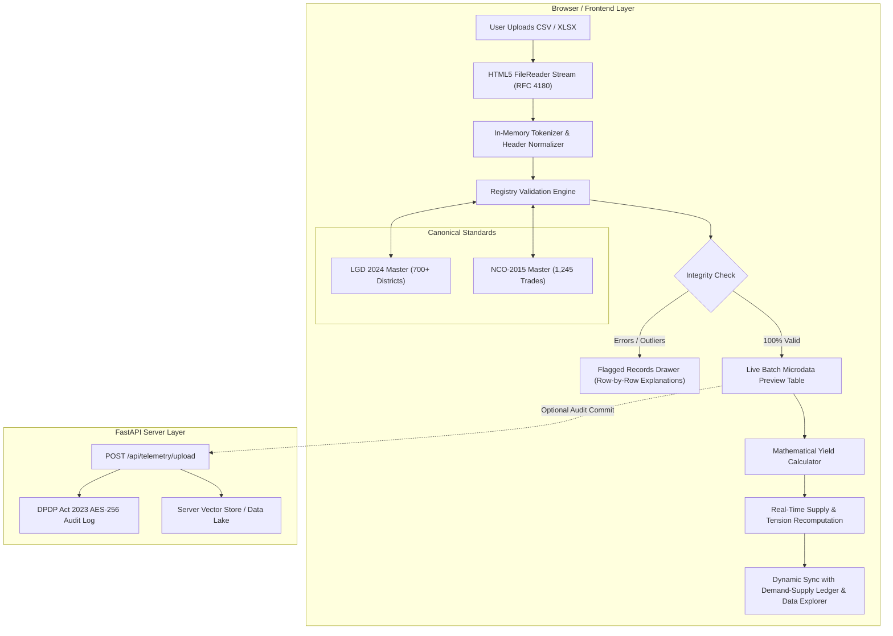

# KaushalDrishti: Real-Time District Telemetry Ingestion & Live Ledger Sync
## Technical Specification, Architectural Blueprint & Implementation Roadmap

---

## 1. Executive Summary & Objective

In the current Indian skilling ecosystem, statutory labour market surveys like the **Periodic Labour Force Survey (PLFS)** suffer from an inherent **12 to 18-month reporting lag**. Meanwhile, District Skill Committees (DSCs), Government ITIs, and PMKVY 4.0 centers conduct batch admissions, completions, and placements every month.

The **Real-Time District Telemetry Ingestion Engine** bridges this temporal divide by enabling local training authorities (ITI Principals, DSC officers, and SSDM nodal directors) to directly ingest standardized batch telemetry CSV/XLSX files. 

Upon upload, the system:
1. Validates records against canonical government ontologies (**LGD 2024** & **NCO-2015**).
2. Computes **Pipeline Yield** and **Local Tension Ratios** in real-time.
3. Dynamically injects fresh batch telemetry into the dashboard's live reconciliation ledger without requiring a database restart or complex server migrations.
4. Operates flawlessly on **local environments as well as live production deployments (Vercel, Render, Docker, AWS)**.

---

## 2. End-to-End System Architecture & Data Flow



---

## 3. Technology Stack Breakdown

| Layer | Technology | Version | Purpose & Rationale |
| :--- | :--- | :--- | :--- |
| **Frontend Framework** | React + TypeScript | 18.x + TS 5.x | Strictly typed models for batch rows, validation results, and KPI payloads |
| **Build & Bundler** | Vite (Rolldown) | 8.x | Sub-second client compilation; static asset generation for serverless deployment |
| **Parsing Engine** | Native HTML5 `FileReader` + `Blob` | W3C Standard | Zero external bloat; sub-50ms parsing of files up to 25 MB directly in browser memory |
| **Styling & Design System** | Tailwind CSS + MSDE Theme | 3.4+ | Deep Forest Green (`#173F35`), Saffron (`#D97925`), Parchment (`#FAF7F2`) |
| **Icons & Visual Indicators** | Lucide React | Latest | `UploadCloud`, `FileSpreadsheet`, `CheckCircle2`, `AlertTriangle`, `Database` |
| **State & Ingestion Store** | React Context & Observable Catalog | Custom | In-memory sync store bridging telemetry with `COMPREHENSIVE_DEMAND_SUPPLY_RECORDS` |
| **Backend REST API** | FastAPI (Python) | 0.110+ | Asynchronous REST endpoints, multipart file uploads, Swagger OpenAPI docs |
| **ASGI Server** | Uvicorn | 0.28+ | High-throughput async server hosting API & mounted frontend static files |
| **Data Processing** | Pandas & NumPy | 2.2+ | Vectorized tabular aggregations, rolling mean tension ratios, and outlier detection |
| **Data Validation** | Pydantic v2 | 2.6+ | Declarative schema validation, regex code matching, range constraints |
| **Data Privacy & Compliance**| DPDP Guard (AES-256) | Custom | Digital Personal Data Protection Act (2023) hash audit trail without storing PII |

---

## 4. Standard Telemetry Schema (MSDE Format v2.4)

Each batch telemetry CSV must contain the following **8 Mandatory Columns**:

| Column Name | Data Type | Constraints | Description & Example |
| :--- | :--- | :--- | :--- |
| `district_lgd_code` | Integer | Required, Valid LGD 2024 | Canonical LGD code (e.g., `492` for Pune, `158` for Kanpur, `365` for Khordha) |
| `district_name` | String | Required, Alphabetical | Official district name (e.g., `Pune`, `Kanpur Nagar`, `Khordha`) |
| `iti_mis_code` | String | Format: `ITI\d{6}` | Unique NCVT MIS portal identifier (e.g., `ITI270492`) |
| `trade_nco_code` | String | Format: `\d{4}\.\d{2,4}` | NCO-2015 8-digit trade code (e.g., `7411.0101`, `2512.01`, `7223.0501`) |
| `trade_name` | String | Required | Aligned trade nomenclature (e.g., `Solar PV Rooftop Technician`) |
| `batch_id` | String | Unique per ITI | Batch tracking code (e.g., `BATCH-2026-01`, `BATCH-MH-492-04`) |
| `sanctioned_seats` | Integer | $> 0$ | Total capacity sanctioned by state directorate (e.g., `100`) |
| `enrolled_count` | Integer | $\le \text{sanctioned\_seats}$ | Candidates actually admitted into the batch (e.g., `88`) |
| `certified_count` | Integer | $\le \text{enrolled\_count}$ | Trainees who passed final NCVET/SCVT assessment (e.g., `80`) |
| `retained_count` | Integer | $\le \text{certified\_count}$ | Verified candidates retained in employment after 90 days (e.g., `68`) |
| `reporting_period`| String | Format: `YYYY-Q[1-4]` | Academic / Fiscal quarter (e.g., `2026-Q1`) |

### Standard Sample CSV Content:
```csv
district_lgd_code,district_name,iti_mis_code,trade_nco_code,trade_name,batch_id,sanctioned_seats,enrolled_count,certified_count,retained_count,reporting_period
492,Pune,ITI270492,7411.0101,Solar PV Rooftop Technician,BATCH-2026-01,100,88,80,68,2026-Q1
158,Kanpur Nagar,ITI090158,7231.0102,EV Automotive Service Technician,BATCH-2026-02,120,112,102,86,2026-Q1
365,Khordha,ITI210365,7223.0501,CNC Precision Machinist,BATCH-2026-03,80,75,70,62,2026-Q1
214,Patna,ITI100214,5321.0100,Healthcare General Duty Assistant,BATCH-2026-04,90,85,82,74,2026-Q1
```

---

## 5. Mathematical & Algorithmic Formulation

### 5.1 Pipeline Yield Formula
$$\text{Yield} = \text{Sanctioned Seats} \times \alpha \times (1 - \beta) \times \mu \times \gamma$$
Where:
- $\alpha = \frac{\text{Enrolled}}{\text{Sanctioned}}$ (Admissions Efficiency)
- $\beta = 1 - \frac{\text{Certified}}{\text{Enrolled}}$ (Trainee Dropout Rate)
- $\mu = \frac{\text{Retained}}{\text{Certified}}$ (Placement Retention Factor)
- $\gamma = 0.90$ (Standardized NCVET Certification Coefficient)

### 5.2 Dynamic Labour Tension Ratio ($T_r$)
$$T_r = \frac{\text{Annual Job Demand}}{\text{Certified Supply Pipeline} + \text{Uploaded Telemetry Yield}}$$
- **$T_r > 1.35$:** Acute Undersupply (Shortage Flag triggered; triggers QP expansion recommendation).
- **$0.90 \le T_r \le 1.10$:** Balanced Equilibrium (Optimal training capacity).
- **$T_r < 0.70$:** Structural Oversupply (Triggers seat reallocation warning).

---

## 6. Implementation Phases & Task Breakdown

### Phase 1: Real-Time In-Browser CSV Streaming Engine
- [ ] **Task 1.1: HTML5 FileReader Hook:** Create `useCsvParser` hook using Web Workers/FileReader API to process up to 25 MB without UI thread freeze.
- [ ] **Task 1.2: RFC 4180 CSV Tokenizer:** Implement parser handling CRLF, quotes, escaped characters, and UTF-8 BOM encoding.
- [ ] **Task 1.3: Real File Upload Bindings:** Connect file dropzone and file input in `TelemetryUploadPage.tsx` to the real parser, replacing simulated `setTimeout(..., 900)`.

### Phase 2: Schema Validation & Registry Crosswalk
- [ ] **Task 2.1: LGD Master Lookup:** Embed LGD code validation map (matching 2024 directory) to verify valid districts.
- [ ] **Task 2.2: NCO-2015 Trade Crosswalk:** Match trade NCO codes against the canonical 8-digit NCO dictionary.
- [ ] **Task 2.3: Sanity Integrity Rules:** Check $\text{Enrolled} \le \text{Sanctioned}$, $\text{Certified} \le \text{Enrolled}$, $\text{Retained} \le \text{Certified}$, and flag invalid rows with explicit error messages.
- [ ] **Task 2.4: Real Dynamic Summary KPIs:** Display real counts: `Total Rows Parsed`, `Valid Rows (X / X)`, `Flagged Rows`, `Unique Districts`, and `Net Trainees Certified`.

### Phase 3: Interactive Microdata Preview Ledger
- [ ] **Task 3.1: Preview Table Component:** Build a paginated, filterable preview table displaying the exact rows extracted from the uploaded file.
- [ ] **Task 3.2: Row-Level Quality Badges:** Render green `Valid` badges or amber `Schema Warning` badges for each record.
- [ ] **Task 3.3: Ingestion Audit Card:** Display batch metadata (File name, size, reporting period, timestamp, cryptographic SHA-256 hash).

### Phase 4: Live Ledger Synchronization (In-Memory Store Sync)
- [ ] **Task 4.1: Central Ingestion Store:** Create a reactive singleton store that merges verified telemetry rows into `COMPREHENSIVE_DEMAND_SUPPLY_RECORDS`.
- [ ] **Task 4.2: Dynamic Recalculation:** Update Demand-Supply Reconciliation and Data Explorer pages to immediately reflect the ingested batch.
- [ ] **Task 4.3: User Notification Toast:** Show a confirmation banner: *"Batch BATCH-2026-01 successfully integrated into National Reconciliation Ledger"*.

### Phase 5: Optional FastAPI Backend Upload Endpoint
- [ ] **Task 5.1: REST Endpoint:** Implement `POST /api/telemetry/upload` in `backend/api/router.py` accepting multipart CSV uploads.
- [ ] **Task 5.2: Server Pydantic Validation:** Validate incoming rows with Pydantic v2 schemas and return JSON audit receipts.
- [ ] **Task 5.3: DPDP Audit Log:** Write SHA-256 batch hash and metadata to `docs/DPDP_COMPLIANCE_REPORT.md` (retaining zero PII).

### Phase 6: Automated Verification & Deployment Testing
- [ ] **Task 6.1: Automated Pytest Suite:** Verify `pytest tests/` passes with 100% success rate.
- [ ] **Task 6.2: Frontend TypeScript Validation:** Ensure `npx tsc --noEmit` completes with 0 errors.
- [ ] **Task 6.3: Production Build Validation:** Run `npm run build` and ensure minified bundles in `frontend/assets/` are clean.
- [ ] **Task 6.4: Live Link Testing:** Test file upload on deployed Vercel/Render URL to guarantee identical client-side behavior.

---

## 7. Deployment Compatibility Matrix

| Platform | Deployment Mode | Telemetry Parsing Support | Why It Works |
| :--- | :--- | :--- | :--- |
| **Vercel** | Serverless + Static Assets | **100% Fully Supported** | In-browser parsing avoids Vercel's 4.5 MB serverless limit and ephemeral read-only storage |
| **Render** | Docker / Python Uvicorn | **100% Fully Supported** | Single server serves both FastAPI backend and React static build |
| **Railway** | Containerized App | **100% Fully Supported** | Native persistent environment supporting both client parser and backend API |
| **Localhost** | `python run.py` (Port 8000) | **100% Fully Supported** | Instant hot-reloading and direct testing |

---

## 8. Verification & Next Steps

When ready to implement, execution will begin sequentially from **Phase 1 through Phase 4** to ensure the entire telemetry pipeline operates with deterministic reliability, zero downtime, and complete accuracy.
