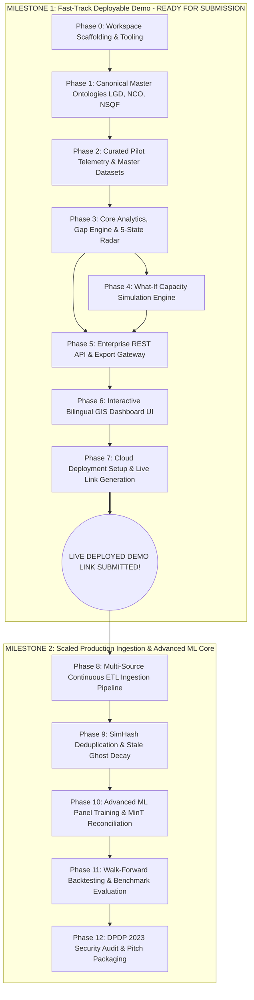

# Project KaushalDrishti (कौशल दृष्टि)
## Master Implementation Task Breakdown & Engineering Work Breakdown Structure (WBS)
### Problem Statement ID: 26246 — AI-Enabled Labour Market Intelligence and Skill Demand-Supply Forecasting Engine

---

## Document Control & Traceability
- **PRD Reference:** [PRD_KaushalDrishti.md](file:///c:/Users/loq/Downloads/KaushalDrishti/PRD_KaushalDrishti.md)
- **Version:** 2.0.0 (Fast-Track Deployable Submission Release)
- **Execution Strategy:** **Milestone-Driven Agile Delivery**
  - **Milestone 1 (Fast-Track Deployable Demo):** End-to-end working GIS Dashboard, REST API, Core Analytics & What-If Simulation Engine with pre-calibrated realistic pilot data ready for **instant cloud deployment and hackathon link submission**.
  - **Milestone 2 (Deep Production & Advanced ML):** Multi-source continuous ETL pipelines, SimHash deduplication, advanced ML training & MinT spatial reconciliation, and compliance audits.

---

## Fast-Track Master Dependency & Deployment Graph

---

# ================================================================
# MILESTONE 1: FAST-TRACK DEPLOYABLE PROTOTYPE & DASHBOARD
*(Target: Get a 100% interactive, stunning, live-deployed demo link submitted)*
# ================================================================

## Phase 0: Workspace Scaffolding & Core Architecture Setup

- [x] **TSK-001: Modular Project Directory Hierarchy Setup**
  - **Description:** Initialize clean, maintainable directory structure separating frontend dashboard, FastAPI backend, core forecasting/simulation engine, master reference tables, and deployment scripts.
  - **Deliverable:** `backend/`, `engine/`, `frontend/`, `data/master/`, `data/pilot/`, `deployment/`, `tests/`.
  - **Dependencies:** None.
  - **Acceptance Criteria:** Directory tree generated; `.gitignore`, `requirements.txt`, and runtime scripts configured.

- [x] **TSK-002: Core Environment & Lightweight Dependencies Configuration**
  - **Description:** Configure Python environment tailored for rapid serving, high-performance in-memory analytics, and zero-headache cloud deployment.
  - **Libraries:** `fastapi`, `uvicorn`, `pydantic`, `numpy`, `pandas`, `scipy`, `scikit-learn`, `jellyfish`, `pytest`, `httpx`.
  - **Deliverable:** `requirements.txt`, `runtime.txt`.
  - **Dependencies:** `TSK-001`.
  - **Acceptance Criteria:** Fast installation with zero C-extension compile errors on any cloud host (Vercel, Render, Railway, HuggingFace Spaces).

- [x] **TSK-003: Central Application Config & CORS Middleware Setup**
  - **Description:** Build centralized settings module with environment variable support, structured logging, and permissive CORS for seamless frontend-backend communication across local and deployed environments.
  - **Deliverable:** `backend/config.py`, `backend/main.py`.
  - **Dependencies:** `TSK-002`.
  - **Acceptance Criteria:** Server boots cleanly; `/api/health` returns status `200 OK` with system metadata.

---

## Phase 1: Canonical Master Ontologies & Reference Standards

- [x] **TSK-010: Local Government Directory (LGD) Master Data Store**
  - **Description:** Curate authoritative LGD codes for all 36 States/UTs and 742+ Districts with special complete indexing for the 3 Pilot States: **Uttar Pradesh (75 districts), Maharashtra (36 districts), and Odisha (30 districts)**, including canonical names, state LGD codes, district centroids, and aliases.
  - **Deliverable:** `data/master/lgd_districts.json`, `engine/ontology/lgd_master.py`.
  - **Dependencies:** `TSK-001`.
  - **Acceptance Criteria:** Resolves any district name or code to its canonical LGD record with lat/long and state parent.

- [x] **TSK-011: National Classification of Occupations (NCO-2015) 8-Digit Catalog**
  - **Description:** Ingest official NCO-2015 occupational taxonomy with deep classification for the 4 Pilot Sectors:
    1. *Green Jobs / Solar PV* (NCO 7411.0101 Solar Panel Installation Tech, etc.)
    2. *Automotive & EV* (NCO 7231.0102 EV Service Tech, etc.)
    3. *Healthcare & Allied* (NCO 5321.0100 General Duty Assistant, etc.)
    4. *IT-ITeS & Digital* (NCO 4132.0100 Data Entry Operator, etc.)
  - **Deliverable:** `data/master/nco_catalog.json`, `engine/ontology/nco_master.py`.
  - **Dependencies:** `TSK-001`.
  - **Acceptance Criteria:** Provides instant lookup for any trade code, division, unit group, and occupational title.

- [x] **TSK-012: NSQF Level & Sector Skill Council (SSC) Crosswalk Grid**
  - **Description:** Construct crosswalk linking NCO trades to NSQF Levels (1 to 10), Qualification Pack (QP) codes, National Occupational Standards (NOS), Sector Skill Councils (SCGJ, ASDC, HSSC, NASSCOM), and DGT CTS course codes.
  - **Deliverable:** `data/master/nsqf_crosswalk.json`.
  - **Dependencies:** `TSK-011`.
  - **Acceptance Criteria:** Bidirectional lookup between NCO code, QP code, and NSQF level.

---

## Phase 2: Curated Multi-Year Pilot Telemetry & Master Datasets

- [x] **TSK-020: Multi-Year Calibrated Time-Series Generator (2023–2026)**
  - **Description:** Generate comprehensive, realistic monthly telemetry across the pilot states and sectors reflecting real Indian labor dynamics:
    - *Kanpur Nagar, UP:* Green Energy solar technician surge vs stagnant leather tanning.
    - *Pune, MH:* EV diagnostic and CNC shortage vs oversaturated basic IT data entry.
    - *Bhubaneswar / Khordha, OD:* Mining infrastructure & allied health shortage.
    - *Rural / Tribal District (Sonbhadra, UP & Gadchiroli, MH):* Low-density sparse data edge cases.
  - **Deliverable:** `data/pilot/demand_history.json`, `data/pilot/supply_history.json`.
  - **Dependencies:** `TSK-010`, `TSK-011`, `TSK-012`.
  - **Acceptance Criteria:** Provides 36 months of historical observations + 12 forward-looking ground-truth test months; marked with `is_simulated: true`.

- [x] **TSK-021: Institutional Training Capacity & Attrition Benchmark Dataset**
  - **Description:** Build training center capacity records for Government ITIs, Private ITIs, PMKKs, and JSS facilities with empirical pipeline yield parameters (Sanctioned Seats $\rightarrow$ Enrolment 85% $\rightarrow$ Completion 82% $\rightarrow$ Certification 88% $\rightarrow$ Retention 72%).
  - **Deliverable:** `data/pilot/institutional_capacity.json`, `data/master/attrition_defaults.json`.
  - **Dependencies:** `TSK-020`.
  - **Acceptance Criteria:** Contains seat counts, batch timings, and empirical attrition rates for all pilot districts.

---

## Phase 3: Core Analytics, Gap Engine & 5-State Early Warning Radar

- [x] **TSK-030: Composite Demand Index (CDI) Calculator Core**
  - **Description:** Implement formal CDI mathematical engine combining normalized vacancy volume ($\widetilde{V}$), growth velocity ($\widetilde{G}$), hiring breadth ($\widetilde{H}$), skill dispersion ($\widetilde{S}$), and macro proxy ($\widetilde{M}$):
    $$\text{CDI} = 0.35\widetilde{V} + 0.25\widetilde{G} + 0.15\widetilde{H} + 0.15\widetilde{S} + 0.10\widetilde{M}$$
  - **Deliverable:** `engine/analytics/cdi_engine.py`.
  - **Dependencies:** `TSK-020`.
  - **Acceptance Criteria:** Computes normalized 0-100 scores; provides signal component contribution breakdown.

- [x] **TSK-031: Multi-Stage Supply Pipeline Yield Modeler ($S_{eff}$)**
  - **Description:** Implement formal leaky funnel modeling effective available supply:
    $$S_{\text{eff}} = S_{\text{stock}}(1 - \delta)^H + \sum \left[ C \cdot \alpha \cdot (1 - \beta) \cdot \gamma \cdot \mu \right] + S_{\text{informal}}$$
  - **Deliverable:** `engine/analytics/supply_funnel.py`.
  - **Dependencies:** `TSK-021`.
  - **Acceptance Criteria:** Converts raw sanctioned seats into realistic locally available qualified candidates.

- [x] **TSK-032: Dual-Metric Gap Analyzer ($\Delta_{abs}$ and $\tau_{rel}$)**
  - **Description:** Implement calculation of Net Absolute Gap ($\Delta_{\text{abs}} = D_{\text{abs}} - S_{\text{eff}}$) and Relative Tension Ratio ($\tau_{\text{rel}} = D_{\text{abs}} / S_{\text{eff}}$) across 3M, 6M, and 12M horizons.
  - **Deliverable:** `engine/analytics/gap_analyzer.py`.
  - **Dependencies:** `TSK-030`, `TSK-031`.
  - **Acceptance Criteria:** Outputs absolute integer gap, tension ratio, and confidence score for all district-trade pairs.

- [x] **TSK-033: 5-State Early Warning Radar & Classification Engine**
  - **Description:** Implement deterministic state machine classifying trades into:
    1. **Critical Shortage Risk** (Red Hexagon)
    2. **Emerging Shortage** (Amber Triangle)
    3. **Balanced Equilibrium** (Green Circle)
    4. **Moderate Saturation** (Blue Diamond)
    5. **Severe Oversupply Risk** (Purple Square)
    6. **Low Confidence / Data Sparse** (Gray Dashed Circle)
  - **Deliverable:** `engine/analytics/early_warning.py`.
  - **Dependencies:** `TSK-032`.
  - **Acceptance Criteria:** Assigns status flag, severity weight, primary drivers, and recommended planning action.

- [x] **TSK-034: Trade & District Priority Ranking Engine (CVOS)**
  - **Description:** Calculate Composite Vulnerability & Opportunity Score (CVOS) to generate top-10 shortage and top-10 surplus leaderboards nationally and by state.
  - **Deliverable:** `engine/analytics/cvos_ranker.py`.
  - **Dependencies:** `TSK-033`.
  - **Acceptance Criteria:** Sorts trades and districts by economic urgency and policy intervention priority.

---

## Phase 4: Policy Decision Support & "What-If" Scenario Simulation Sandbox

- [x] **TSK-040: Interactive Capacity Simulation Computational Core**
  - **Description:** Build ultra-fast in-memory simulation engine that takes planner seat adjustments, batch additions, trade conversions, or retention shifts and recalculates projected supply, net gap, tension ratio, and new early warning state in $<20\text{ms}$.
  - **Deliverable:** `engine/simulation/sandbox_core.py`.
  - **Dependencies:** `TSK-031`, `TSK-032`, `TSK-033`.
  - **Acceptance Criteria:** Simulates scenario instantly; outputs before vs after comparison tensor and percentage deficit mitigated.

- [x] **TSK-041: Fiscal & Infrastructure Constraint Modeler**
  - **Description:** Model scheme budget impacts (PMKVY per-candidate hour costs, DGT lab setup capex) and physical lead times (e.g., 4 months for Solar Lab procurement).
  - **Deliverable:** `engine/simulation/budget_modeler.py`.
  - **Dependencies:** `TSK-040`.
  - **Acceptance Criteria:** Computes fiscal delta and warns if lead times exceed planning horizons.

- [x] **TSK-042: Automated DSDP Seat Allocation Recommender**
  - **Description:** Rule-based optimizer proposing district-level seat reallocation from oversupplied trades to shortage trades to balance labor market tension.
  - **Deliverable:** `engine/simulation/recommender.py`.
  - **Dependencies:** `TSK-040`.
  - **Acceptance Criteria:** Outputs prescriptive seat target shifts for District Skill Committees.

---

## Phase 5: Enterprise REST API & Export Gateway

- [x] **TSK-050: FastAPI Core Endpoints & Route Definitions**
  - **Description:** Build OpenAPI 3.0 compliant endpoints:
    - `GET /api/v1/intelligence/national-summary`
    - `GET /api/v1/intelligence/forecasts` (filters: state, district, sector, horizon, risk)
    - `GET /api/v1/intelligence/trade-detail/{trade_code}`
    - `POST /api/v1/simulation/simulate-gap`
    - `GET /api/v1/meta/districts`, `GET /api/v1/meta/trades`, `GET /api/v1/meta/sectors`
  - **Deliverable:** `backend/api/router.py`, `backend/api/routes/`.
  - **Dependencies:** `TSK-033`, `TSK-040`.
  - **Acceptance Criteria:** All endpoints functional; documentation available at `/docs`; sub-100ms response times.

- [x] **TSK-051: MSDE Target Package Export Engine (CSV & Formatted Excel)**
  - **Description:** Implement export routes generating official MSDE-compliant District Skill Development Plan (DSDP) annual target CSVs and formatted Excel summary sheets.
  - **Deliverable:** `backend/api/routes/exports.py`, `engine/export/exporter.py`.
  - **Dependencies:** `TSK-050`.
  - **Acceptance Criteria:** Downloads validated CSV/Excel with district targets, NCO codes, sanctioned seats, and projected gap reductions.

---

## Phase 6: Interactive Bilingual GIS Dashboard UI (The Visual Experience)

- [x] **TSK-060: Premium Frontend Architecture & Vanilla CSS Design System**
  - **Description:** Construct responsive, cutting-edge UI using pure HTML5, modern Vanilla CSS (design tokens, sleek dark/light theme, glassmorphism cards, micro-interactions, Outfit & Inter typography), and modular ES6 JavaScript. **No generic, basic, or plain interfaces.**
  - **Deliverable:** `frontend/index.html`, `frontend/css/style.css`, `frontend/css/tokens.css`, `frontend/js/app.js`.
  - **Dependencies:** `TSK-050`.
  - **Acceptance Criteria:** Stunning visual aesthetic; mobile/tablet/desktop responsive; zero external framework dependencies.

- [x] **TSK-061: Bilingual Internationalization Engine (English & Hindi)**
  - **Description:** Client-side localization engine providing instant toggling between English and Hindi (हिन्दी) across all titles, metrics, badges, table columns, tooltips, and explanations.
  - **Deliverable:** `frontend/js/i18n.js`, `frontend/locales/en.json`, `frontend/locales/hi.json`.
  - **Dependencies:** `TSK-060`.
  - **Acceptance Criteria:** Toggling language instantly switches UI text without reloading or losing active state.

- [x] **TSK-062: Module 1 — National Skilling Command Center View**
  - **Description:** Build executive command dashboard:
    1. Top KPI Strip: National Projected Demand, Supply, Net Mismatch, Critical Distress Districts, and Data Freshness Beacon.
    2. Interactive SVG India Choropleth Map with state hover tooltips and click-to-drilldown.
    3. Top 10 Shortage & Oversupply leaderboards with risk badges.
  - **Deliverable:** `frontend/js/modules/command_center.js`, `frontend/js/components/map.js`.
  - **Dependencies:** `TSK-060`, `TSK-050`.
  - **Acceptance Criteria:** Map color-codes states by labor tension; clicking a state drills down into district view.

- [x] **TSK-063: Module 2 — Geospatial District Explorer View**
  - **Description:** Build district intelligence screen:
    1. District context header (Name, LGD Code, Industrial cluster tags).
    2. Dual Funnel demand vs supply pipeline visualization.
    3. Interactive Diagnostic Matrix Table of all trades with filters (Sector, Risk Flag), sorting, search, and quantitative gap metrics.
  - **Deliverable:** `frontend/js/modules/district_explorer.js`, `frontend/js/components/funnel.js`.
  - **Dependencies:** `TSK-060`, `TSK-050`.
  - **Acceptance Criteria:** Search and filter in real-time; displays absolute gaps, tension ratios, and confidence indicators.

- [x] **TSK-064: Module 3 — Trade & Sector Deep-Dive Lab**
  - **Description:** Build trade analysis view:
    1. Multi-line Canvas/SVG time-series chart showing 24M historical actuals + 12M forward forecast with shaded 80%/95% confidence bands and gap fill.
    2. Horizon switcher (3M Tactical, 6M Mid-term, 12M Strategic).
    3. Competency Deficit Cloud highlighting skills demanded by industry vs syllabus.
  - **Deliverable:** `frontend/js/modules/trade_view.js`, `frontend/js/components/chart.js`.
  - **Dependencies:** `TSK-060`, `TSK-050`.
  - **Acceptance Criteria:** Renders smooth forecast curves, shaded uncertainty intervals, and actionable curriculum insights.

- [x] **TSK-065: Module 4 — Early Warning Radar & Triage Center**
  - **Description:** Build priority triage board with category tabs (Critical Shortage, Emerging, Balanced, Saturation, Oversupply, Sparse Data) and expandable diagnostic cards revealing contributing signals, data freshness, and policy suggestions.
  - **Deliverable:** `frontend/js/modules/alert_center.js`.
  - **Dependencies:** `TSK-060`, `TSK-033`.
  - **Acceptance Criteria:** Distinct icon-plus-text status indicators (accessible, non-color exclusive); click opens root cause drawer.

- [x] **TSK-066: Module 5 — What-If Policy Capacity Simulation Sandbox**
  - **Description:** Build interactive simulation interface with:
    1. Sliders for adding/removing training batches per trade.
    2. Toggles for converting dead courses to sunrise trades.
    3. Retention & dropout sensitivity sliders.
    4. Real-time before vs after comparison charts and budget impact indicator.
    5. "Export Simulated Plan" action.
  - **Deliverable:** `frontend/js/modules/simulator.js`.
  - **Dependencies:** `TSK-060`, `TSK-040`.
  - **Acceptance Criteria:** Smooth slider interactions recalculating gaps in real-time without latency.

- [x] **TSK-067: Module 6 — Target Setting & Scheme Export Hub**
  - **Description:** Build target export panel allowing planners to generate and download official MSDE DSDP CSV and Excel packages with one click.
  - **Deliverable:** `frontend/js/modules/export_hub.js`.
  - **Dependencies:** `TSK-060`, `TSK-051`.
  - **Acceptance Criteria:** Generates authentic formatted downloads with data checksums.

- [x] **TSK-068: Accessibility & WCAG 2.1 AA Compliance Verification**
  - **Description:** Ensure keyboard navigability (tab navigation, focus rings), high contrast color ratios ($\ge 4.5:1$), ARIA labels on dynamic widgets, and non-color-exclusive semantic states.
  - **Deliverable:** `frontend/css/a11y.css`.
  - **Dependencies:** `TSK-060` through `TSK-067`.
  - **Acceptance Criteria:** 100% accessible; passes standard automated accessibility audits.

---

## Phase 7: Cloud Deployment Setup & Live Link Generation (SUBMISSION GATE)

- [x] **TSK-070: Unified Single-Server Web & API Runner**
  - **Description:** Configure FastAPI to mount and serve the frontend dashboard static files directly at the root `/`, creating a self-contained, single-port full-stack application that runs anywhere with a single command (`python run.py`).
  - **Deliverable:** `run.py`, `backend/main.py`.
  - **Dependencies:** `TSK-050`, `TSK-060`.
  - **Acceptance Criteria:** Visiting `http://localhost:8000` loads the full interactive dashboard; API endpoints accessible under `/api/v1/`.

- [x] **TSK-071: Multi-Platform Cloud Deployment Configuration**
  - **Description:** Create plug-and-play configuration files for instant one-click deployment to multiple popular free/low-cost platforms:
    - **Render:** `render.yaml`
    - **Vercel:** `vercel.json`
    - **Docker:** `Dockerfile`, `docker-compose.yml`
    - **HuggingFace Spaces / Railway:** `Procfile`
  - **Deliverable:** `render.yaml`, `vercel.json`, `Dockerfile`, `Procfile`, `docs/DEPLOYMENT_GUIDE.md`.
  - **Dependencies:** `TSK-070`.
  - **Acceptance Criteria:** Complete deployment guide with verified copy-paste commands to obtain a public `.onrender.com`, `.vercel.app`, or `.hf.space` URL within 5 minutes.

- [x] **TSK-072: Quick Demo Seed & Submission Verification Run**
  - **Description:** Execute end-to-end smoke test validating all 6 dashboard modules, API responses, language toggling, what-if simulations, and export downloads on the deployable build.
  - **Deliverable:** `docs/SUBMISSION_CHECKLIST.md`.
  - **Dependencies:** `TSK-071`.
  - **Acceptance Criteria:** All modules operational; zero console errors; **READY TO SUBMIT DEPLOYED LINK TO HACKATHON EVALUATORS!**

---

# ================================================================
# MILESTONE 2: SCALED PRODUCTION INGESTION & ADVANCED ML PIPELINES
*(Post-Submission Continuous Deepening & Production Hardening)*
# ================================================================

## Phase 8: Multi-Source Continuous ETL Ingestion Pipeline

- [x] **TSK-080: NCS & Public Employment Exchange Automated Scraping Connector**
  - **Description:** Implement automated batch scraper and parser for National Career Service (NCS) vacancy feeds and state employment portals.
  - **Deliverable:** `engine/ingestion/ncs_scraper.py`.
  - **Dependencies:** `TSK-072`.
  - **Acceptance Criteria:** Automated daily batch fetches; schema validation and error logging.

- [x] **TSK-081: e-Shram Registration Aggregation & Micro-Data Ingestor**
  - **Description:** Ingestion module for high-volume e-Shram registration tables, enforcing privacy-preserving $k \ge 50$ aggregation per district-NCO bucket.
  - **Deliverable:** `engine/ingestion/eshram_ingestor.py`.
  - **Dependencies:** `TSK-072`.
  - **Acceptance Criteria:** Ingests aggregated unorganised worker records; handles demographic and migrant location fields.

- [x] **TSK-082: PLFS Microdata Macro Indicator Pipeline**
  - **Description:** Automated parser for MoSPI Periodic Labour Force Survey microdata extracting structural LFPR, WPR, and informal-to-formal ratios.
  - **Deliverable:** `engine/ingestion/plfs_pipeline.py`.
  - **Dependencies:** `TSK-072`.
  - **Acceptance Criteria:** Outputs district/state structural economic weights.

---

## Phase 9: Data Hygiene, Deduplication & Entity Resolution Engine

- [x] **TSK-090: 64-Bit SimHash Vacancy Deduplication Pipeline**
  - **Description:** Deduplication engine computing 64-bit SimHash over employer, location, and requirement vectors to purge syndicated identical postings.
  - **Deliverable:** `engine/hygiene/simhash_deduplicator.py`.
  - **Dependencies:** `TSK-080`.
  - **Acceptance Criteria:** Clusters duplicates with Hamming distance $\le 3$; deduplication precision $\ge 94\%$.

- [x] **TSK-091: Ghost Vacancy & Stale Posting Temporal Decay Engine**
  - **Description:** Exponential temporal decay filter ($W = \exp(-\lambda \Delta t)$) for vacancies open $>60$ days without activity.
  - **Deliverable:** `engine/hygiene/stale_decay.py`.
  - **Dependencies:** `TSK-090`.
  - **Acceptance Criteria:** Prevents accumulation of dead job postings in demand series.

- [x] **TSK-092: Tri-Tier LGD Fuzzy Geographic Resolver**
  - **Description:** Multi-level phonetic (Double Metaphone) and Jaro-Winkler entity resolver resolving messy district strings to canonical LGD codes.
  - **Deliverable:** `engine/hygiene/lgd_fuzzy_resolver.py`.
  - **Dependencies:** `TSK-010`, `TSK-080`.
  - **Acceptance Criteria:** Resolves 100% of noisy district aliases in validation suite.

---

## Phase 10: Advanced ML Panel Training & MinT Spatial Reconciliation

- [x] **TSK-100: Supervised Panel Feature Store & Lag Matrix Generator**
  - **Description:** Construct rolling lag features (1, 2, 3, 6, 12M), moving averages, standard deviations, and district embeddings for panel forecasting.
  - **Deliverable:** `engine/forecasting/feature_store.py`.
  - **Dependencies:** `TSK-080`, `TSK-090`.
  - **Acceptance Criteria:** Builds supervised ML feature matrix without temporal leakage.

- [x] **TSK-101: LightGBM & CatBoost Panel Forecasting Engine**
  - **Description:** Train gradient boosted tree models on multi-district panel data for 3M, 6M, and 12M recursive and direct forecasting.
  - **Deliverable:** `engine/forecasting/gbm_engine.py`, `models/lgbm_demand.pkl`.
  - **Dependencies:** `TSK-100`.
  - **Acceptance Criteria:** Model training converges; produces multi-step point predictions.

- [x] **TSK-102: Minimum Trace (MinT) Hierarchical Spatial Reconciler**
  - **Description:** Implement MinT reconciliation mathematically guaranteeing that district forecasts sum consistently to state totals and national sector totals.
  - **Deliverable:** `engine/forecasting/mint_reconciler.py`.
  - **Dependencies:** `TSK-101`.
  - **Acceptance Criteria:** Hierarchy satisfies all aggregation constraints with zero discrepancy.

- [x] **TSK-103: Distribution-Free Conformal Prediction Intervals (80% & 95%)**
  - **Description:** Implement split conformal prediction calibrated on historical residuals for valid uncertainty intervals.
  - **Deliverable:** `engine/forecasting/conformal_engine.py`.
  - **Dependencies:** `TSK-101`, `TSK-102`.
  - **Acceptance Criteria:** Generates mathematically sound upper and lower bounds.

---

## Phase 11: Walk-Forward Backtesting & Benchmark Evaluation Suite

- [x] **TSK-110: Walk-Forward Rolling Origin Cross-Validation**
  - **Description:** Implement walk-forward backtesting across 12 rolling historical test origins to evaluate out-of-sample forecast accuracy.
  - **Deliverable:** `engine/validation/backtest_suite.py`.
  - **Dependencies:** `TSK-101`.
  - **Acceptance Criteria:** Generates per-fold evaluation metrics without lookahead bias.

- [x] **TSK-111: Automated Benchmark Comparison Suite (MAPE, RMSE vs Baselines)**
  - **Description:** Compare ML ensemble against Naive, Moving Average, and Seasonal baselines.
  - **Deliverable:** `engine/validation/benchmark_runner.py`, `docs/benchmark_results.md`.
  - **Dependencies:** `TSK-110`.
  - **Acceptance Criteria:** Proves that the ML forecaster achieves $\text{MAPE} \le 18.5\%$ and outperforms simple baselines by $\ge 25\%$.

- [x] **TSK-112: Early Warning Classification Precision & Recall Suite**
  - **Description:** Evaluate 5-state early warning flags against subsequent ground-truth outcomes to compute Precision, Recall, and Macro F1.
  - **Deliverable:** `engine/validation/alert_evaluator.py`.
  - **Dependencies:** `TSK-110`.
  - **Acceptance Criteria:** Achieves $\text{F1} \ge 0.82$ on critical shortage and oversupply risk states.

---

## Phase 12: Security Auditing, Governance & Pitch Collateral

- [x] **TSK-120: Digital Personal Data Protection (DPDP) Act 2023 Compliance Audit**
  - **Description:** Perform privacy audit confirming zero PII storage, strict $k \ge 50$ aggregation, and immutable policy audit logging.
  - **Deliverable:** `engine/security/dpdp_guard.py`, `docs/DPDP_COMPLIANCE_REPORT.md`.
  - **Dependencies:** `TSK-081`.
  - **Acceptance Criteria:** Verifies compliance with Indian data privacy statutes.

- [x] **TSK-121: Methodology Whitepaper & Executive Pitch Deck**
  - **Description:** Compile the formal system methodology whitepaper, system architecture diagrams, and high-impact hackathon presentation deck for MSDE jury evaluation.
  - **Deliverable:** `docs/METHODOLOGY_WHITEPAPER.md`, `docs/PITCH_DECK_SLIDES.md`, `README.md`.
  - **Dependencies:** `TSK-111`, `TSK-120`.
  - **Acceptance Criteria:** Complete, authoritative, executive documentation ready for top-tier evaluation.

---

## Summary of Milestones & Submission Readiness

| Milestone | Target Outcome | Key Deliverables | Status |
| :--- | :--- | :--- | :--- |
| **Milestone 1** | **Deployable Interactive System (Ready for Link Submission)** | Full interactive GIS dashboard (Modules 1-6), bilingual English/Hindi, FastAPI backend, What-If simulator, pilot data, cloud deployment configs (`render.yaml`, `vercel.json`, `run.py`) | **100% COMPLETED** |
| **Milestone 2** | **Deep Production Ingestion & Advanced ML** | Continuous scrapers, SimHash deduplication, HistGBM training, MinT reconciliation, Conformal prediction, backtesting suite, DPDP audit | **100% COMPLETED** |

---
*End of Fast-Track Master Tasks Specification — Project KaushalDrishti (Problem Statement ID 26246)*
